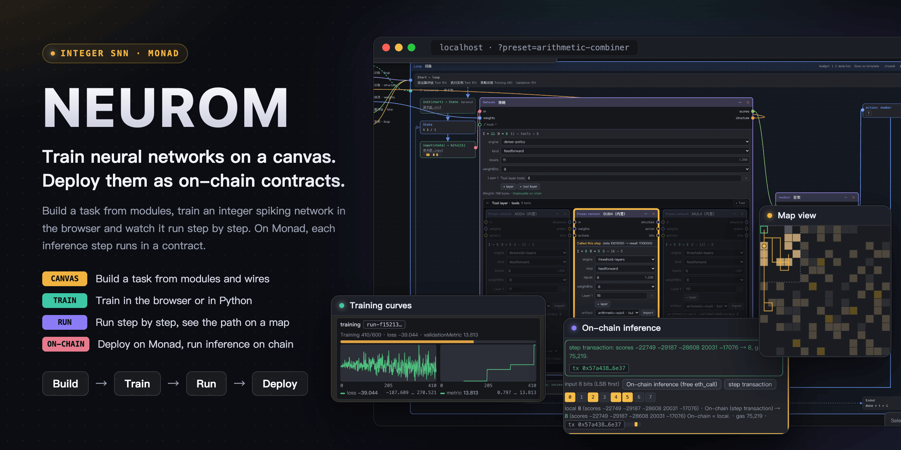
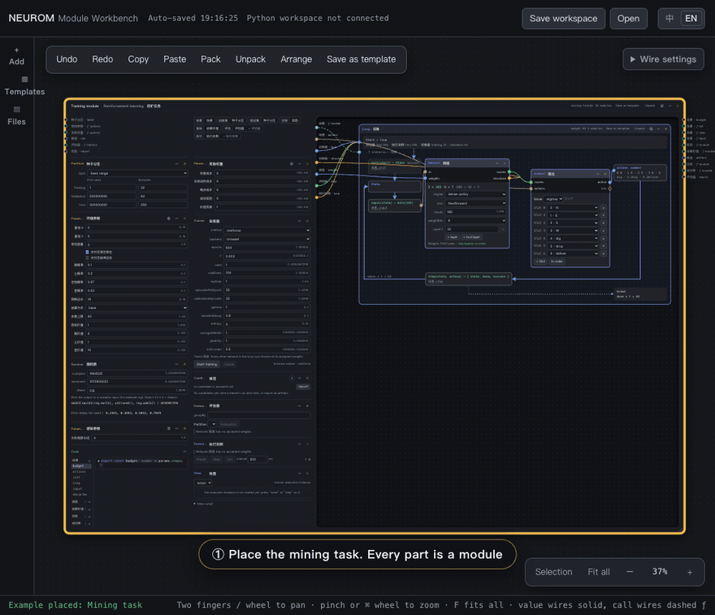
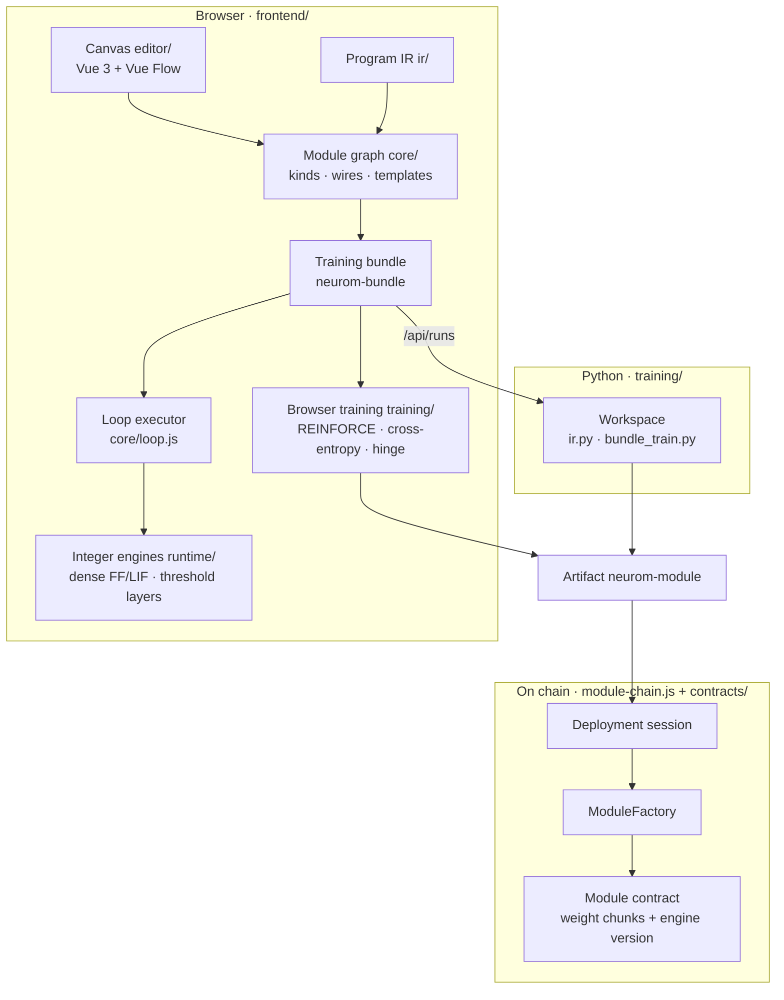

<p align="center">
  
</p>

<p align="center">
  <a href=".github/workflows/ci.yml"></a>
  
  
  
  
  <a href="LICENSE"></a>
</p>

<p align="center">
  <a href="README.md">中文</a> · <b>English</b>
  <br>
  <a href="#quick-start">Quick start</a> ·
  <a href="docs/user-guide.en.md">User guide</a> ·
  <a href="docs/development.en.md">Developer guide</a> ·
  <a href="docs/design.en.md">Design</a> ·
  <a href="CONTEXT.md">Terms</a>
</p>

> Author: Box (X: [@boxmrchen](https://x.com/boxmrchen)) · DevRel From Monad Foundation

Neurom is a neural network workbench. On a canvas in the browser, you build a task, train a small neural network and watch it run step by step. You can deploy a trained network on Monad as a contract. After the deployment, each inference step of the network runs on chain.

Neurom uses integer spiking neural networks: threshold networks and LIF networks. The browser, Python and Solidity calculate with the same integer rules. Thus the on-chain result is the same as the result on the canvas.

## 25-second demo

<p align="center"></p>

1. Place the mining task from a template.
2. Train the network in the browser. The curves update live.
3. Accept a trained candidate.
4. Run the task step by step. The map draws the path of the player.
5. The policy network of the combiner picks the subtraction network for an arithmetic question.
6. Deploy the network on chain, then send a transaction. The on-chain result agrees with the local result.

## Example: the mining game

Mining is a builtin task. A player moves on a 16×16 grid for at most 63 steps. The grid has dirt, coal and gold, with the values 1, 2 and 10. The backpack holds at most 3 items. The player gets a score only when it brings the items back to the base and delivers them.

On each step, the network gets 185 input bits:

- For each cell of the 9×9 view: is there coal, is there gold.
- The relative position of the base.
- The contents of the backpack, and whether the backpack is full.
- The number of steps that remain.

On each step, the network picks one of 7 actions: `N`, `E`, `S`, `W`, `dig`, `drop` and `deliver`. The input does not tell where the nearest ore is. The network must learn from the reward where to dig and when to go back.

All these rules are params and code modules in the template. You can change them on the canvas, for example a smaller grid or a higher value for gold.

<table>
  <tr>
    <td width="50%" valign="top"><b>Train in the browser</b><br>With the default settings, 600 epochs take about 35 seconds. Progress, loss and the validation metric update live.</td>
    <td width="50%" valign="top"><b>Run step by step</b><br>After you accept a candidate, the execution runs the episode step by step. The map view draws the view of the player, the base and the path.</td>
  </tr>
  <tr>
    <td valign="top"></td>
    <td valign="top"></td>
  </tr>
</table>

Try it:

1. Open `http://localhost:5173/?preset=mining-task`.
2. On the trainer, click "Start training".
3. When the training is complete, click "Accept" on a candidate.
4. On the execution, click "Reset", then click "run".

[Section 4 of the user guide](docs/user-guide.en.md#4-train-your-first-model-mining) gives the full steps. You can deploy the trained network on chain. [Monad network results](#monad-network-results) gives the results.

## Features

### Build a task from modules

A task is a set of modules on the canvas. The modules are params, scenarios, rewards, networks, trainers and deployments. Wires connect the modules.

- Scenarios, rewards and metrics are code modules in JavaScript. The functions and consts that a code module exports are its ports.
- Wires have type checks. A wire with a wrong signature does not connect. A type error points to the line.
- A task is saved as one YAML template. A new task does not need changes to the workbench code.

<p align="center"></p>

<table>
  <tr>
    <td width="45%" valign="top"><b>Role page of a code module</b><br><br>The protocol locks the header of each role function, for example the reward function. Click <b>?</b> to see who calls the function, its parameters and return value, and an example from a real run.</td>
    <td width="55%" valign="top"></td>
  </tr>
</table>

### Train a network

- Train in the browser, or let the local Python (PyTorch) train. The two backends use the same training bundle.
- There are three training methods: REINFORCE (reinforcement learning), cross-entropy and hinge.
- A trainer trains one network on the whole loop. The other networks in the loop run frozen.
- Training calculates with int8 or int16 integer weights. Evaluation and the chain use these same weights.
- Each training produces candidates. When you accept a candidate, the network uses its weights.

### Run and check

<table>
  <tr>
    <td width="55%" valign="top">
      <ul>
        <li>The execution runs the whole loop step by step. You can do one step, run continuously or reset.</li>
        <li>The map view draws the position and the path of the player.</li>
        <li>The evaluator runs the network on the validation and test partitions. Then it lists the results by group. The image shows the evaluation report of the combiner, with the results by operation.</li>
      </ul>
    </td>
    <td width="45%" valign="top"></td>
  </tr>
</table>

### Combine trained networks

A network can have a tool layer. On each step, the tool layer picks one of some trained networks and the data bits to give it. Only the chosen network runs.

The combiner task is an example. The policy network reads an arithmetic question. Then it picks one of three networks, for addition, subtraction and multiplication, to calculate the answer. The image shows the question 9 − 2: the policy network picks the subtraction network SUB4. The networks that are not chosen are dimmed.

<p align="center"></p>

### Deploy on chain

<table>
  <tr>
    <td width="50%" valign="top">
      <ul>
        <li>The deployment module deploys an accepted network as a module contract on Monad.</li>
        <li>Each step transaction makes the contract calculate the next step of the network on chain. The contract keeps the potentials of a LIF network.</li>
        <li>On each step, the workbench compares the on-chain result with the local result.</li>
        <li>New weights go into a new contract. Accepting a new candidate does not change a deployed contract.</li>
      </ul>
      We verified deploy, verify, step and reset on a local Anvil node. Signing on a public chain is not verified.
    </td>
    <td width="50%" valign="top"></td>
  </tr>
</table>

## Monad network results

`anvil --network monad` calculates gas the same as the Monad testnet, item by item. We compared the two on the same set of operations: cold and warm account access, storage pages (MIP-8), memory expansion, and the deploy, forward and step of the mining network. All 14 numbers are equal. [benchmark/](benchmark/README.en.md) has the check script.

We deployed the trained mining network from above on the Monad network. Then we played test episode 0 with 63 step transactions. The deployment and the steps went through the chain bridge of the workbench, `frontend/module-chain.js`. For comparison, we ran the same network with the same inputs again with Ethereum rules (`anvil --network ethereum`).

- Network: FF 185→32→7, int8 weights, one weight chunk of 7,040 bytes.
- With both rule sets, the result of each on-chain step agrees with the local result (63 / 63). The episode is a success.

| Gas of each transaction (gasUsed of the receipt) | Ethereum rules | Monad rules | Difference |
|---|---|---|---|
| Deploy (weight chunk + module, one transaction) | 1,910,812 | 1,982,588 | +3.8% |
| One step transaction (median of 63) | 75,674 | 95,571 | +26.3% |
| Total of 63 step transactions | 4,775,707 | 6,029,218 | +26.2% |
| Gas really charged for one step transaction | 75,663 (gasUsed) | 106,008 (gasLimit) | +40.1% |

A small network uses more gas with Monad rules. Monad does not lower the gas of the opcodes. It changes only some prices ([Opcode Pricing](https://docs.monad.xyz/developer-essentials/opcode-pricing)):

- A cold account access goes from 2,600 to 10,100. A step transaction makes cold accesses to three accounts: the module implementation, the engine version and the weight chunk. The prices give 22,500 more. The measurement gives 19,897 more.
- Memory expansion is linear, not quadratic. This network uses only about 20 KB of memory per step, so the saving is only 2–3k.
- A transaction pays for its gas limit, not for its gas used. The bridge sets a gas limit 10.9% above the gas used, and you also pay for this part.
- MIP-8 counts storage reads and writes by page. The step of an FF network writes no storage, so the step does not change. The deploy uses 16,500 less gas (−0.8%).

### The larger the network, the larger the Monad advantage

We deployed 5 networks, from small to large, with the same engine. Then we sent real transactions with both rule sets. On the Ethereum side, the weight chunks obey the real code size limit of 24 KB. On the Monad side, a chunk holds up to 112 KiB.

One step (one step transaction, median of 8):

| Network | Weight chunks Monad / Ethereum | Monad | Ethereum | Difference |
|---|---|---|---|---|
| 185→32→7 int8 (the default mining network) | 1 / 1 | 100k | 80k | Monad costs 24.8% more |
| 185→128→128→7 int8 | 1 / 2 | 304k | 307k | −1.3% |
| 185→256→256→7 int8 | 2 / 5 | 671k | 746k | −10.0% |
| 185→256→256→7 int16 | 3 / 10 | 854k | 1,053k | −18.9% |
| 185→256×4→7 int8 (5 layers) | 3 / 11 | 1,398k | 1,730k | −19.2% |

63 steps in one transaction:

| Network | Monad | Ethereum | Difference |
|---|---|---|---|
| 185→32→7 int8 | 3.36M | 3.56M | −5.6% |
| 185→128→128→7 int8 | 17.6M | 21.4M | −17.7% |
| 185→256→256→7 int8 | 41.6M | 56.4M | −26.2% |
| 185→256→256→7 int16 | 51.9M | 74.4M | −30.2% |
| 185→256×4→7 int8 | 92.1M | 147.8M | −37.6% |

There are two reasons:

- The engine copies all weights into memory. A larger network uses more memory. Ethereum memory cost grows quadratically, and Monad memory cost grows linearly.
- The code size limit is 24 KB on Ethereum and 128 KB on Monad. The same 5-layer network needs 11 weight chunks on Ethereum and only 3 on Monad. Each additional chunk adds one cold access to each step.

A small network uses little memory and has only one weight chunk. Thus the higher price of cold accesses is the largest part, and Monad costs more.

Notes:

- A Monad transaction can use at most 30M gas. A game above 30M in the table must be split into several transactions. For the measurement, we raised this limit.
- These 5 networks use synthetic weights, with about 21 input bits set per step. A trained network fires a different number of neurons, so its gas is different.
- We did not get a result for 185→256×7→7 (8 layers). The test script ran out of memory when it put the weights together on chain.

Monad is cheap mainly because of the price of gas. The minimum base fee on Monad is 100 MON-gwei ([Gas Pricing](https://docs.monad.xyz/developer-essentials/gas-pricing)). At this price, one step transaction of the mining network (gas limit 106,008) costs about 0.0106 MON, and one step of the 5-layer network costs about 0.14 MON.

To reproduce: from the repository root, run `node benchmark/mining.mjs`, `node benchmark/network-size.mjs` and `node benchmark/monad-parity.mjs`. [benchmark/](benchmark/README.en.md) explains them.

## Builtin tasks

| Template | Task | Training method |
|---|---|---|
| `mining-task` mining | A player digs dirt, coal and gold on a grid, and brings them back to the base. The network must learn where to dig and when to go back. | REINFORCE |
| `memory-map-task` memory map | The target shows one time, then it is hidden. After some waiting steps, the network must go to the target from memory. | cross-entropy |
| `arithmetic-add4 / sub4 / mul4` four-bit arithmetic | Three threshold networks that calculate the sum, the difference and the product of two 4-bit numbers. The templates include trained networks. | hinge |
| `arithmetic-combiner` combiner | A policy network reads an arithmetic question and picks a four-bit arithmetic network to calculate it. The template includes a trained policy. | REINFORCE |

The [builtin tasks section of the user guide](docs/user-guide.en.md#builtin-tasks) gives the rules, input bits and partitions of each task.

## Quick start

You need Node.js ≥ 22.12. Browser training does not need Python.

```sh
git clone git@github.com:nishuzumi/neurom.git && cd neurom
npm ci
npm run dev
```

Open the address that the terminal shows, and add `?preset=arithmetic-combiner`. For example: `http://localhost:5173/?preset=arithmetic-combiner`. The canvas places the combiner example with its builtin artifacts accepted. Then do these two steps:

1. On the evaluator in the left column, click "Evaluation". The report lists the results by operation.
2. On the execution, click "Reset", then "Step". The loop box shows the network that this step chose.

`?preset=` works only on an empty canvas. If the canvas is not empty, first click "Clear entire workspace" in the "Files" drawer.

Next:

- [User guide](docs/user-guide.en.md): train your first model, change the rules, train in Python, deploy on a local chain, and troubleshooting.
- [Developer guide](docs/development.en.md): environment, repository layout, test matrix, CI and common development tasks.

## Architecture



- Training, evaluation and execution all go through one loop executor (ADR 0009).
- The Python side is a twin of the JS side. Parity fixtures make sure that the two sides agree bit for bit.
- Deployment is per artifact. A whole loop does not go on chain (ADR 0014).

[Section 9 of the design document](docs/design.en.md#9-code-layers) gives the layers in detail.

## Documentation

| Document | Readers | Contents |
|---|---|---|
| [User guide](docs/user-guide.en.md) | users | installation, first use, training, on-chain deployment, builtin tasks, troubleshooting |
| [Developer guide](docs/development.en.md) | developers | environment, repository layout, commands, test matrix, CI, common development tasks |
| [Frontend guide](frontend/README.en.md) | users, developers | canvas operations, module kinds, code modules, state boundaries, file boundaries |
| [Design document](docs/design.en.md) | developers | module kinds, wires, templates, bundles, IR, loop executor, chain |
| [AI / Python training guide](docs/ai-module-training.en.md) | users, AI | training methods, bundles, offline training, Workspace API |
| [Canvas node components](docs/canvas-nodes.en.md) | frontend developers | host node, composite node, training module, ports, arrange |
| [contracts](contracts/README.en.md) · [training](training/README.en.md) | developers | contract structure and gas, Python bundle protocol and tests |
| [benchmark](benchmark/README.en.md) | developers | gas benchmarks, the check of anvil against the Monad testnet |
| [ADRs](docs/adr/) · [CONTEXT.md](CONTEXT.md) | developers | architecture decisions, terms |

## License

[MIT](LICENSE).
