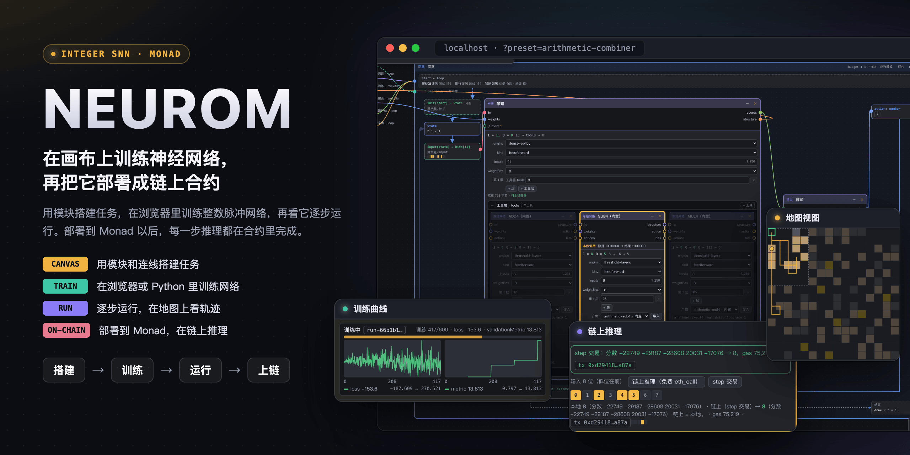
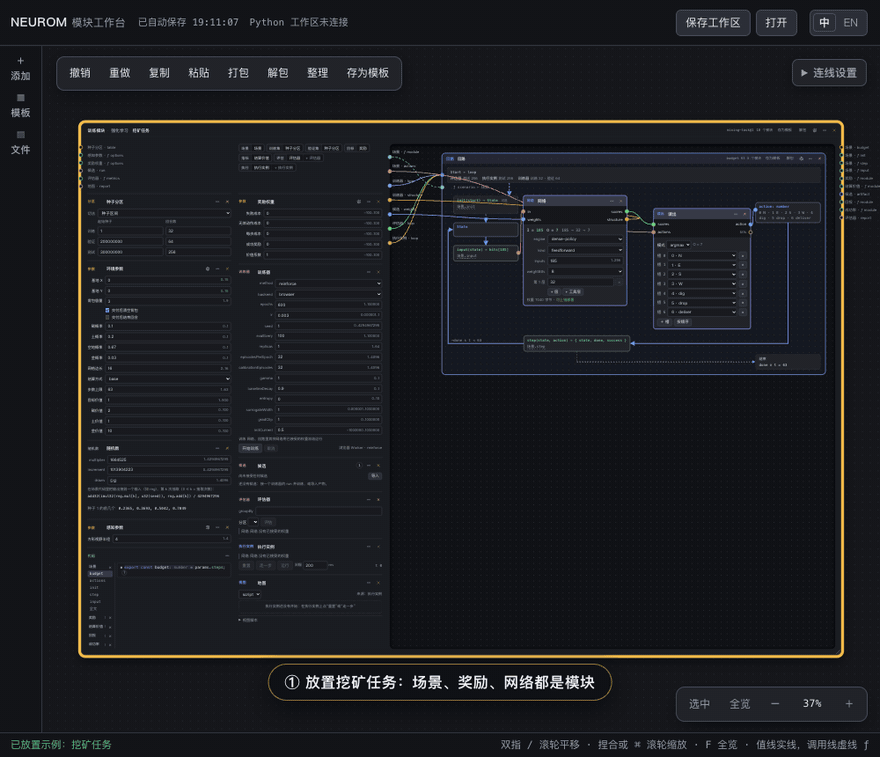
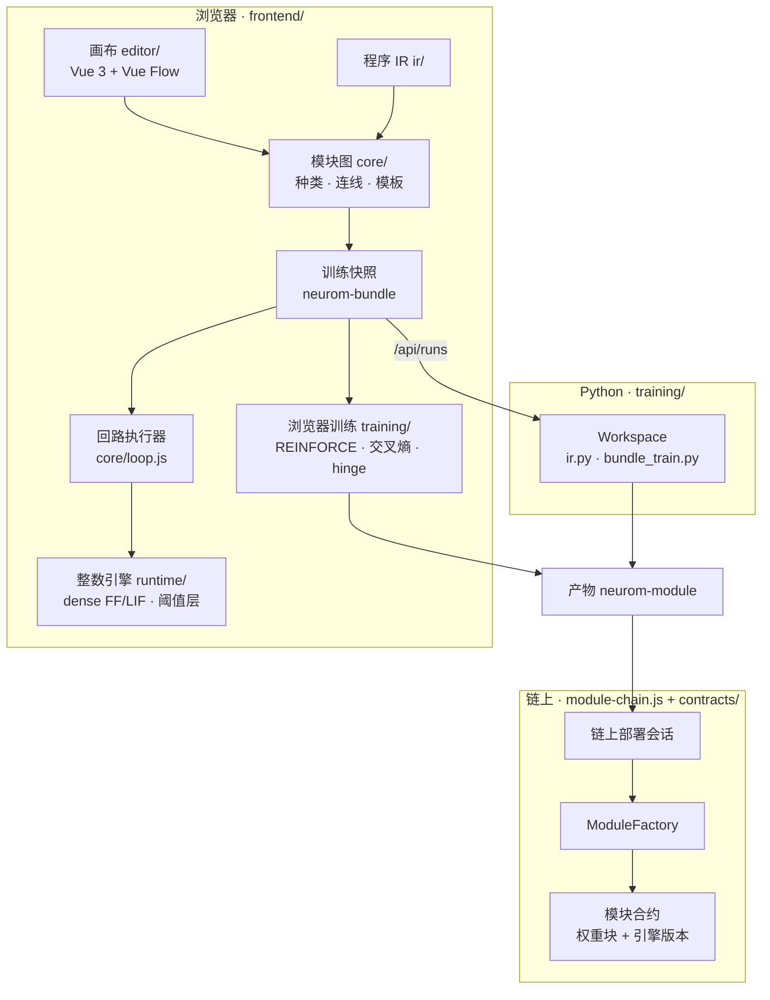

<p align="center">
  
</p>

<p align="center">
  <a href=".github/workflows/ci.yml"></a>
  
  
  
  
  <a href="LICENSE"></a>
</p>

<p align="center">
  <b>中文</b> · <a href="README.en.md">English</a>
  <br>
  <a href="#快速开始">快速开始</a> ·
  <a href="docs/user-guide.md">使用指南</a> ·
  <a href="docs/development.md">开发者文档</a> ·
  <a href="docs/design.md">设计文档</a> ·
  <a href="CONTEXT.md">术语</a>
</p>

> 作者：Box（X：[@boxmrchen](https://x.com/boxmrchen)）· DevRel From Monad Foundation

Neurom 是一个神经网络工作台。你在浏览器的画布上搭建任务，训练一个小型神经网络，再看它一步一步地运行。训练好的网络可以部署到 Monad，成为一个合约。部署以后，网络的每一步推理都在链上完成。

Neurom 用整数脉冲神经网络，包括阈值网络和 LIF 网络。浏览器、Python 和 Solidity 按同一套整数规则计算，所以链上算出的结果和画布上的结果一样。

## 25 秒演示

<p align="center"></p>

1. 从模板放置挖矿任务。
2. 在浏览器里训练网络。曲线实时更新。
3. 接受一个训练好的候选。
4. 逐步运行任务。地图上画出玩家走过的路。
5. 组合器的策略网络为一道算术题选中减法网络。
6. 把网络部署到链上，再发一笔交易。链上结果和本地结果一致。

## 示例：挖矿游戏

挖矿是一个内置任务。玩家在 16×16 的网格上最多走 63 步。网格里有土、煤和金，价值分别是 1、2 和 10。背包最多装 3 件。玩家把挖到的东西带回基地交付，才能得分。

网络每一步收到 185 个输入位：

- 9×9 视野里每一格有没有煤、有没有金。
- 基地的相对位置。
- 背包里有什么、背包满了没有。
- 还剩几步。

网络每一步选 7 个动作中的一个：`N`、`E`、`S`、`W`、`dig`、`drop` 和 `deliver`。输入里没有“最近的矿在哪里”。网络要从奖励里自己学会去哪里挖、什么时候回去。

这些规则都是模板里的参数和代码模块。你可以在画布上直接改，例如把网格改小，或者把金的价值调高。

<table>
  <tr>
    <td width="50%" valign="top"><b>在浏览器里训练</b><br>默认设置训练 600 轮，约 35 秒。进度、loss 和验证指标实时更新。</td>
    <td width="50%" valign="top"><b>逐步运行</b><br>接受候选以后，执行实例逐步运行回合。地图视图画出玩家的视野、基地和走过的路。</td>
  </tr>
  <tr>
    <td valign="top"></td>
    <td valign="top"></td>
  </tr>
</table>

自己试一下：

1. 打开 `http://localhost:5173/?preset=mining-task`。
2. 在训练器上点「开始训练」。
3. 训练结束后，在候选上点「接受」。
4. 在执行实例上点「重置」，再点「运行」。

详细步骤见 [使用指南第 4 节](docs/user-guide.md#4-训练第一个模型挖矿)。训练好的网络可以部署到链上，结果见 [Monad 网络实测](#monad-网络实测)。

## 功能

### 用模块搭建任务

一个任务由画布上的模块组成。模块包括参数、场景、奖励、网络、训练器和链上部署。模块之间用线连接。

- 场景、奖励和指标是代码模块，用 JavaScript 写。代码模块导出的函数和常量就是它的端口。
- 连线有类型检查。签名不符的线连不上。类型错误定位到出错的行。
- 一个任务保存成一份 YAML 模板。加一个新任务，不用改工作台的代码。

<p align="center"></p>

<table>
  <tr>
    <td width="45%" valign="top"><b>代码模块的角色页</b><br><br>每个角色函数（例如奖励函数）的函数头按协议锁定。点 <b>?</b> 可以看到谁调用这个函数、它的参数和返回值，以及一次真实运行的例子。</td>
    <td width="55%" valign="top"></td>
  </tr>
</table>

### 训练网络

- 在浏览器里训练，或者交给本机的 Python（PyTorch）训练。两边用同一份训练快照。
- 有三种训练方法：REINFORCE（强化学习）、交叉熵和 hinge。
- 训练器在整条回路上训练一个网络。回路里的其他网络冻结运行。
- 训练时就用 int8 或 int16 整数权重计算。评估和上链用的就是这些权重。
- 每次训练生成候选。你接受一个候选以后，网络就用它的权重。

### 运行和检查

<table>
  <tr>
    <td width="55%" valign="top">
      <ul>
        <li>执行实例逐步运行整条回路。你可以走一步、连续运行或重置。</li>
        <li>地图视图画出玩家的位置和走过的路。</li>
        <li>评估器在验证分区和测试分区上运行网络，然后按分组列出结果。右图是组合器的评估报告，结果按运算分组。</li>
      </ul>
    </td>
    <td width="45%" valign="top"></td>
  </tr>
</table>

### 组合已有的网络

网络可以有工具层。工具层每一步从几个训练好的网络里选一个，并决定交给它哪些数据位。只有选中的网络运行。

组合器任务是一个例子。策略网络读一道算术题，然后从加法、减法和乘法三个网络里选一个来算。下图是题目 9 − 2：策略网络选中了减法网络 SUB4，没有选中的网络变暗。

<p align="center"></p>

### 部署到链上

<table>
  <tr>
    <td width="50%" valign="top">
      <ul>
        <li>链上部署模块把接受的网络部署成 Monad 上的模块合约。</li>
        <li>每发一笔 step 交易，合约就在链上算出网络的下一步。LIF 网络的电位保存在合约里。</li>
        <li>每一步，工作台都把链上结果和本地结果对比。</li>
        <li>新的权重部署成新的合约。接受新候选不改变已经部署的合约。</li>
      </ul>
      部署、核对、step 和 reset 已经在本地 Anvil 上验证。公共链上的签名还没有验证。
    </td>
    <td width="50%" valign="top"></td>
  </tr>
</table>

## Monad 网络实测

`anvil --network monad` 的 gas 计算和 Monad 测试网逐项一致。我们在同一组操作上对比了两者：冷热账户访问、存储页（MIP-8）、内存扩展，以及挖矿网络的部署、forward 和 step。14 项数字完全相同。核对脚本见 [benchmark/](benchmark/README.md)。

我们把上面训练出来的挖矿网络部署到 Monad 网络上，然后用 63 笔 step 交易走完测试回合 0。部署和 step 都经过工作台自己的链上桥接 `frontend/module-chain.js`。作为对比，我们在以太坊规则（`anvil --network ethereum`）下用同一个网络和同一组输入又跑了一次。

- 网络：FF 185→32→7，int8 权重，一个 7,040 字节的权重块。
- 两种规则下，链上每一步的结果都和本地一致（63 / 63）。回合成功。

| 每笔交易的 gas（收据里的 gasUsed） | 以太坊规则 | Monad 规则 | 差别 |
|---|---|---|---|
| 部署（权重块 + 模块，一笔交易） | 1,910,812 | 1,982,588 | +3.8% |
| 一笔 step 交易（63 笔的中位数） | 75,674 | 95,571 | +26.3% |
| 63 笔 step 交易合计 | 4,775,707 | 6,029,218 | +26.2% |
| 一笔 step 交易实际扣费的 gas | 75,663（按 gasUsed） | 106,008（按 gasLimit） | +40.1% |

小网络在 Monad 规则下用的 gas 更多。Monad 没有降低操作码的 gas，它只调整了几项价格（[Opcode Pricing](https://docs.monad.xyz/developer-essentials/opcode-pricing)）：

- 冷账户访问从 2,600 涨到 10,100。一笔 step 交易要冷访问三个账户：模块实现、引擎版本和权重块。按价格算多 22,500，实测多 19,897。
- 内存扩展从平方增长改成线性增长。这个网络每步只用约 20 KB 内存，所以只省 2–3k。
- 交易按 gasLimit 扣费，不按 gasUsed。桥接设的 gasLimit 比 gasUsed 多 10.9%，这部分也要付。
- MIP-8 按页计存储的读写。FF 网络的 step 不写存储，所以 step 不变。部署少 16,500 gas（−0.8%）。

### 网络越大，Monad 越占优

我们用同一个引擎部署了 5 个从小到大的网络，在两种规则下各发真实交易。以太坊一侧按真实的 24 KB 代码上限拆权重块，Monad 一侧按 112 KiB 拆块。

单步（一笔 step 交易，8 笔的中位数）：

| 网络 | 权重块数 Monad / 以太坊 | Monad | 以太坊 | 差别 |
|---|---|---|---|---|
| 185→32→7 int8（默认的挖矿网络） | 1 / 1 | 100k | 80k | Monad 贵 24.8% |
| 185→128→128→7 int8 | 1 / 2 | 304k | 307k | −1.3% |
| 185→256→256→7 int8 | 2 / 5 | 671k | 746k | −10.0% |
| 185→256→256→7 int16 | 3 / 10 | 854k | 1,053k | −18.9% |
| 185→256×4→7 int8（5 层） | 3 / 11 | 1,398k | 1,730k | −19.2% |

一笔交易跑 63 步：

| 网络 | Monad | 以太坊 | 差别 |
|---|---|---|---|
| 185→32→7 int8 | 3.36M | 3.56M | −5.6% |
| 185→128→128→7 int8 | 17.6M | 21.4M | −17.7% |
| 185→256→256→7 int8 | 41.6M | 56.4M | −26.2% |
| 185→256→256→7 int16 | 51.9M | 74.4M | −30.2% |
| 185→256×4→7 int8 | 92.1M | 147.8M | −37.6% |

原因有两个：

- 引擎把全部权重复制进内存。网络越大，用的内存越多。以太坊的内存费按平方增长，Monad 按线性增长。
- 以太坊的代码上限是 24 KB，Monad 是 128 KB。同一个 5 层网络，以太坊要 11 个权重块，Monad 只要 3 个。每多一个块，每步就多一次冷访问。

小网络用的内存少，权重块也只有一个。所以冷访问的加价占了大头，Monad 更贵。

注意：

- Monad 一笔交易最多 30M gas。上表里超过 30M 的一局要拆成几笔交易。测量时放宽了这个上限。
- 这 5 个网络用的是合成权重，每步约 21 个输入位为 1。训练出来的网络发放的神经元数不同，gas 也会不同。
- 185→256×7→7（8 层）没有测出结果，因为测试脚本在链上拼接权重时内存不够。

Monad 便宜，主要在 gas 的价格。Monad 的最低基础费是 100 MON-gwei（[Gas Pricing](https://docs.monad.xyz/developer-essentials/gas-pricing)）。按这个价格，挖矿网络的一笔 step 交易（gasLimit 106,008）约 0.0106 MON，5 层网络的一步约 0.14 MON。

复现：在仓库根目录运行 `node benchmark/mining.mjs`、`node benchmark/network-size.mjs` 和 `node benchmark/monad-parity.mjs`。说明见 [benchmark/](benchmark/README.md)。

## 内置任务

| 模板 | 任务内容 | 训练方法 |
|---|---|---|
| `mining-task` 挖矿 | 玩家在网格上挖土、煤和金，再把它们带回基地交付。网络要学会去哪里挖、什么时候回去。 | REINFORCE |
| `memory-map-task` 记忆地图 | 目标只显示一次，然后隐藏。等待几步以后，网络要凭记忆走到目标。 | 交叉熵 |
| `arithmetic-add4 / sub4 / mul4` 四位算术 | 三个阈值网络，分别计算两个 4 位数的和、差和积。模板带训练好的网络。 | hinge |
| `arithmetic-combiner` 组合器 | 策略网络读一道算术题，选一个四位算术网络来算。模板带训练好的策略。 | REINFORCE |

每个任务的规则、输入位和分区见 [使用指南的内置任务一节](docs/user-guide.md#内置任务)。

## 快速开始

需要 Node.js ≥ 22.12。浏览器训练不需要 Python。

```sh
git clone git@github.com:nishuzumi/neurom.git && cd neurom
npm ci
npm run dev
```

打开终端显示的地址，在后面加上 `?preset=arithmetic-combiner`，例如 `http://localhost:5173/?preset=arithmetic-combiner`。画布放置组合器示例，内置产物已经接受。然后做这两步：

1. 在左栏的评估器上点「评估」。报告按运算分组列出结果。
2. 在执行实例上点「重置」，再点「走一步」。回路框显示这一步选中的网络。

`?preset=` 只在空画布上生效。如果画布不空，先在「文件」抽屉里点「清空整个工作区」。

下一步：

- [使用指南](docs/user-guide.md)：训练第一个模型、改规则、Python 训练、本地链上部署和常见问题。
- [开发者文档](docs/development.md)：环境、仓库结构、测试矩阵、CI 和常见开发任务。

## 架构



- 训练、评估和执行都经过同一个回路执行器（ADR 0009）。
- Python 侧是 JS 侧的孪生。对拍语料钉住两边逐位一致。
- 部署按单份产物进行。整条回路不上链（ADR 0014）。

分层的细节见 [设计文档第 9 节](docs/design.md#9-代码怎么分层)。

## 文档

| 文档 | 读者 | 内容 |
|---|---|---|
| [使用指南](docs/user-guide.md) | 用户 | 安装、第一次使用、训练、链上部署、内置任务、常见问题 |
| [开发者文档](docs/development.md) | 开发人员 | 环境、仓库结构、命令、测试矩阵、CI、常见开发任务 |
| [前端操作说明](frontend/README.md) | 用户、开发人员 | 画布操作、模块种类、代码模块、状态边界、文件边界 |
| [设计文档](docs/design.md) | 开发人员 | 模块种类、线、模板、快照、IR、回路执行器、链上 |
| [AI / Python 训练指南](docs/ai-module-training.md) | 用户、AI | 训练方法、快照、离线训练、Workspace 接口 |
| [画布节点组件](docs/canvas-nodes.md) | 前端开发 | 宿主节点、组合节点、训练模块、端口、整理 |
| [contracts](contracts/README.md) · [training](training/README.md) | 开发人员 | 合约结构与 Gas，Python 快照协议与测试 |
| [benchmark](benchmark/README.md) | 开发人员 | gas 基准测试，anvil 和 Monad 测试网的核对 |
| [ADR](docs/adr/) · [CONTEXT.md](CONTEXT.md) | 开发人员 | 架构决定，术语（只有英文） |

## 许可

[MIT](LICENSE)。
