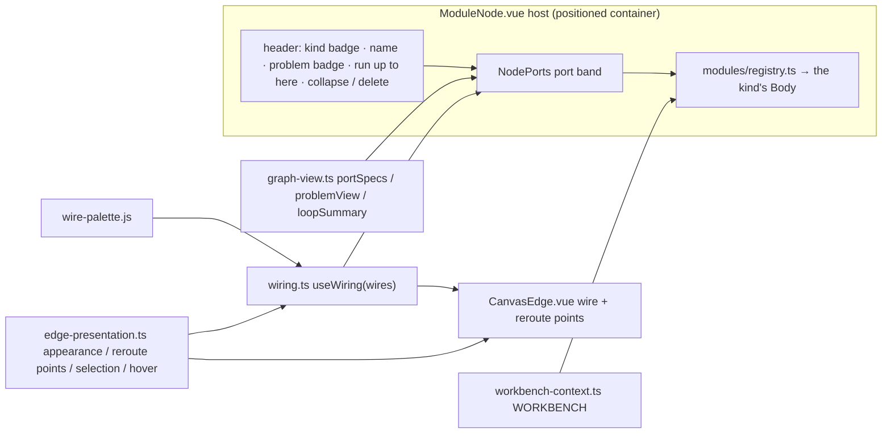

# Canvas node components

[中文](canvas-nodes.md) · **English**

The canvas has three kinds of node:

- **Modules** (`ModuleNode.vue`): one host for every module kind.
- **Composites** (`GroupNode.vue`): a collapsed template instance, a user-packed group, or a group marked as a loop box.
- **Training modules** (`TrainingModuleNode.vue`): the frame that shows an expanded prefab.

The three kinds of node share one port band (`NodePorts.vue`), one wiring model (`wiring.ts`) and one wire component (`CanvasEdge.vue`). The own component of each module kind (`editor/modules/*Body.vue`) renders the content of the module. The host does not know what the content is. For the terms, refer to [CONTEXT.md](../CONTEXT.md). For the design decisions, refer to [docs/adr](adr/).

## The host `ModuleNode.vue`

1. **Frame**: a positioned box (`position: relative`, which fills the Vue Flow node). Port slots have absolute positions relative to it, on the left and right borders. The host sets the width: `node.uiSize.w`, or if it is not set, the natural width of the kind in `sizes.ts`. The root of the content component fills the host (`width: 100%`) and sets no `min-width` of its own (AGENTS.md).
2. **Header**: the drag handle. The header has the kind badge (`kindOf(kind).label` through `t()`), the editable name, the problem badge, collapse and delete. On the problem badge, red is the number of errors and grey is the number of unconnected items. On hover, the badge shows the full text. Controls in the header have `nodrag`. The headers of candidates, trainer, evaluator, execution and script modules also have ▶ 「运行到这里」 (run up to here, `RunUpTo.vue`, ADR 0023). The section headers of these modules in a training module also have this button. While a chain runs, all of these buttons are disabled, and the button of the module that the chain runs for is lit.
3. **`<NodePorts>`**: the port band. `graph-view.ts portSpecs(graph, resolution, nodeId)` generates the port band from the resolution of the module graph.
4. **Content**: `BODIES[kind]` from `modules/registry.ts`, whose only prop is `nodeId`. Content components get `graph`, `resolution()`, `session(kind, nodeId)`, `edit(label, fn)` and `status()` through `inject(WORKBENCH)` (`workbench-context.ts`). Content components change configuration only through `edit()` and runtime state only through sessions.
5. **Size**:
   - Controls: `NodeResizer` (only the bottom-right corner and the four edges, none drawn, only the cursor changes) plus a keyboard handle. The arrow keys move the size in small steps, Shift gives steps of 1 px, and `Home` restores the default size.
   - Explicit height: when the node has an explicit height (`uiSize.h`, or during a drag), the host has the `sized` class. The content area fills the remaining height. The part of each content component marked `.bfill` (code box, text box, view renderer) takes the extra height. When the content does not fit, the content area scrolls inside the frame. It does not go across the border.
   - Minimum height: the minimum drag height of the host is header + port band + one line of content. The host measures this height when the gesture starts.
   - Other: there are no other size controls in the content (text boxes have no resize grip). When the node is collapsed, only the header and the port band remain.
6. **Tool layers** (networks, ADR 0010 §9):
   - Sub-canvas: after the content, each tool layer has one foldable sub-canvas 「工具层 · port」, in layer order. The fold state is in `node.uiFolded`.
   - Cards inside: a module wired only into that tool port shows inside the sub-canvas as a full card. A frozen network with its readout (a bits readout or an argmax readout) counts as one module: the `run` of the readout is wired there. The network feeds only that readout. The unwired ports of this module are slots `${module id}/${port}` on the host node. If you wire the module elsewhere from one of these slots, the module goes back to the outer canvas.
   - Tools outside: a tool that is also wired elsewhere stays outside. The sub-canvas has only a label, and a click on the label moves to the tool.
   - Membership: membership comes only from the wires (`editor/tool-canvas.js`). The system does not store it.
   - 「+ 工具」: this adds a `(bits) → bits` code tool, or a frozen network that runs a selected artifact, and wires it. Each of these operations is one history entry.
   - During execution: on the current step of the execution that runs the network, the chosen tool is highlighted. It shows the data bits it received and its result. The other tools are dimmed. When the sub-canvas is folded, it shows a one-line summary.
   - Width: the host takes the width that its cards need (`graph-view.ts TOOL_CANVAS`). The card grid fills this width.
   - Available artifacts: any network with a readout, a bits readout or an argmax readout (FF, LIF, or with tool layers of its own, ADR 0014). The list marks an artifact with an argmax readout with `argmax`. If you select an artifact with tool layers, the system also adds the network tools that the artifact used in training. The system wires these tools into its tool ports. You must wire code tools manually.
   - Nesting: when tools nest more than 3 levels deep, the outermost network shows a problem. The system refuses a wire that directly causes this deep nesting.

The host draws no slots and does not set the wire colours.

## The composite `GroupNode.vue`

- A composite node is one `group` in the module graph. The node has: the title, the `组合` badge, the source template `id@revision` (if there is one), the member count, save as template, the expand / collapse button on the right (`+` / `−`, the same as on module nodes), and delete. The node has no ungroup control. To ungroup, use "Unpack" on the toolbar (`Shift G`).
- **Collapsed**: the members are not drawn. The port band lists the member ports in `expose`, with the slot id `${member flow id}/${port}`. Wires that go across the boundary go to those slots. Wires between members are not drawn. Wiring gestures resolve the slot back to the member port before they give it to the module graph. Thus new connection logic does not have to handle composites.
- **Expanded**: a frame around the members. The members are Vue Flow child nodes (`parentNode`), and you edit them in place. Composites can nest (ADR 0003). `GroupNode.vue` does not draw an expanded prefab (a group with a `prefab` record, for example a builtin template instance). An expanded prefab shows as a training-module frame (refer to the next section).

### The loop box

When a group has `loop` (`group.loop` = the id of a loop module), `GroupNode.vue` draws the group as that loop (`index.ts` gives it a `box` view, ADR 0009, ADR 0011 §4):

- The badge is `回路` (loop), and the border is solid in `--inh`. The loop module has no card of its own (`canvas-geometry.ts shownBy`: the box draws the loop module). Around the members, the frame shows how one episode runs:
  - Top: `Start ← loop`. The `loop` handle is on the left border, and drivers connect there. After it come the partitions and episode counts of each driver.
  - Left border below the `loop` handle: `ƒ scenario ← <scene>`.
  - Left column: `init(start) → State` → `State` → `input(state) → bits[I]`. The `input` handle is on its right edge and feeds the body.
  - Right: `action: number`. The `action` handle is on its left edge.
  - Bottom: `step(state, action)` and the end condition.
  - Below each function role is the export that fills it, as `<scene>.<export>`. When the `roles` config of the loop maps the role to another export of the scenario, the box shows that export, for example `场景.duelStep` (ADR 0022). A click opens the code of that export.

  The frame shows only protocol signatures, values that come from the graph (`graph-view.ts loopContract`) and empty states. `sizes.ts LOOP_FRAME` keeps space for these stations, so the members do not cover them.
- When the box is collapsed, it shows its exposed ports and a one-line summary of the body: "each step: input bits → network → readout → … → action" (`graph-view.ts loopSummary`, in evaluation order). When the loop is not closed, the summary is "loop not closed".
- The problem badge in the header shows the problems of the loop module. When the box is in a training module, these problems show on the header of the training module. The box is only a view: the body comes from the wires. When the members of the box differ from "loop module + body", the loop reports "The members of loop box … differ from the loop body (extra: …; missing: …)". A move of a module into or out of the box does not change the body. Only a change of wires changes the body.
- A loop module that is not in a loop box shows as an ordinary card (`LoopBody.vue`). A loop in a loop box has no card, so its `roles` config changes in the template or in the config.

## The training module `TrainingModuleNode.vue`

An expanded prefab shows as one frame (ADR 0011). The split of its members comes only from the wires (`editor/training-module.js trainingModule`). This split is presentation only. It never changes the graph.

Each builtin task template shows as such a frame after you place it, for example mining and the tank battle. The replay view of the tank battle is a view section in the left column. Its view script draws the map (bricks, steel, base), the tanks and the bullets.

- **Sections** (the left column): sections are not Vue Flow nodes and have no port band. These modules are sections:
  - Trainers, candidates, evaluators, executions, partitions and datasets are always sections.
  - The code module wired into the `scenario` of the loop of this frame is the environment section.
  - Code, params, view and random modules are sections when each of their wires connects them to a section.

  The code modules of the frame share one 「代码」 section (`CodeTabs.vue`, grouped by module). Each section has a head row (kind, title, problems, fold, delete). Below the head row is the body component of the kind.
- **Columns**: the sections go into columns in sequence, so that the whole frame is about `TRAIN_FRAME.aspect`. More columns make the frame wider to the left, and the frame stops before a neighbour at its level. When Arrange lays out the level of the frame, the split does not look at the neighbours. Arrange then puts the neighbours around the frame. When a section becomes taller at run time, only its column becomes longer. The system splits the columns again only after the first measurements, on Arrange, or when the sections or their fold states change (`training-module.js sectionColumns`). The kind label at the left of a head row is a drag grip. A drop stores the split in the `columns` of the group (the 「代码」 section as all the code modules it shows), and after that the frame uses the stored split (`placeSections / moveSection`).
- **Sub-canvas** (right): every other member is an ordinary node inside the recessed sub-canvas. The sub-canvas is only background. The pointer goes through it to the pane.
- **Ports** (`sectionPorts`):
  - A section port wired into the sub-canvas is a handle on the left edge of the sub-canvas.
  - A section port connected to the outside, or not connected, is a slot on the outer edge of the frame.
  - A section port connected only to other sections is not drawn, and its wires are not drawn.
- **Minimap**: sections are not Vue Flow nodes, so a training module draws itself in the minimap (`EditorRoot.vue`). The training module draws the outline of the frame, the sub-canvas, and the position of each section in the left column, with a colour for each kind. The section positions are the rectangles that `training-module.js` places at the measured heights. Group frames are outlines only, so their members stay visible.
- The top of the left column lists the slots of the prefab and the expected wires that are missing (「恢复」 restores one expected wire).

## Content components

Each kind has one `editor/modules/<Kind>Body.vue`, registered in `BODIES` of `registry.ts`. The content components related to loops:

| Component | Content |
|---|---|
| `LoopBody.vue` | A loop that shows as a card: scenario status (unwired / error / incomplete / ready), input width I, the body summary, the driver ports that run it, the form of the export of each role (`roles`, ADR 0022), and the problems of the loop (disallowed kinds in the body, box mismatch, drivers that do not agree on the episode kind) |
| `TrainerBody.vue` | Method, backend and the recipe fields that the method reads. Which network of the loop it trains (the one wired into `structure`, every other network runs frozen). When `gate` has a wire: the condition (a metric of that evaluator, a minimum, a maximum), and below the start button the gate state with its reason (ADR 0020). Python connection state, start / cancel, progress with curves, the run list |
| `EvaluatorBody.vue` | Select the partition role, and run the whole loop greedily on that partition (every network on its accepted weights). The metrics table, the curve grouped by an enumerate axis, which artifact each network ran, sample episodes |
| `ExecutionBody.vue` | Select an episode of the partition, step / run / pause / reset, manual actions, scrub the history. The history shows the input bits of every step, the action, how the step ended, and the values that every body module produced (the `values` of the executor). A network with tool layers shows which tool each tool layer called on that step (a frozen network by its title, a code tool as `module.function`). It also shows the data bits that it gave to the tool and the result (only that tool ran). The views wired to `execution` render the state |

The content component of a script module is `ScriptBody.vue` (ADR 0019). The host is a vertical box, and the user can resize it freely:

- The first row has only 「✎ 编辑代码」. This button opens the dialog `ScriptFiles.vue`. The left side of the dialog is the file list (new, delete, select). The right side is `ScriptEditor.vue`, the same editor as for a view script. The dialog changes only a draft. 「保存并重新运行」 writes the draft as one history entry, and 「取消」 discards the draft.
- Below the file list of the dialog are the declared function inputs and value inputs (new, rename, delete). Under each name is the module wired into it. When the dialog saves, the wires of the inputs follow a rename (`carryInputLists` in `common.ts`). Each list is calculated on its own: by position when the count does not change, else by name.
- The declared inputs are the ports on the left of the standard port band (ƒ marks a function input).
- Below the first row is `renderers/script-module.vue`. It is `.bfill` and fills the remaining height of the host. When the host has no explicit height, this area is 440px high.
- The page uses `@babel/parser` to rewrite the `import` and `export` statements of each file (`renderers/script-module.js`). The line numbers do not change. The loader in the sandbox (`renderers/script-module-runtime.js`) runs the rewritten files and draws the views in the CSS grid of `layout`. The sandbox document comes from `script-frame.js`, with the same CSP and permissions as a view script.
- When the script fails, the error shows above the iframe, with the file and the line.
- The call bridge: the sandbox sends `{ type: 'call', id, name, args }`. The page runs the call outside the sandbox with `core/script-calls.js` and replies `{ type: 'reply', id, result }` or `{ type: 'reply', id, error }`. The values of the value inputs go into the sandbox in `{ type: 'values', functions, values }`: one time before `load`, and again when they change. After a reset or a new iframe, the replies of the old run are dropped.
- While the user resizes the host, the host has the class `resizing`. Then the iframe does not get pointer events, so a drag over the iframe does not stop the gesture.

The script module 坦克对战 of the tank battle template has 3 files: `main.js`, `game.js` and `views.js`. Its layout is `'board side' / 'log log'`. The battlefield is on the top left. The side panel (`Controls`, the result and the state of both sides) is on the top right. The log is below them.

## `NodePorts.vue`

| prop | type | description |
|---|---|---|
| `node` | `string` | this node's flow id, matching `Wire.source / target` |
| `inputs` / `outputs` | `PortSpec[]` | the declared ports, one row each, in order |
| `wiring` | `Wiring` | the canvas wiring model (`inject(CANVAS_WIRING)`) |
| `label` | `string` | node name, for accessibility labels |

There are no slots (Vue slots): all that a port row shows comes from its `PortSpec`.

Behaviour:

- Each port renders only one Vue Flow `Handle`, and its id is `PortSpec.id`. Inputs are on the left edge, outputs are on the right edge, and each is at the vertical position of its row. There is one exception: the inputs that a driver takes from the item that it drives. These inputs are the `loop` handle of a loop and the `structure` of a trained network (`training-module.js facing`, `PortSpec.right`). They are at the top of the right column with their slot on the right edge, toward the loop box they point at. Thus those wires go straight back to it.
- Slot style: an unconnected slot is a hollow ring in the colour of the port type. A connected slot is filled. When the slot has exactly one wire, the fill is the colour of that wire. When one of its wires is hovered or selected, the slot is highlighted.
- Call port names have an `ƒ` prefix and are italic (`.port-row.call`). A required port that is not connected has a `*` after its name (`.port-row.required:not(.bound)`).
- A record output has a `+/−` to the left of its name (`.port-toggle`). When the output is expanded, the next level of fields shows below it as a tree (`.port-row.tree`, `├─ └─ │` guides). Each field has its own slot. When the output is collapsed, only the wired fields remain, with their full path (`.port-row.path`). Only one module can be expanded at a time. A click on another module or on empty canvas collapses the expanded module (`fieldTree` in `index.ts`).

`PortSpec`: `{ id, label, type, title?, class?, right? }`. `type` sets the slot colour (`[data-type=…]` in `editor.css`). `graph-view.ts portType` gets `type` from the port declaration:

| type | colour variable | used for |
|---|---|---|
| `bits` | `--wire` | 0/1 bit vectors (the loop's input bits `input`, network input `in`, readout bit outputs, bit wires) |
| `fn` / `handle-module` | `--sens` | call ports (functions. The `module` output of a code module and the `scenario` input of the loop are the whole file) |
| `number` / `boolean` / `string` / `vector` / `array` / `record` / `any` / `table` / `handle-partition` | `--plastic` | values and data (including the loop's `action`) |
| `handle-weights` / `handle-structure` / `handle-artifact` | `--mod` | weights, structure, artifacts |
| `handle-run` / `handle-report` | `--train` | training runs, reports |
| `handle-execution` / `handle-deployment` | `--focus` | executions, deployments |
| `handle-loop` | `--inh` | the loop handle (the loop's `loop` output and the `loop` inputs of trainer, evaluator and execution) |

Add a new handle type to `HANDLES` in `core/types.js` and also to `editor.css`. Module border colours are in `.kind-<kind>`, for example `.kind-loop` uses `--inh`.

## `wiring.ts`

`useWiring(wires: () => readonly Wire[]): Wiring`, called in the setup of a component. There is only one wiring plane: the canvas.

- `Wire`: `{ id, source, sourcePort, target, targetPort, label, type?, disconnect? }`. `type` is `'value' | 'call'`. `sourcePort` / `targetPort` are the ids of the Handles at the two ends.
- `Wiring`: `wiresAt(node, port, kind)`, `colorOf(wireId)` (wires on the same node never have the same colour), `isHot` / `isSelected`.
- The hover state and the selection state are global, with the wire id as the key (the wire appearance uses the same key). When a wire is deleted or the component unmounts, these states are cleared automatically.
- `EditorRoot.vue` provides the `Wiring` of the main canvas as `CANVAS_WIRING`.

## Wires and reroute points (`CanvasEdge.vue`, `edge-presentation.ts`)

- There is one edge type `wire`, with `data.kind` `value` or `call`. Value wires are solid. Call wires are dashed and have an `ƒ` label. There is only one global routing setting, `defaults.shape` (`EdgeSettings.vue`). The `EdgeAppearance` of a single wire has only `color` and `route`. Colour precedence: the wire's own colour → the global default colour → the palette colour.
- The operations for a single wire are in the context menu `EdgeMenu.vue`. The menu shows only when the wire that it points at is the selected wire. Push `Delete` to disconnect the selected wire.
- **Reroute points**: `EdgeAppearance.route` is an ordered list of points `{u, n}` in the coordinates of the wire, with a maximum of 16. Reroute points change only the drawing, never the module graph. The gestures are:
  - Add: Alt+click or double-click a wire.
  - Move: drag the reroute point.
  - Remove: double-click or Alt+click the reroute point.

  All gestures have undo history.

## Connection gestures (`index.ts`, slot mapping in `canvas-geometry.ts`)

- During a drag, the `wire` field of the ports at the two ends sets the wire kind. On drop, the gesture calls `graph.canConnect(spec)`, and the status bar shows the reason for a refusal. Validation is in the core: `core/resolve.js` does type / signature matching. `core/graph.js` makes sure that value wires have no cycle and that call wires have no recursion. Value wires into loop inputs can close a cycle. Loop inputs are ports declared `loop`, that is the loop's `action` and a network's `weights`.
- `canvas-geometry.ts socket` sets which flow node and which slot show a member port. A collapsed composite, the frame of a loop box, the section ports of a training module and a tool card inside a network card all use `${member}/${port}`. The gestures then resolve the slot back to the member port through `member`. The four slots on the frame of a loop box are the own ports of the loop module.
- History (`history.ts`) records snapshots of `graph.toJSON()` (with the `loop` marks of groups) and of the wire appearances. Undo restores in increments and keeps node identities and sessions.

## Arrange (`canvas-geometry.ts arrange`)

- Arrange puts units in layers from left to right by wire depth. When there are many layers, it wraps them into rows, so that the result is about the aspect of the viewport. In each layer, it sorts the units by the barycentre of their neighbours to decrease crossings. It puts each unit level with the units that feed it, where possible.
- Arrange does not wrap between two adjacent layers that both have a training module. These training modules are stages that follow one another, so they stay in one row from left to right (ADR 0020).
- A wire counts between two units at the current level: the two units that contain its ends. Thus a wire that goes across group boundaries connects the member units that contain its endpoints.
- Wires into loop inputs count as usual. Only the wires that close a cycle do not count. Examples are the trained network's own candidates → `weights`, through its trainer, and a trainer's own candidates → `init`. Thus frozen weights stand before the loop box that they feed. The candidates of an earlier stage → `init` do not close a cycle, so that wire counts: the earlier stage stands on the left.
- A wire into the facing input of a driver (`training-module.js facing`: a `loop` or `structure` handle) counts as a wire from the driver to the item that it drives. The pairs are: trainer, evaluator, execution → the loop, and trainer → the trained network. Thus drivers stand before the loop box.
- If a unit only gives a whole module to one consumer (a scenario to its loop), the unit follows the rules of that consumer: the same layer, directly below it.
- In a training module, Arrange arranges only the sub-canvas. The sections keep their column split (refer to "The training module" above). Drivers, the environment and candidates are sections, so the sub-canvas holds the loop box and the remaining members (ADR 0011).

## Checklist for a new module kind

1. Write the kind file in `frontend/core/kinds/` (`kind`, `label`, `config.schema`, `ports`, `infer`, `problems`). Register the kind with `registerKind`. Import the file in `kinds/index.js` (the import registers the kind). If the kind must be allowed in a loop body, add it to `BODY_KINDS` in `kinds/loop.js`, and write its step in `core/loop.js` (and `training/bundle_loop.py`).
2. Write the content component `editor/modules/<Kind>Body.vue`. Use props `{ nodeId }` and a root with `width: 100%`. Use `ConfigForm.vue` for forms. Read state from `graph` / `resolution()` / `session()` of `useWorkbench()`. Make changes through `edit()`.
3. Register the component in `BODIES` of `editor/modules/registry.ts`. Give it a natural `width` / `height` in `editor/sizes.ts`. Give it a colour in the `.kind-<kind>` block of `editor.css` (host border and minimap rectangle).
4. If you need a new handle type, add it to `HANDLES` in `core/types.js` and to `[data-type=handle-…]` in `editor.css`.
5. Add an `i18n/en.json` entry for each Chinese literal (`node frontend/i18n/check.mjs`).
6. Do not give a node its own slot style, colours, fonts or wire-endpoint logic.
