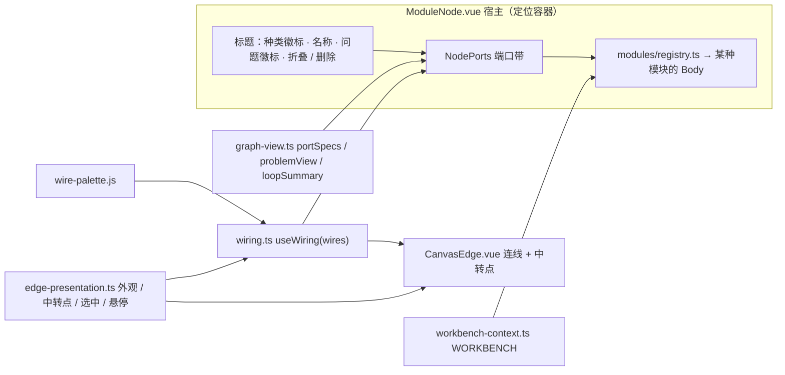

# 画布节点组件

**中文** · [English](canvas-nodes.en.md)

画布上有三种节点：

- **模块**（`ModuleNode.vue`）：任何种类的模块都用同一个宿主。
- **组合**（`GroupNode.vue`）：折叠的模板实例、用户打包的分组，或标成回路框的分组。
- **训练模块**（`TrainingModuleNode.vue`）：展开的预制模块画成的框。

三种节点共用同一条端口带（`NodePorts.vue`）、同一套连线模型（`wiring.ts`）和同一个连线组件（`CanvasEdge.vue`）。每种模块自己的组件（`editor/modules/*Body.vue`）渲染模块的内容，宿主不知道内容是什么。术语见 [CONTEXT.md](../CONTEXT.md)，设计取舍见 [docs/adr](adr/)。

## 宿主节点 `ModuleNode.vue`

1. **节点框**：一个有定位的盒子（`position: relative`，填满 Vue Flow 节点）。端口插槽相对它绝对定位，落在左右边框上。宿主决定宽度：用 `node.uiSize.w`，没有时用 `sizes.ts` 里这个种类的自然宽度。内容组件的根填满宿主（`width: 100%`），不设自己的 `min-width`（AGENTS.md）。
2. **标题**：拖动把手。标题里有种类徽标（`kindOf(kind).label` 经过 `t()`）、可编辑的名称、问题徽标、折叠和删除。问题徽标的红色数字是错误数，灰色数字是未连接项数，悬停时显示全文。标题里的控件加 `nodrag`。
3. **`<NodePorts>`**：端口带。`graph-view.ts portSpecs(graph, resolution, nodeId)` 从模块图的解析结果生成端口带。
4. **内容**：`modules/registry.ts` 的 `BODIES[kind]`，props 只有 `nodeId`。内容组件通过 `inject(WORKBENCH)`（`workbench-context.ts`）得到 `graph`、`resolution()`、`session(kind, nodeId)`、`edit(label, fn)` 和 `status()`。内容组件只通过 `edit()` 改配置，只通过会话改运行状态。
5. **尺寸**：
   - 控件：`NodeResizer`（只保留右下角和四条边，都不画出来，只改变光标）加一个键盘手柄。方向键微调，按住 Shift 时每次 1 像素，`Home` 恢复默认尺寸。
   - 显式高度：有显式高度（`uiSize.h` 或正在拖动）时，宿主带 `sized` 类。内容区填满剩余高度。每个内容组件里标了 `.bfill` 的那一块（代码框、文字框、视图渲染器）分走多出的高度。放不下时，内容区在框内滚动，不溢出边框。
   - 最小高度：宿主拖拽的最小高度是标题 + 端口带 + 一行内容。手势开始时测量这个高度。
   - 其他：内容里没有别的尺寸控制（文本框没有 resize 角）。折叠时只剩标题和端口带。
6. **工具层**（网络，ADR 0010 §9）：
   - 子画布：内容之后，每个工具层有一块可折叠的子画布「工具层 · 端口」，按层的顺序排列。折叠状态存在 `node.uiFolded`。
   - 里面的卡片：只接到这个工具端口的模块画在子画布里，是完整的卡片。冻结网络和它的位读出算一个模块：读出的 `run` 接在这里，网络只给这个读出提供输入。这个模块没接线的端口是宿主节点上的插槽 `${模块 id}/${端口}`。如果从这些插槽把模块连到别处，模块就回到外面的画布。
   - 外面的工具：还接在别处的工具画在外面。子画布里只有一个标签，点击标签跳到这个工具。
   - 归属：归属只由连线推出（`editor/tool-canvas.js`），不存储。
   - 「+ 工具」：新建一个 `(bits) → bits` 的代码工具，或选一份产物加一个冻结网络，并接好线。每种操作是一条历史记录。
   - 执行时：运行这个网络的执行实例走到当前这一步时，被选中的工具高亮。高亮的工具写出交给它的数据位和它的结果。其他工具变暗。折叠时显示一行摘要。
   - 宽度：宿主按里面卡片的需要取宽度（`graph-view.ts TOOL_CANVAS`），卡片网格填满这个宽度。
   - 可选的产物：任何按位读出的网络（FF、LIF，或自己带工具层，ADR 0014）。如果选了带工具层的产物，它训练时用的网络工具也一起放上，并接到它的工具端口。代码工具要手动接。
   - 嵌套：工具嵌套超过 3 层时，最外层的网络显示问题。系统拒绝直接造成超深嵌套的连线。

宿主不画插槽，也不决定线的颜色。

## 组合节点 `GroupNode.vue`

- 组合节点对应模块图里的一个 `group`。节点上有：标题、`组合` 徽标、来源模板 `id@revision`（如果有）、成员数、存为模板、右侧的展开 / 折叠按钮（`+` / `−`，和模块节点一样）、删除。取消组合的操作不在节点上。用工具栏的“解包”（`Shift G`）取消组合。
- **折叠时**：不画成员。端口带列出 `expose` 里的成员端口，插槽 id 是 `${成员 flow id}/${端口}`。跨越边界的线改画到这些插槽上，成员之间的线不画。连线手势先把插槽解析回成员端口，再交给模块图。所以新的连接逻辑不用单独处理组合。
- **展开时**：一个框住成员的框。成员是 Vue Flow 的子节点（`parentNode`），在原处编辑。组合可以嵌套（ADR 0003）。`GroupNode.vue` 不画展开的预制模块（带 `prefab` 记录的组合，例如内置模板实例）。展开的预制模块画成训练模块框，见下一节。

### 回路框

分组带 `loop`（`group.loop` = 回路模块 id）时，`GroupNode.vue` 把这个分组画成回路本身（`index.ts` 给它 `box` 视图，ADR 0009、ADR 0011 §4）：

- 徽标是 `回路`，边框是 `--inh` 实线。回路模块没有自己的卡片（`canvas-geometry.ts shownBy`：框画出回路模块）。框在成员周围画出一个回合怎样运行：
  - 顶部：`Start ← loop`。`loop` 句柄在左边框上，驱动模块从这里连接。后面列出每个驱动带来的分区和回合数。
  - `loop` 句柄下面的左边框：`ƒ scenario ← 场景`。
  - 左栏：`init(start) → State` → `State` → `input(state) → bits[I]`。`input` 句柄在它右边，接回路体。
  - 右边：`action: number`。`action` 句柄在它左边。
  - 下面：`step(state, action)` 和结束条件。

  框里只写协议签名、从图推出的值（`graph-view.ts loopContract`）和空状态。`sizes.ts LOOP_FRAME` 给这些站点留出位置，所以成员不压住它们。
- 折叠时，框照常显示暴露的端口，另加一行回路体摘要：“每一步：输入位 → 网络 → 读出 → … → 动作”（`graph-view.ts loopSummary`，按求值顺序）。回路没闭合时，摘要写“回路未闭合”。
- 标题栏的问题徽标显示回路模块自己的问题。框放在训练模块里时，这些问题显示在训练模块的标题栏上。框只是视图：回路体由连线推出。框的成员与“回路模块 + 回路体”不一致时，回路报“回路框 … 的成员与回路体不一致（多了：…；少了：…）”。把模块移进或移出框不改变回路体，改连线才改变回路体。
- 不在回路框里的回路模块画成普通卡片（`LoopBody.vue`）。

## 训练模块 `TrainingModuleNode.vue`

展开的预制模块画成一个框（ADR 0011）。成员的划分只由连线推出（`editor/training-module.js trainingModule`）。这只是画法，不改变模块图。

- **段落**（左栏）：段落不是 Vue Flow 节点，没有端口带。下面的模块是段落：
  - 训练器、候选、评估器、执行实例、分区和数据集总是段落。
  - 接到本框回路 `scenario` 的代码模块是环境段落。
  - 代码、参数、视图和随机数模块的每根线都连到段落上时，这些模块也是段落。

  框里的代码模块合成一个「代码」段落（`CodeTabs.vue`，按模块分组）。每个段落有一行段头（种类、标题、问题、折叠、删除），段头下面是这种模块的内容组件。
- **列**：段落按顺序自动分成几列，使整个框接近 `TRAIN_FRAME.aspect`。加列时，框向左加宽，碰到同层的邻居前停下。段落运行时变高，只加长它所在的列。只在首次测量后、“整理”时、段落或折叠状态变化时重新分列（`training-module.js sectionColumns`）。段头左边的种类标签是拖动把手。放下时，分列存进分组的 `columns`（「代码」段落存成它显示的全部代码模块），此后框按存下的分列画（`placeSections / moveSection`）。
- **子画布**（右边）：其余成员是普通节点，放在下凹的子画布里。子画布只是背景，指针穿过它到达画布。
- **端口**（`sectionPorts`）：
  - 段落连进子画布的端口画成子画布左边缘上的探头。
  - 连到框外或没连的端口画在框的外侧边缘上。
  - 只在段落之间相连的端口不画，这些线也不画。
- **小地图**：段落不是 Vue Flow 节点，所以训练模块在小地图里自己画自己（`EditorRoot.vue`）。训练模块画出框的轮廓、子画布和每个段落在左栏里的位置，按种类着色。段落的位置是 `training-module.js` 按测量高度排出的矩形。组合框只画轮廓，所以里面的成员不被遮住。
- 左栏顶部列出预制模块的槽位和缺少的预期连线（「恢复」恢复一条预期连线）。

## 内容组件

每种模块有一个 `editor/modules/<Kind>Body.vue`，在 `registry.ts` 的 `BODIES` 里注册。与回路相关的内容组件：

| 组件 | 内容 |
|---|---|
| `LoopBody.vue` | 回路画成卡片时：场景状态（未接 / 有错误 / 不完整 / 就绪）、输入位宽 I、回路体摘要、驱动它的端口列表，以及回路自己的问题（回路体里不允许的种类、框不一致、驱动的回合种类不一致） |
| `TrainerBody.vue` | 方法、后端和这个方法读取的配方字段。训练的是回路里哪个网络（接到 `structure` 的那个，其余网络冻结）。Python 连接状态，开始 / 取消，进度和曲线，运行列表 |
| `EvaluatorBody.vue` | 选分区角色，在这个分区上贪心地运行整条回路（每个网络用已接受的权重）。指标表，按枚举轴分组的曲线，每个网络运行的是哪份产物，回合样例 |
| `ExecutionBody.vue` | 选分区里的回合，step / 连续运行 / 暂停 / reset，手动动作，拖动历史。历史显示每步的输入位、动作、这一步怎样结束，以及回路体每个模块的值（执行器的 `values`）。带工具层的网络写出每个工具层这一步调用了哪个工具（冻结网络按它的标题，代码工具按 `模块.函数`）。它还写出交给工具的数据位和工具的结果（只有这个工具运行了）。接在 `execution` 上的视图负责状态渲染 |

## `NodePorts.vue`

| prop | 类型 | 说明 |
|---|---|---|
| `node` | `string` | 这个节点的 flow id，与 `Wire.source / target` 对应 |
| `inputs` / `outputs` | `PortSpec[]` | 声明的端口，按顺序一行一个 |
| `wiring` | `Wiring` | 画布的连线模型（`inject(CANVAS_WIRING)`） |
| `label` | `string` | 节点名，用于无障碍标签 |

没有插槽（slot）：端口行显示的内容全部来自它的 `PortSpec`。

行为：

- 每个端口只渲染一个 Vue Flow `Handle`，id 就是 `PortSpec.id`。输入在左边缘，输出在右边缘，垂直位置跟随它那一行。例外是驱动模块从它驱动的对象接的输入：回路的 `loop` 句柄和被训练网络的 `structure`（`training-module.js facing`，`PortSpec.right`）。这些输入排在右栏最上面，插槽在右边缘，朝向它指向的回路框，所以线直接走回去。
- 插槽样式：未连接时是空心圈，颜色是端口类型的颜色。连上后变成实心。只连一根线时，插槽填这根线的颜色。所连的线被悬停或选中时，插槽跟着高亮。
- 调用端口的名字带 `ƒ` 前缀，用斜体（`.port-row.call`）。必需但未接的端口名后加 `*`（`.port-row.required:not(.bound)`）。
- record 输出的名字左边有 `+/−`（`.port-toggle`）。展开后，下一级字段按树状排在它下面（`.port-row.tree`，`├─ └─ │` 引导线），每个字段有自己的插槽。收起时只保留已连线的字段，按完整路径显示（`.port-row.path`）。同一时间只有一个模块展开。点别的模块或空白处时，展开的模块收起（`index.ts` 的 `fieldTree`）。

`PortSpec`：`{ id, label, type, title?, class?, right? }`。`type` 决定插槽颜色（`editor.css` 的 `[data-type=…]`）。`graph-view.ts portType` 从端口声明推出 `type`：

| type | 颜色变量 | 用于 |
|---|---|---|
| `bits` | `--wire` | 0/1 位向量（回路的输入位 `input`、网络输入 `in`、读出的位输出、位线） |
| `fn` / `handle-module` | `--sens` | 调用端口（函数。代码模块的 `module` 输出与回路的 `scenario` 输入是整个文件） |
| `number` / `boolean` / `string` / `vector` / `array` / `record` / `any` / `table` / `handle-partition` | `--plastic` | 值与数据（包括回路的 `action`） |
| `handle-weights` / `handle-structure` / `handle-artifact` | `--mod` | 权重、结构、产物 |
| `handle-run` / `handle-report` | `--train` | 训练运行、报告 |
| `handle-execution` / `handle-deployment` | `--focus` | 执行实例、链上部署 |
| `handle-loop` | `--inh` | 回路句柄（回路的 `loop` 输出与训练器、评估器、执行实例的 `loop` 输入） |

新的句柄类型要同时加到 `core/types.js` 的 `HANDLES` 和 `editor.css` 里。模块边框颜色在 `.kind-<kind>` 里，例如 `.kind-loop` 用 `--inh`。

## `wiring.ts`

`useWiring(wires: () => readonly Wire[]): Wiring`，在组件的 setup 里调用。只有一个连线平面：画布。

- `Wire`：`{ id, source, sourcePort, target, targetPort, label, type?, disconnect? }`。`type` 是 `'value' | 'call'`。`sourcePort` / `targetPort` 就是两端 Handle 的 id。
- `Wiring`：`wiresAt(node, port, kind)`、`colorOf(wireId)`（同一节点上的线互不重色）、`isHot` / `isSelected`。
- 悬停和选中状态全局共享，key 是线的 id（连线外观也用这个 key）。线删除或组件卸载时，这些状态自动清除。
- `EditorRoot.vue` 以 `CANVAS_WIRING` 提供主画布的 `Wiring`。

## 连线与中转点（`CanvasEdge.vue`、`edge-presentation.ts`）

- 只有一种边类型 `wire`，`data.kind` 是 `value` 或 `call`。值线是实线，调用线是虚线并带 `ƒ` 标签。走线形状只有一个全局设置 `defaults.shape`（`EdgeSettings.vue`）。单根线的 `EdgeAppearance` 只有 `color` 和 `route`。颜色优先级：这根线自己的颜色 → 全局默认颜色 → 调色板颜色。
- 单根线的操作在右键菜单 `EdgeMenu.vue` 里。只有菜单指向的线是选中的线时，菜单才显示。按 `Delete` 断开选中的线。
- **中转点**：`EdgeAppearance.route` 是一串有顺序的点 `{u, n}`，用这根线自己的坐标，最多 16 个。中转点只影响画法，不进入模块图。手势如下：
  - 添加：Alt+点击或双击连线。
  - 移动：拖动中转点。
  - 删除：双击或 Alt+点击中转点。

  所有手势都有撤销历史。

## 连接手势（`index.ts`，插槽映射在 `canvas-geometry.ts`）

- 拖线时，两端端口的 `wire` 字段决定线的种类。放下时，手势调用 `graph.canConnect(spec)`，状态栏显示拒绝的原因。校验在核心里：`core/resolve.js` 做类型 / 签名匹配。`core/graph.js` 保证值线无环，也保证调用线无递归。接进回路输入的值线可以成环。回路输入是声明了 `loop` 的端口，也就是回路的 `action` 和网络的 `weights`。
- `canvas-geometry.ts socket` 决定成员端口画在哪个节点的哪个插槽上。折叠组合、回路框边、训练模块的段落端口、网络卡片里的工具卡片都用 `${成员}/${端口}`。手势再通过 `member` 把插槽解析回成员端口。回路框边上的四个插槽就是回路模块自己的端口。
- 历史（`history.ts`）记录 `graph.toJSON()`（包括分组的 `loop` 标记）和连线外观的快照。撤销按增量还原，保留节点身份和会话。

## 整理（`canvas-geometry.ts arrange`）

- 按连线深度从左到右分层。层数多时折成几行，整体接近视口比例。每一层里按邻居的重心排序，以减少交叉。每个单元尽量与给它输入的单元对齐。
- 一根线算在两个单元之间：这两个单元在当前层级上，分别包含线的两端。所以跨越分组边界的线连接包含两端的成员单元。
- 接进回路输入的线照常计入。只有会闭合环的线不计入，也就是被训练网络自己的 候选 → `weights`（经过它的训练器）。所以冻结权重排在它提供权重的回路框之前。
- 接进驱动朝向输入（`training-module.js facing`：`loop` 句柄、`structure` 句柄）的线当作从驱动指向它驱动的对象。这些方向是：训练器、评估器、执行实例 → 回路，训练器 → 被训练网络。所以驱动排在回路框之前。
- 如果一个单元只把整个模块交给一个消费者（场景交给回路），这个单元按那个消费者的规则排：同一层，紧挨着放在它下面。
- 训练模块里只整理子画布。段落不参与排布，分列见上面“训练模块”。驱动、环境、候选都是段落，子画布里是回路框和其余成员（ADR 0011）。

## 新增一种模块的检查清单

1. 在 `frontend/core/kinds/` 写种类文件（`kind`、`label`、`config.schema`、`ports`、`infer`、`problems`）。用 `registerKind` 注册这个种类。在 `kinds/index.js` 里 import 这个文件（import 即注册）。如果这个种类要能放进回路体，把它加进 `kinds/loop.js BODY_KINDS`，并在 `core/loop.js`（和 `training/bundle_loop.py`）里实现它的一步。
2. 写内容组件 `editor/modules/<Kind>Body.vue`。props 是 `{ nodeId }`，根元素用 `width: 100%`。配置表单用 `ConfigForm.vue`。从 `useWorkbench()` 的 `graph` / `resolution()` / `session()` 读状态。通过 `edit()` 提交改动。
3. 在 `editor/modules/registry.ts` 的 `BODIES` 里注册组件。在 `editor/sizes.ts` 里给出自然尺寸 `width` / `height`。在 `editor.css` 的 `.kind-<kind>` 块里给出颜色（宿主边框和小地图矩形）。
4. 如果需要新的句柄类型，把它加到 `core/types.js` 的 `HANDLES` 和 `editor.css` 的 `[data-type=handle-…]`。
5. 给每个中文字面量加 `i18n/en.json` 词条（`node frontend/i18n/check.mjs`）。
6. 不要给节点单独写插槽样式、颜色、字体或连线端点逻辑。
