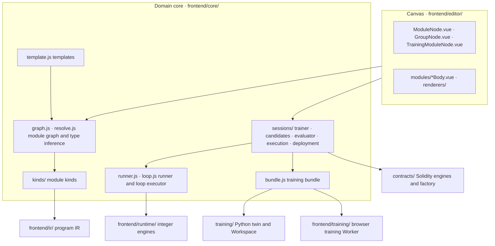
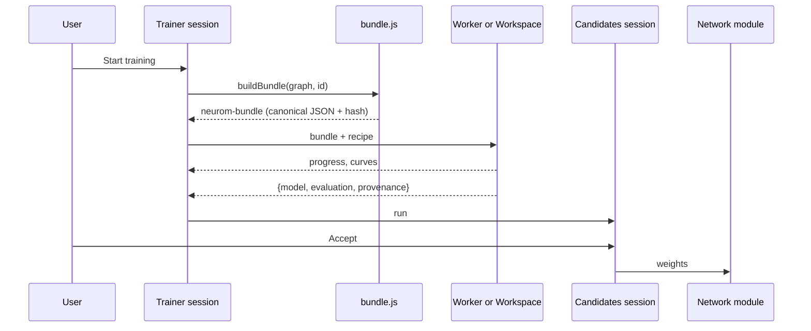

# Developer guide

[中文](development.md) · **English**

This guide is for developers who change the Neurom code. It gives the environment, the repository layout, the commands, the tests and the common development tasks. The [design document](design.en.md) gives the system design. [CONTEXT.md](../CONTEXT.md) gives the terms. The [ADRs](adr/) give the reasons for the main decisions.

## Contents

1. [Environment](#1-environment)
2. [Repository layout](#2-repository-layout)
3. [Architecture overview](#3-architecture-overview)
4. [Commands](#4-commands)
5. [Test matrix](#5-test-matrix)
6. [CI](#6-ci)
7. [Common development tasks](#7-common-development-tasks)
8. [Engineering rules](#8-engineering-rules)
9. [Documentation rules](#9-documentation-rules)

## 1. Environment

| Tool | Version | Use |
|---|---|---|
| Node.js | ≥ 22.12 (`engines` in `package.json`) | frontend, Node tests, build, generators |
| Python | 3.12 (the CI version) | `training/`: IR twin, bundle trainers, Workspace |
| numpy, PyTorch | `training/requirements.txt`, `training/requirements-torch.txt` | Python training and Python tests |
| Foundry | ≥ 1.8.0 (with Monad execution support) | contract tests, ABI generation, local Anvil, chain bridge tests |

Installation steps:

1. Install the Node dependencies:

   ```sh
   npm ci
   ```

2. Install the Python dependencies. The scripts and documents of the repository use this venv path by default:

   ```sh
   python3 -m venv ~/.cache/neurom-venv
   ~/.cache/neurom-venv/bin/python -m pip install -r training/requirements.txt -r training/requirements-torch.txt
   ```

3. Install Foundry:

   ```sh
   curl -L https://foundry.paradigm.xyz | bash && foundryup
   ```

Without Foundry, `npm test` skips the on-chain tests that need `anvil`. The other tests run as usual.

## 2. Repository layout

```
contracts/     Foundry / Monad: Roles, ModuleFactory behind its proxy (with the engine versions), weight chunks, immutable engine versions (dense FF/LIF and threshold layers) and module contracts
training/      Python: IR (one generated numpy function per program), the bundle runner and loop executor, the three training methods, same-origin Workspace service
frontend/      Module workbench (index.html entry, Vue 3 + TypeScript + Vite)
               ir/          program IR: JS-subset parser, type checker, compiler
               core/        module kinds, module graph, the two wires, bundles, runner, loop executor, templates, workspace; sessions/ is each module's runtime
               templates/   builtin training modules (YAML) and the four-bit arithmetic / combiner builtin artifacts
               training/    browser Worker: REINFORCE, cross-entropy, hinge on the whole loop; FF QAT, LIF BPTT
               editor/      Vue / TypeScript canvas: host node, composite node (loop boxes included), one content component per kind, view renderers
               runtime/     integer execution engines: dense FF / LIF (dense-policy.js), threshold layers (threshold-layers.js)
               i18n/        English strings and the coverage check
               dist/        single-file entry generated by npm run build (not committed)
docs/          design, training integration, canvas components, user guide, developer guide, ADRs, README images (images/)
benchmark/     gas benchmarks: Monad rules against Ethereum rules, and the check of anvil --network monad against the Monad testnet (see benchmark/README.en.md)
```

Generated files. Do not edit these files by hand. Change the source, then generate them again:

| File | Source | Command |
|---|---|---|
| `frontend/abi/*.json` | `contracts/src/` | `npm run abi` |
| `frontend/templates/artifacts/*.json` | the four-bit arithmetic and combiner templates | `node frontend/templates/artifacts/generate.mjs` |
| `frontend/ir/fixtures/programs.json` | the browser IR | `node frontend/ir/fixtures/generate.mjs` |
| `training/fixtures/bundle-env.json`, `training/fixtures/bundles.json` | the browser runner and loop executor | `node training/fixtures/bundle-env.mjs` |
| `training/fixtures/replays.json` | Python trainers + browser executor | `node training/fixtures/replays.mjs` |
| `frontend/dist/neurom-studio.html` | all of `frontend/` | `npm run build` (not committed) |

## 3. Architecture overview

[Section 9 of the design document](design.en.md#9-code-layers) gives the work of each layer. [File boundaries in the frontend guide](../frontend/README.en.md#file-boundaries) gives the work of each file.



The data flow of one training run:



Invariants to keep:

- The interface changes state only through the sessions and `graph`. Persistent state goes only through the workspace save.
- `admit` is the only way for a graph description into the graph. Loading, undo, paste and template instantiation all go through it.
- Training, evaluation and execution all go through one loop executor (ADR 0009).
- The browser and Python run the same `neurom-program`. The integer results of the two sides must agree bit for bit.
- The declarations of a module decide what it exposes. A module kind checks the declarations and does not guess from names (ADR 0005, ADR 0006).

## 4. Commands

Run these commands from the repository root.

| Command | What it does |
|---|---|
| `npm run dev` | starts the Vite dev server (default 5173), with `/api` proxied to `127.0.0.1:18766` |
| `npm test` | runs all Node tests (`node --test`) |
| `npm run typecheck` | checks Vue SFCs and TypeScript with `vue-tsc` |
| `npm run build` | generates the single file `frontend/dist/neurom-studio.html` |
| `npm run abi` | generates `frontend/abi/*.json` from Solidity |
| `npm run workspace` | starts the Workspace with `python3` from PATH (the Python dependencies must be installed) |
| `~/.cache/neurom-venv/bin/python -m unittest discover -s training -p 'test_*.py'` | runs the Python tests |
| `python3 contracts/scripts/export_abi.py --check` | checks that the committed ABIs agree with the contract sources |
| `cd contracts && forge test --network monad -vvv` | runs the contract tests. `-vv` prints the gas measurements |
| `node frontend/i18n/check.mjs` | runs only the UI string coverage check |
| `node frontend/templates/artifacts/generate.mjs` | retrains the four builtin artifacts |

Local chain work uses two terminals. The second terminal is in `contracts/`:

```sh
anvil --network monad --port 18545
forge script script/Deploy.s.sol --rpc-url http://127.0.0.1:18545 --unlocked --sender 0xf39fd6e51aad88f6f4ce6ab8827279cfffb92266 --broadcast
```

After a deployment from account 0 on a freshly started node, the official factory is at the `factory` address of 31337 in `frontend/chain.js`.

## 5. Test matrix

| Suite | Command | What it pins |
|---|---|---|
| IR | `npm test` (`frontend/ir/ir.test.js`) + `training/test_ir.py` | JS and Python IR results are equal per lane, including error attribution, signed zero and u32 limits |
| Core and sessions | `npm test` (`frontend/core/**/*.test.js`) | module graph, types, templates, bundles, runner, loop executor, tool layers, readouts, and the sessions of trainer, candidates, evaluator, execution, deployment and dataset |
| Browser training | `npm test` (`frontend/training/train.test.js`) | the three methods, QAT, quantization |
| Canvas geometry | `npm test` (`frontend/editor/*.test.js`) | slots, arrange, training module columns, history, wire colors |
| Builtin artifacts | `npm test` (`frontend/templates/artifacts/artifacts.test.js`) | environment and exact scores of the four builtin artifacts, tool choice and data bits of the combiner |
| Runner parity | `npm test` (`training/fixtures/bundle-env.test.mjs`) + `test_bundle_env.py`, `test_bundle_train.py` | the browser and Python runner, loop executor and lockstep runner agree step by step |
| UI strings | `npm test` (`frontend/i18n.test.js`) | each Chinese literal has an English string, the placeholders agree, no unused strings |
| Chain bridge | `npm test` (`frontend/module-chain.test.js`, needs Foundry) | deploy, verify and step on a local anvil, bit for bit with the browser. Only the official factory is trusted |
| Engine versions | `npm test` (`contracts/scripts/*.test.mjs`, needs Foundry) | the bit-exact check before an engine version is added, the role list |
| Workspace | `training/test_workspace.py` | submit, SSE, cancel, import and boundaries |
| Contracts | `forge test --network monad` | integer semantics, tool layers, weight chunks, factory checks, roles, gas |
| Types | `npm run typecheck` | Vue SFCs and TypeScript |

[Section 11 of the design document](design.en.md#11-correctness-and-performance) tells what each fixture pins.

Obey these rules when you write tests:

- A test pins behavior that a user can see: limits, invariants, state transitions, precedence and errors.
- A test does not pin wording, source text or incidental defaults.
- A test is deterministic and isolated, and it passes inside the full suite.

## 6. CI

`.github/workflows/ci.yml` runs three jobs on each push and pull request:

| Job | Steps |
|---|---|
| `contracts` | install Foundry v1.8.0 → `forge test --network monad -vvv` → `export_abi.py --check` |
| `training` | Python 3.12 → install numpy and the CPU torch → `unittest discover -s training` |
| `frontend` | Node 22 → `npm ci` → `npm test` → `npm run typecheck` → `npm run build` |

Before you commit, run the jobs that your change affects on your computer.

## 7. Common development tasks

### 7.1 Add a task

If the current module kinds are sufficient, a new task is one template. You do not change JS, Python or Vue.

1. Copy a similar template, for example `frontend/templates/mining-task.yaml`.
2. Change `id`, `name` and `revision`.
3. In the code modules, write the scenario (`init`, `input`, `step`, `budget`), the reward and the metrics.
4. If the task must show under "Examples", add `preset: { label: … }`.
5. Put the file in `frontend/templates/`. `templates/index.js` reads each YAML file in the directory, so you do not register it.
6. Add English strings for `name`, `description` and `preset.label` (`frontend/i18n/en.json`).
7. Run `npm test`.

The parser instantiates the template into a scratch graph and checks each wire against the wiring rules. The finished instance must have no problems other than "incomplete". [Section 5 of the design document](design.en.md#5-templates) gives the template format.

### 7.2 Add a module kind

Follow the [checklist in the canvas node components](canvas-nodes.en.md). In summary:

1. Write the kind file in `frontend/core/kinds/`, register it with `registerKind`, and import it in `kinds/index.js`.
2. If the kind can go into a loop body, add it to `BODY_KINDS` in `kinds/loop.js`. Then implement its step in `core/loop.js` and `training/bundle_loop.py`.
3. Write the content component `frontend/editor/modules/<Kind>Body.vue`, and register it in `BODIES` of `editor/modules/registry.ts`.
4. Give the natural size in `editor/sizes.ts` and the color in the `.kind-<kind>` block of `editor.css`.
5. Add English strings for the new Chinese literals.

### 7.3 Change UI text

- The Chinese source text is the string key. The English text is in `frontend/i18n/en.json`.
- Each Chinese literal, Vue template text, static text of `index.html`, and the `name` / `description` / `preset.label` of the builtin templates must have an English string.
- The placeholders and HTML tags of an English string must agree with the source.
- Delete strings that are not used. `npm test` reports unused strings.

### 7.4 Change the contracts

1. Change `contracts/src/`.
2. Run `cd contracts && forge test --network monad -vvv`.
3. Run `npm run abi` to update `frontend/abi/`.
4. If you change the deployment order or the deployment account, update `contracts/script/Deploy.s.sol`, `frontend/anvil.fixture.js` and `CHAINS[31337].factory` in `frontend/chain.js` together. `module-chain.test.js` checks that the three agree.

Engine versions are only added, never changed. [contracts/README.en.md](../contracts/README.en.md) gives the steps to add an engine version.

### 7.5 After a template or weight-format change

1. Run `node frontend/templates/artifacts/generate.mjs`. The script retrains the four builtin artifacts with the JS trainer and pinned seeds.
2. Copy the printed ids into `frontend/templates/arithmetic-combiner.yaml`. This file pins the `artifact` of the tool networks and the `accepted` of the policy candidates.
3. Run `npm test`. If an id does not agree, `artifacts.test.js` fails.

### 7.6 After a change to the semantics of the runner, the loop executor or the IR

Change both the browser side and the Python side. Then generate the parity fixtures again:

1. If the IR semantics changed, run `node frontend/ir/fixtures/generate.mjs`. It generates `frontend/ir/fixtures/programs.json`.
2. Run `node training/fixtures/bundle-env.mjs`. It generates `bundle-env.json` and `bundles.json` with the browser code only.
3. If the behavior of models that Python trains changed, run `node training/fixtures/replays.mjs`. This script runs the Python trainer. The environment variable `NEUROM_PYTHON` names the interpreter. The default is `~/.cache/neurom-venv/bin/python`.
4. Run `npm test` and the Python tests.

### 7.7 Change the canvas layout

- The measured host box owns the width and the minimum width. Host boxes are Vue Flow nodes and blocks, for example `.tool-body`, `.mw-node.n-*` and `.gnode-module`.
- A panel root inside a host only fills the host (`width:100%` or its natural size). It has no `min-width` or fixed width of its own.
- The reason: Vue Flow measures only the border box of the host. When a child overflows, the plane size, auto-arrange and wire docking do not see the overflow.
- To verify, find the descendants whose right edge is past `getBoundingClientRect().right` of the host. Exclude `.vue-flow__handle`, which crosses the border on purpose.

## 8. Engineering rules

- The code of a general module can fix its own protocol, for example port roles, call order and checks.
- Content that changes with the task never goes into JS, Python or Vue. This content includes scenario rules, parameter values, rewards, metrics, maps, action tables and the use of random numbers. It goes only into template data, module config or the source of the module itself (ADR 0004).
- The test: if a different task, parameter or reward makes you change code, the code is hardcoded.
- When a scenario exports a function that is not a role and is not wired anywhere, the environment reports the function. It does not ignore it.
- Modules are immutable. To improve a module, train a new module. New weights make a new artifact and a new deployed instance.

## 9. Documentation rules

- Write all text to the rules of ASD-STE100 Simplified Technical English. Chinese text uses the matching rules in [AGENTS.md](../AGENTS.md).
- Change a Chinese document and its English version together. The two must have the same meaning.
- Keep quoted UI text, code identifiers, file paths and commands as they are.
- Use one word for one concept, the word in `CONTEXT.md`.
- The README screenshots and demo GIFs are in `docs/images/`. Each file has a `-zh` and an `-en` version. After a UI change, take the screenshots and record the demo again on the `?preset=` examples, and keep the file names.
