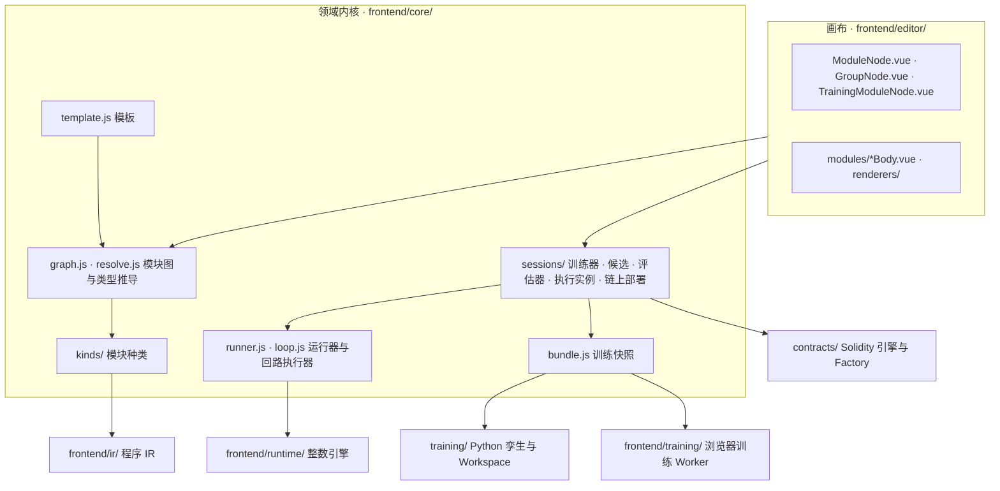
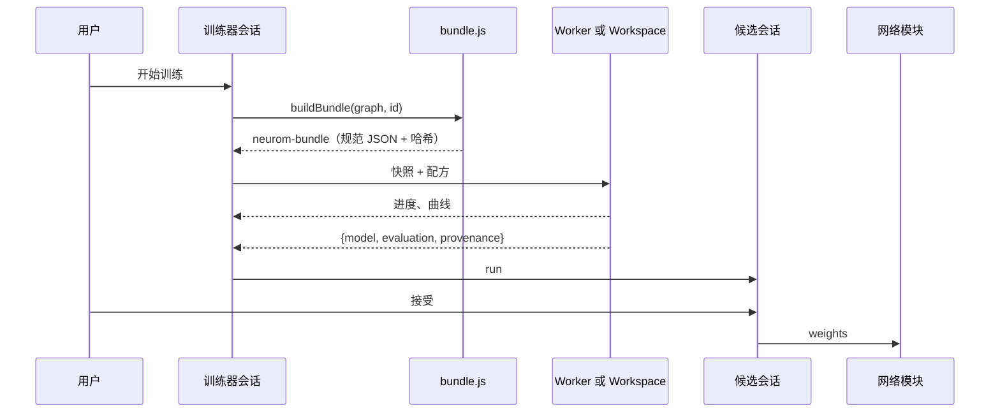

# 开发者文档

**中文** · [English](development.en.md)

本文写给要改 Neurom 代码的开发人员。它说明环境、仓库结构、命令、测试和常见开发任务。系统设计见 [设计文档](design.md)。术语见 [CONTEXT.md](../CONTEXT.md)。主要决定的理由见 [ADR](adr/)。

## 目录

1. [环境](#1-环境)
2. [仓库结构](#2-仓库结构)
3. [架构速览](#3-架构速览)
4. [常用命令](#4-常用命令)
5. [测试矩阵](#5-测试矩阵)
6. [CI](#6-ci)
7. [常见开发任务](#7-常见开发任务)
8. [工程规则](#8-工程规则)
9. [写文档的规则](#9-写文档的规则)

## 1. 环境

| 工具 | 版本 | 用途 |
|---|---|---|
| Node.js | ≥ 22.12（`package.json` 的 `engines`） | 前端、Node 测试、构建、生成脚本 |
| Python | 3.12（CI 用的版本） | `training/`：IR 孪生、快照训练器、Workspace |
| numpy、PyTorch | `training/requirements.txt`、`training/requirements-torch.txt` | Python 训练和 Python 测试 |
| Foundry | ≥ 1.8.0（Monad 执行支持） | 合约测试、ABI 生成、本地 Anvil、链上桥接测试 |

安装步骤：

1. 安装 Node 依赖：

   ```sh
   npm ci
   ```

2. 安装 Python 依赖。仓库的脚本和文档默认使用这个 venv 路径：

   ```sh
   python3 -m venv ~/.cache/neurom-venv
   ~/.cache/neurom-venv/bin/python -m pip install -r training/requirements.txt -r training/requirements-torch.txt
   ```

3. 安装 Foundry：

   ```sh
   curl -L https://foundry.paradigm.xyz | bash && foundryup
   ```

没有 Foundry 时，`npm test` 跳过要用 `anvil` 的链上测试，其他测试照常运行。

## 2. 仓库结构

```
contracts/     Foundry / Monad：Roles、代理后面的 ModuleFactory（含引擎版本列表）、权重块、不可改的引擎版本（dense FF/LIF 与阈值层）与模块合约
training/      Python：IR（每个程序生成一个 numpy 函数）、快照上的运行器与回路执行器、三种训练方法、Workspace 同源服务
frontend/      模块工作台（index.html 入口，Vue 3 + TypeScript + Vite）
               ir/          程序 IR：JS 子集解析、类型检查、编译
               core/        模块种类、模块图、两种线、训练快照、运行器、回路执行器、模板、工作区；sessions/ 是各模块的运行时
               templates/   内置训练模块（YAML）与四位算术 / 组合器的内置产物
               training/    浏览器 Worker：整回路上的 REINFORCE、交叉熵、hinge；FF QAT、LIF BPTT
               editor/      Vue / TypeScript 画布：宿主节点、组合节点（含回路框）、每种模块的内容组件、视图渲染器
               runtime/     整数执行引擎：dense FF / LIF（dense-policy.js）、阈值层（threshold-layers.js）
               i18n/        英文词条与词条覆盖检查
               dist/        npm run build 生成的单文件入口（不入库）
docs/          设计、训练接入、画布组件、使用指南、开发者文档、ADR、README 图片（images/）
benchmark/     gas 基准测试：Monad 规则对以太坊规则，以及 anvil --network monad 和 Monad 测试网的核对（见 benchmark/README.md）
```

生成的文件。不要手改这些文件，改了源头以后重新生成：

| 文件 | 源头 | 生成命令 |
|---|---|---|
| `frontend/abi/*.json` | `contracts/src/` | `npm run abi` |
| `frontend/templates/artifacts/*.json` | 四位算术和组合器模板 | `node frontend/templates/artifacts/generate.mjs` |
| `frontend/ir/fixtures/programs.json` | 浏览器 IR | `node frontend/ir/fixtures/generate.mjs` |
| `training/fixtures/bundle-env.json`、`training/fixtures/bundles.json` | 浏览器运行器和回路执行器 | `node training/fixtures/bundle-env.mjs` |
| `training/fixtures/replays.json` | Python 训练器 + 浏览器执行器 | `node training/fixtures/replays.mjs` |
| `frontend/dist/neurom-studio.html` | 整个 `frontend/` | `npm run build`（不入库） |

## 3. 架构速览

各层的职责见 [设计文档第 9 节](design.md#9-代码怎么分层)。文件级的职责见 [前端操作说明的文件边界](../frontend/README.md#文件边界)。



一次训练的数据流：



要记住的不变量：

- 界面只通过会话和 `graph` 修改状态。持久状态只经工作区保存。
- `admit` 是图描述进入图的唯一入口。读档、撤销、粘贴和模板实例化都经过它。
- 训练、评估和执行都经过同一个回路执行器（ADR 0009）。
- 浏览器和 Python 执行同一份 `neurom-program`。两边的整数结果必须逐位一致。
- 一个模块暴露什么，由它自己的声明决定。模块种类只校验声明，不按名字去猜（ADR 0005、ADR 0006）。

## 4. 常用命令

在仓库根目录运行这些命令。

| 命令 | 做什么 |
|---|---|
| `npm run dev` | 启动 Vite 开发服务器（默认 5173），把 `/api` 代理到 `127.0.0.1:18766` |
| `npm test` | 运行全部 Node 测试（`node --test`） |
| `npm run typecheck` | 用 `vue-tsc` 检查 Vue SFC 和 TypeScript |
| `npm run build` | 生成单文件 `frontend/dist/neurom-studio.html` |
| `npm run abi` | 从 Solidity 生成 `frontend/abi/*.json` |
| `npm run workspace` | 用 PATH 里的 `python3` 启动 Workspace（需要已装好 Python 依赖） |
| `~/.cache/neurom-venv/bin/python -m unittest discover -s training -p 'test_*.py'` | 运行 Python 测试 |
| `python3 contracts/scripts/export_abi.py --check` | 检查提交的 ABI 与合约源码一致 |
| `cd contracts && forge test --network monad -vvv` | 运行合约测试。`-vv` 打印 gas 测量 |
| `node frontend/i18n/check.mjs` | 只运行界面词条覆盖检查 |
| `node frontend/templates/artifacts/generate.mjs` | 重训四份内置产物 |

本地链联调用两个终端，第二个终端在 `contracts/` 下：

```sh
anvil --network monad --port 18545
forge script script/Deploy.s.sol --rpc-url http://127.0.0.1:18545 --unlocked --sender 0xf39fd6e51aad88f6f4ce6ab8827279cfffb92266 --broadcast
```

在新启动的节点上用账户 0 部署后，官方 Factory 落在 `frontend/chain.js` 里 31337 的 `factory` 地址。

## 5. 测试矩阵

| 套件 | 命令 | 钉住什么 |
|---|---|---|
| IR | `npm test`（`frontend/ir/ir.test.js`）+ `training/test_ir.py` | JS 与 Python 的 IR 结果逐 lane 相等，包括报错归属、有符号零与 u32 边界 |
| 内核与会话 | `npm test`（`frontend/core/**/*.test.js`） | 模块图、类型、模板、快照、运行器、回路执行器、工具层、读出，以及训练器、候选、评估器、执行实例、链上部署、数据集的会话 |
| 浏览器训练 | `npm test`（`frontend/training/train.test.js`） | 三种方法、QAT、量化 |
| 画布几何 | `npm test`（`frontend/editor/*.test.js`） | 插槽、整理、训练模块分列、历史、连线配色 |
| 内置产物 | `npm test`（`frontend/templates/artifacts/artifacts.test.js`） | 四份内置产物的环境与确切分数，组合器的工具选择与数据位 |
| 运行器对拍 | `npm test`（`training/fixtures/bundle-env.test.mjs`）+ `test_bundle_env.py`、`test_bundle_train.py` | 浏览器与 Python 的运行器、回路执行器和锁步运行器逐步一致 |
| 界面词条 | `npm test`（`frontend/i18n.test.js`） | 每个中文字面量都有英文词条，占位符一致，没有未使用的词条 |
| 链上桥接 | `npm test`（`frontend/module-chain.test.js`，需要 Foundry） | 在本地 anvil 上部署、核对、step，与浏览器逐位一致。只信任官方 Factory |
| 引擎版本 | `npm test`（`contracts/scripts/*.test.mjs`，需要 Foundry） | 添加引擎版本前的逐位核对、角色列表 |
| Workspace | `training/test_workspace.py` | 提交、SSE、取消、导入和边界 |
| 合约 | `forge test --network monad` | 整数语义、工具层、权重块、Factory 校验、角色、gas |
| 类型 | `npm run typecheck` | Vue SFC 与 TypeScript |

每个夹具钉住什么，见 [设计文档第 11 节](design.md#11-正确性与性能)。

写测试时遵守这些规则：

- 测试钉住使用者看得到的行为：边界、不变量、状态转换、优先级和错误。
- 不钉住措辞、源码文本或偶然的默认值。
- 测试要确定、隔离，并且在整套测试里也能通过。

## 6. CI

`.github/workflows/ci.yml` 在每次 push 和 pull request 时运行三个 job：

| Job | 步骤 |
|---|---|
| `contracts` | 安装 Foundry v1.8.0 → `forge test --network monad -vvv` → `export_abi.py --check` |
| `training` | Python 3.12 → 安装 numpy 和 CPU 版 torch → `unittest discover -s training` |
| `frontend` | Node 22 → `npm ci` → `npm test` → `npm run typecheck` → `npm run build` |

提交前，在本地运行和你的改动有关的 job。

## 7. 常见开发任务

### 7.1 加一个任务

如果现有的模块种类够用，加一个任务只加一份模板，不改 JS、Python 或 Vue。

1. 复制一份相近的模板，例如 `frontend/templates/mining-task.yaml`。
2. 改 `id`、`name` 和 `revision`。
3. 在代码模块里写场景（`init`、`input`、`step`、`budget`）、奖励和指标。
4. 如果要在「示例」里出现，加 `preset: { label: … }`。
5. 把文件放进 `frontend/templates/`。`templates/index.js` 自动读入目录里的每个 YAML，不用注册。
6. 给 `name`、`description` 和 `preset.label` 加英文词条（`frontend/i18n/en.json`）。
7. 运行 `npm test`。

解析器把模板实例化到一张临时图里，并按连线规则检查每条线。完成后的实例除了“未完成”之外，不能有任何问题。模板格式见 [设计文档第 5 节](design.md#5-模板)。

### 7.2 加一种模块种类

按 [画布节点组件的检查清单](canvas-nodes.md#新增一种模块的检查清单) 做。概要如下：

1. 在 `frontend/core/kinds/` 写种类文件，用 `registerKind` 注册，在 `kinds/index.js` 里 import。
2. 如果这个种类能放进回路体，把它加进 `kinds/loop.js` 的 `BODY_KINDS`。然后在 `core/loop.js` 和 `training/bundle_loop.py` 里实现它的一步。
3. 写内容组件 `frontend/editor/modules/<Kind>Body.vue`，并在 `editor/modules/registry.ts` 的 `BODIES` 里注册。
4. 在 `editor/sizes.ts` 里给出自然尺寸，在 `editor.css` 的 `.kind-<kind>` 块里给出颜色。
5. 给新的中文字面量加英文词条。

### 7.3 改界面文字

- 中文原文就是词条键。英文写在 `frontend/i18n/en.json`。
- 每个中文字面量、Vue 模板文字、`index.html` 静态文字，以及内置模板的 `name` / `description` / `preset.label` 都要有英文词条。
- 英文词条的占位符和 HTML 标签要与原文一致。
- 删掉不再使用的词条。`npm test` 报告未使用的词条。

### 7.4 改合约

1. 改 `contracts/src/`。
2. 运行 `cd contracts && forge test --network monad -vvv`。
3. 运行 `npm run abi`，更新 `frontend/abi/`。
4. 如果改了部署顺序或部署账户，同时更新 `contracts/script/Deploy.s.sol`、`frontend/anvil.fixture.js` 和 `frontend/chain.js` 的 `CHAINS[31337].factory`。`module-chain.test.js` 检查这三处一致。

引擎版本只增不改。添加引擎版本的步骤见 [contracts/README.md](../contracts/README.md#添加引擎版本)。

### 7.5 改了模板或权重格式

1. 运行 `node frontend/templates/artifacts/generate.mjs`。脚本用 JS 训练器重训四份内置产物，种子固定。
2. 把打印出的 id 抄进 `frontend/templates/arithmetic-combiner.yaml`。这个文件钉住工具网络的 `artifact` 和策略候选的 `accepted`。
3. 运行 `npm test`。如果 id 不一致，`artifacts.test.js` 失败。

### 7.6 改了运行器、回路执行器或 IR 的语义

浏览器和 Python 两边都要改，然后重新生成对拍语料：

1. 如果 IR 的语义变了，运行 `node frontend/ir/fixtures/generate.mjs`。它生成 `frontend/ir/fixtures/programs.json`。
2. 运行 `node training/fixtures/bundle-env.mjs`。它只用浏览器代码生成 `bundle-env.json` 和 `bundles.json`。
3. 如果 Python 训练出的模型的行为变了，运行 `node training/fixtures/replays.mjs`。这个脚本要运行 Python 训练器。环境变量 `NEUROM_PYTHON` 指定解释器，默认是 `~/.cache/neurom-venv/bin/python`。
4. 运行 `npm test` 和 Python 测试。

### 7.7 改画布布局

- 被测量的宿主盒拥有宽度和最小宽度。宿主盒是 Vue Flow 的节点和块，例如 `.tool-body`、`.mw-node.n-*`、`.gnode-module`。
- 嵌在宿主里的面板根只能填满宿主（`width:100%` 或自然尺寸），不能自带 `min-width` 或固定宽度。
- 原因：Vue Flow 只测宿主的 border box。子元素溢出时，平面尺寸、自动排布和连线停靠都看不到溢出。
- 验证时，找出右边界超出宿主 `getBoundingClientRect().right` 的后代。排除有意跨在边框上的 `.vue-flow__handle`。

## 8. 工程规则

- 通用模块的代码可以固定它自己的协议，例如端口角色、调用顺序和校验规则。
- 会随任务变化的内容，一律不写进 JS、Python 或 Vue。这些内容包括场景规则、参数取值、奖励、指标、映射表、动作表和随机数的用法。它们只能放在模板数据、模块配置或模块自己的源码里（ADR 0004）。
- 判断标准：如果换一个任务、改一个参数或换一种奖励时要改代码，就是写死了。
- 场景导出了一个函数，但它不是角色，也没有接到别处时，环境报告这个函数，不悄悄忽略它。
- 模块不可改。要优化，就训练新模块。新权重生成新产物，部署成新实例。

## 9. 写文档的规则

- 所有文字都按 ASD-STE100 简化技术英语的规则写。中文用 [AGENTS.md](../AGENTS.md) 里的对应规则。
- 中英文对照的文档一起改，两边的意思要一致。
- 引用的界面文字、代码标识符、文件路径和命令保持原样。
- 一个概念只用一个词，用 `CONTEXT.md` 里的词。
- README 的截图和演示 GIF 在 `docs/images/`，每个文件有 `-zh` 和 `-en` 两个版本。界面改了以后，在 `?preset=` 示例上重新截图和录制，并保持文件名不变。
