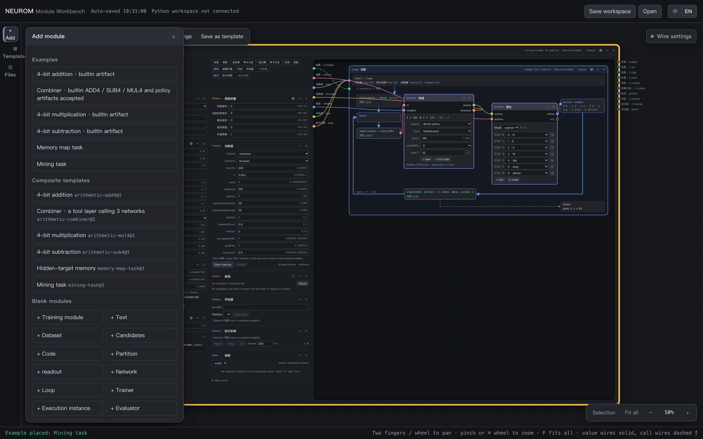
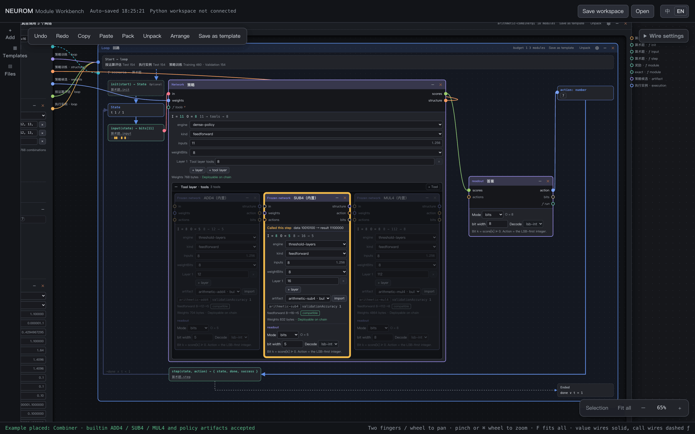
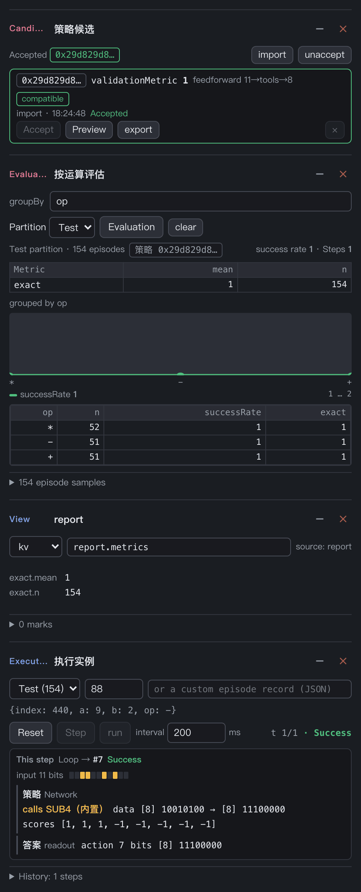
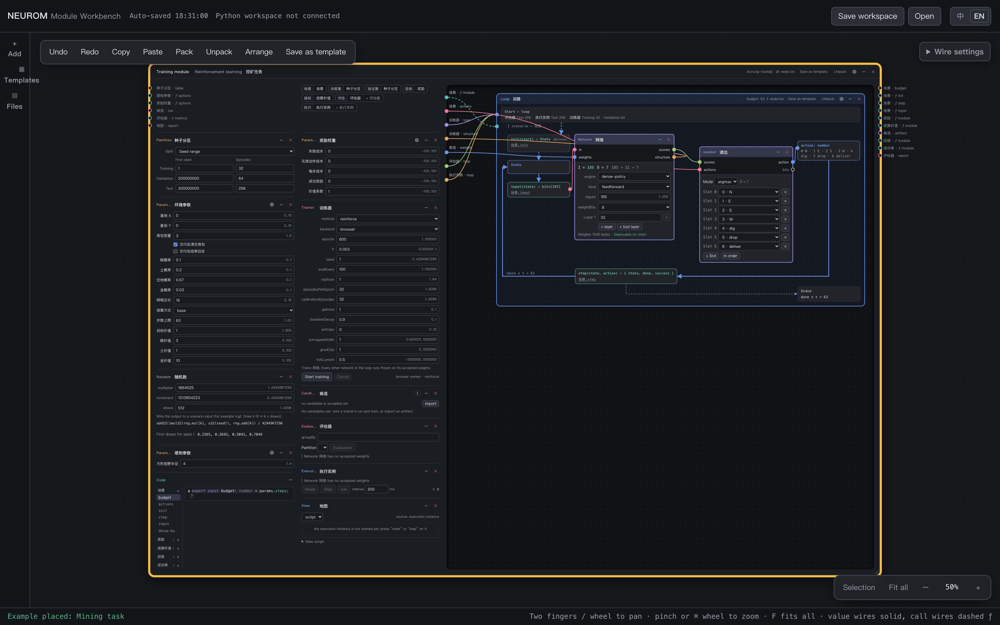
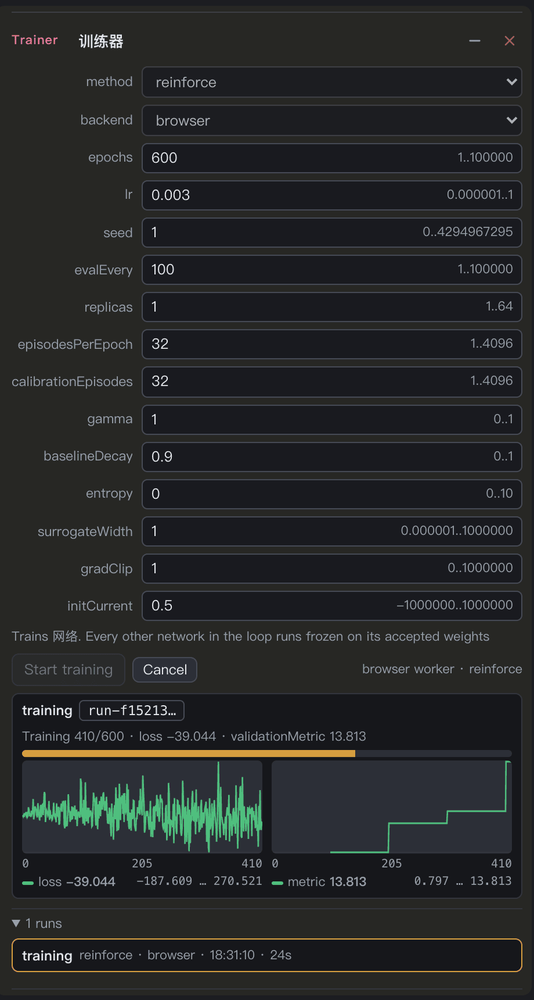
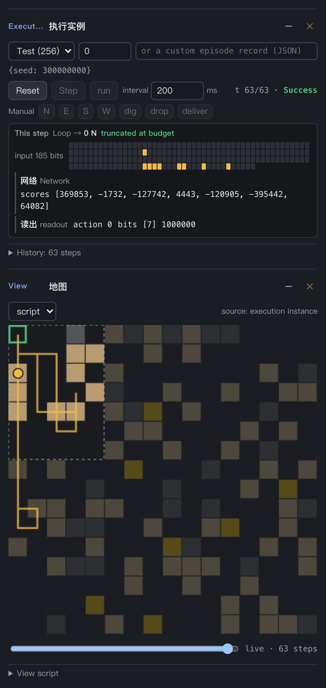
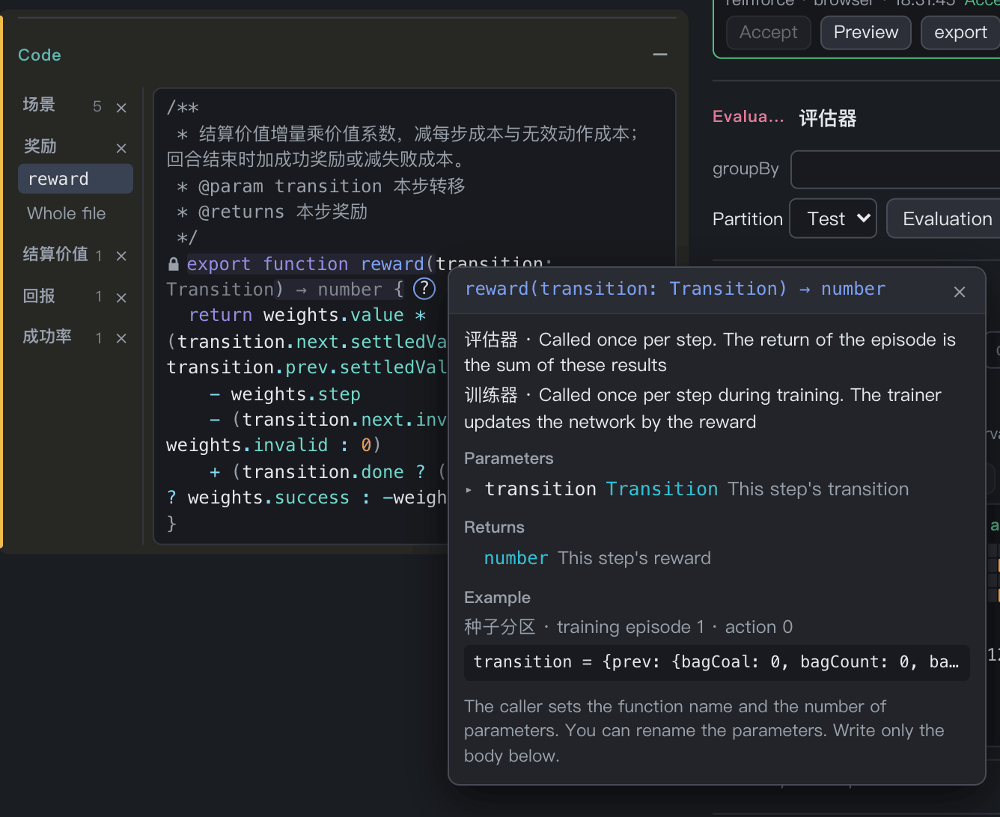
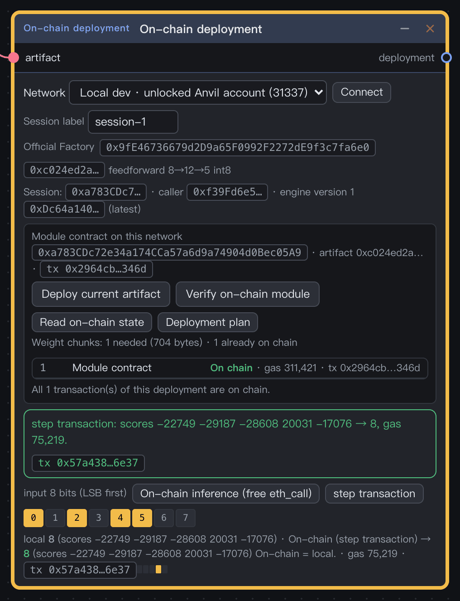

# User guide

[中文](user-guide.md) · **English**

This guide tells you how to install, try and test the Neurom workbench. Each section tells you where to click and what you must see. The [frontend guide](../frontend/README.en.md) gives all the canvas operations. [CONTEXT.md](../CONTEXT.md) gives the terms.

## Contents

1. [Prepare](#1-prepare)
2. [Start the workbench](#2-start-the-workbench)
3. [Five minutes with the combiner](#3-five-minutes-with-the-combiner)
4. [Train your first model: mining](#4-train-your-first-model-mining)
5. [Change the rules](#5-change-the-rules)
6. [Train in Python](#6-train-in-python)
7. [Deploy on a local chain](#7-deploy-on-a-local-chain)
8. [Save, share and templates](#8-save-share-and-templates)
9. [Keyboard shortcuts](#9-keyboard-shortcuts)
10. [Script module](#10-script-module)
11. [Builtin tasks](#builtin-tasks)
12. [Troubleshooting](#troubleshooting)

## 1. Prepare

| Tool | Version | When you need it |
|---|---|---|
| Node.js | ≥ 22.12 | always |
| Python | 3.12 (the CI version) | only for Python training |
| Foundry (`forge`, `anvil`) | ≥ 1.8.0 | only for on-chain deployment or the contract tests |
| Browser | a recent Chrome, Edge or Safari | always |

Install the dependencies in the repository root:

```sh
npm ci
```

## 2. Start the workbench

There are three ways to start. Use the first one first.

| Way | Command | Address | Use it for |
|---|---|---|---|
| Dev server | `npm run dev` | the address that the terminal shows, default `http://localhost:5173/` | trying, changing the source |
| Single file | `npm run build`, then open `frontend/dist/neurom-studio.html` | `file://…` | offline demos, browser training only |
| Python Workspace | see [section 6](#6-train-in-python) | `http://127.0.0.1:18766/` | Python training |

Do not serve the `frontend/` sources with `python -m http.server`. The sources contain TypeScript and Vue SFCs, and a browser cannot run them directly.

When the page opens, you see these areas:

- Top bar: workspace status, "Save workspace", "Open" and the language toggle "中 / EN".
- Left navigation: the three drawers "Add", "Templates" and "Files".
- Middle: the canvas.
- Bottom right: "Selection", "Fit all" and the zoom level.
- Bottom: the status bar. When the canvas refuses a wire, the status bar gives the reason.

<p align="center"></p>

## 3. Five minutes with the combiner

The combiner comes with builtin artifacts, so you see results without training.

1. Open `http://localhost:5173/?preset=arithmetic-combiner`. You can also click "Combiner · builtin ADD4 / SUB4 / MUL4 and policy artifacts accepted" under "Examples" in the "Add" drawer.
2. Press `F`. The canvas shows the whole training module.
3. In the left column, find the evaluator "按运算评估" and click "Evaluation".
4. In the execution, set the episode index to `88`.
5. Click "Reset", then click "Step".
6. Select the loop box on the right, then click "Selection" at the bottom right. The canvas zooms to the loop box.

You must see these results:

- Evaluation report: 154 episodes in the test partition, `exact` mean 1. Grouped by `op`, the three groups `*`, `−` and `+` are all 1.
- Execution: the test episode at index 88 is `{index: 440, a: 9, b: 2, op: −}`. This step "calls SUB4（内置）", the `action` of the answer is 7, and the result is "Success".
- Loop box: SUB4 is highlighted, and ADD4 and MUL4 are dimmed. `State` shows `t 1 / 1`, and `action` shows 7.

Module titles come from the template, so some titles stay in Chinese in the English interface.

<p align="center"></p>

<p align="center"></p>

## 4. Train your first model: mining

The mining task has no builtin artifact. You train a network yourself.

1. If the workspace has content that you want to keep, click "Save workspace" first.
2. In the "Files" drawer, click "Clear entire workspace".
3. Open `http://localhost:5173/?preset=mining-task`.
4. On the trainer, make sure that `backend` is `browser`.
5. Click "Start training". The trainer shows a progress bar, the loss curve and the validation metric curve.
6. When the training is complete, click "Accept" on one candidate.
7. On the execution, click "Reset", then click "run".
8. Look at the map view. The view draws the path of the player, the view square and the base.

<p align="center"></p>

Reference results (seed 1, 600 epochs, headless Chrome on Apple Silicon):

- The training takes about 35 seconds.
- The validation metric `validationMetric` is 17.859.
- Test episode 0 runs all 63 steps, and the result is "Success".

The results can be different for each run and each seed. Mining has no pinned numbers.

<table>
  <tr>
    <td width="50%" valign="top"></td>
    <td width="50%" valign="top"></td>
  </tr>
</table>

Training only produces candidates. The weights go to the network only after you accept a candidate. Changes to the canvas after the start do not affect a running training.

To continue training from accepted weights, connect the `weights` of a candidates module to the `init` of the trainer. The next run then starts from that artifact, not from random weights. The trainer validates the start first, as epoch 0. Only a better epoch replaces the start. The artifact must have the network structure and the readout of the trained network. If not, the trainer shows a problem (ADR 0020).

To make a run wait until the earlier stage passes, connect the `report` of an evaluator to the `gate` of the trainer. Then, in the trainer, select a metric of that evaluator and write a minimum (≥) or a maximum (≤). When you click “Start training”, the trainer reads the current report of that evaluator. In these cases the run does not start, and the trainer shows the reason below the button:

- There is no report.
- The report is stale: the bundle of the evaluator changed after the evaluation.
- The report has no such metric.
- The metric does not meet the condition.

The trainer checks the condition only at the start. A change of the report during a run does not stop the run. This is the same for the browser backend and the Python backend: the workbench checks the condition before it gives the run to the backend. A report is session state, and the workspace does not keep it. Thus, after you open the page again, click “Evaluation” on the evaluator before you start a gated run (ADR 0020).

CAUTION: Do not close the page during training. Browser training runs in a Web Worker, and a closed page stops the training. After you open the page again, the run shows as failed.

## 5. Change the rules

The rules are in the modules of the left column of the training module. You change these modules, not the code.

- Environment parameters: grid side, step limit, bag capacity, resource probabilities, values and settlement.
- Perception parameters: the square view radius.
- Reward weights: step cost, invalid-action cost, success reward, failure cost, value coefficient.
- Code: the scenario (`init`, `input`, `step`, `budget`, `actions`), the reward and the metrics.

The declaration of a parameter gives its range. When a value is out of range, the module shows an error, and the canvas does not let you pack.

Code modules have role pages. Each function that another module calls by protocol has a vertical tab.

- The protocol locks the function header. You can rename a parameter, but you cannot add or remove one.
- Click **?** at the end of the line to open the help window. The window tells who calls the function and when, the parameters, the return value and an example from a real run.
- Hold the pointer over a name to see its type and description.
- A wavy line marks a type error, and the error list is below the editor.

<p align="center"></p>

After you change the scenario, `budget` or the episode kind of a driving partition, the candidates module marks old artifacts as "Different environment". Then you must train again.

## 6. Train in Python

The Python backend uses PyTorch to train the same training bundle.

1. Build the single-file page:

   ```sh
   npm run build
   ```

2. Install the Python dependencies:

   ```sh
   python3 -m venv ~/.cache/neurom-venv
   ~/.cache/neurom-venv/bin/python -m pip install -r training/requirements.txt -r training/requirements-torch.txt
   ```

3. Start the Workspace:

   ```sh
   ~/.cache/neurom-venv/bin/python training/workspace.py --port 18766
   ```

4. Open `http://127.0.0.1:18766/`. The top bar shows "Python workspace connected".
5. On the trainer, set `backend` to `python`, then click "Start training".

The dev server proxies `/api` to `127.0.0.1:18766`. So while the Workspace runs, a page from `npm run dev` can also train in Python. The Workspace holds the Python runs. After you reload the page, the page connects to these runs again.

The [AI / Python training guide](ai-module-training.en.md) gives offline training, the bundle format and a task brief for an AI.

## 7. Deploy on a local chain

This section deploys ADD4 on a local Anvil node, then sends one step transaction.

1. In the first terminal, start Anvil:

   ```sh
   anvil --network monad --port 18545
   ```

2. In the second terminal, deploy the protocol contracts. If the node is freshly started, you must do this step first.

   ```sh
   cd contracts
   forge script script/Deploy.s.sol --rpc-url http://127.0.0.1:18545 --unlocked --sender 0xf39fd6e51aad88f6f4ce6ab8827279cfffb92266 --broadcast
   ```

   The `factory` in the output must be `0x9fE46736679d2D9a65F0992F2272dE9f3c7fa6e0`. This is the official factory of 31337 in `frontend/chain.js`.

3. On an empty canvas, open `?preset=arithmetic-add4`.
4. In the "Add" drawer, under "Blank modules", click "+ On-chain deployment".
5. Drag a wire from the `cands · artifact` port on the right side of the training module to the `artifact` input of the deployment module.
6. On the deployment module, select the network "Local dev · unlocked Anvil account (31337)" and click "Connect".
7. Click "Deploy current artifact". Then click "Verify on-chain module".
8. Under "input 8 bits (LSB first)", turn on bits 0, 2, 4 and 5. This means a = 5 and b = 3.
9. Click "On-chain inference (free eth_call)", then click "step transaction".

You must see these results:

- Deployment plan: 1 weight chunk (704 bytes). The 1 transaction of the deployment is on chain.
- The result of the step transaction is 8, and the module writes "On-chain = local."
- We measured 75,219 gas for one step.

<p align="center"></p>

Deploy, step and reset are transactions. Read-only previews are eth_call. Local dev uses the unlocked Anvil test accounts and does not open a browser wallet. The testnet and the mainnet have no official factory yet, so you cannot deploy or verify on these two networks.

CAUTION: Do not expose an unlocked Anvil node to the internet. If you do, anyone can send transactions from the unlocked accounts.

## 8. Save, share and templates

- The workspace saves itself in the `localStorage` of the browser (key `neurom-workbench`). Artifacts are large, so they go into the IndexedDB of the browser (`neurom-artifacts`) by their content id, and `localStorage` keeps only their ids. The artifacts in IndexedDB are not deleted automatically. Each port and domain has its own save.
- "Save workspace" exports the whole workspace as a JSON file. "Open" imports this file. To use a workspace at a different address, export it first, then import it.
- If a file does not open, the status bar gives the format, the error location and the reason. The current workspace does not change.
- Select modules or a composite, then click "Save as template" to get a template. In the "Templates" drawer, you can instantiate, fork, import and export YAML templates.
- An instance does not follow later changes of its template. The title of each composite shows its source `template id@revision`.

## 9. Keyboard shortcuts

| Action | Keys |
|---|---|
| Fit all | `F` |
| Reset to 100% | `0` |
| Zoom | `⌘ / Ctrl` + wheel, or `+ / −` |
| Pan | wheel, two-finger swipe, middle-button drag, or hold Space and move the pointer |
| Undo / redo | `⌘ / Ctrl Z` / `⌘ / Ctrl Shift Z` or `⌘ / Ctrl Y` |
| Copy / paste | `⌘ / Ctrl C` / `⌘ / Ctrl V` |
| Select all | `⌘ / Ctrl A` |
| Pack / unpack | `⌘ / Ctrl G` / `⌘ / Ctrl Shift G` |
| Delete the selected modules or wire | `Delete` or `Backspace` |
| Add a reroute point on a wire | Alt + click, or double-click the wire |

## 10. Script module

A script module runs JavaScript that you write and draws the result as views. It does inference only. No training bundle contains it, and it does not change an environment hash (ADR 0019).

1. Click 「添加」.
2. Click 「脚本模块」.
3. Click 「单步」.
4. Click 「运行」.
5. Click 「暂停」.
6. Click 「重置」.
7. Click 「✎ 编辑代码」.
8. Type a file name below the file list.
9. Click 「＋ 文件」.
10. Click 「保存并重新运行」.

The results of the steps:

- The new module has a counter example.
- 「单步」 increases the count and 「第 n 轮」 by 1.
- 「运行」 increases the count continuously, and 「暂停」 stops it.
- 「重置」 starts `main` again, and the count goes back to 0.
- The left side of the editor is the file list, and the right side is the code.
- 「保存并重新运行」 starts the script again with the new code. 「取消」 discards the changes that are not saved.

You cannot delete `main.js`.

The default export of `main.js` is `{ layout, views, main }`:

- `layout`: the `columns`, `rows` and `areas` of a CSS grid. If there is no `layout`, the views go in a grid that wraps automatically.
- `views`: maps the cell names of `areas` to Vue components. Each component gets two props, `state` and `run`.
- `main(ctx)`: the loop that you write. Start each round with `await ctx.frame()`. `ctx.state` is the reactive data that the views read.

```js
import { Controls } from '@ui';
import { Board } from './views.js';

export default {
  layout: { columns: '1fr 160px', rows: '1fr', areas: ['board side'] },
  views: { board: Board, side: Controls },
  async main(ctx) {
    ctx.state.t = 0;
    while (true) {
      await ctx.frame();
      ctx.state.t += 1;
    }
  },
};
```

`run` has these members:

- `reset()`, `step()`, `play()`, `pause()` and `toggle()`: reset, step, run, pause, and change between run and pause.
- `steps`: the current round count.
- `running`: true while the rounds run continuously.
- `done`: true when `main` is at its end.

`import { Controls } from '@ui'` gives the built-in run buttons. Files import each other with `import`, for example `import { Board } from './views.js'`. An imported name holds the value at the time of the import.

Drag the bottom-right corner of the module to change its size. The views adapt to the size. When the script fails, the module shows the file, the line and the error message below 「✎ 编辑代码」. The script runs in the sandbox of a view script. It cannot get access to the workbench, the storage or the network.

### Inputs: call networks and code functions

A script module can call the networks and code functions wired into it, and it can read the values wired into it.

1. Click 「✎ 编辑代码」.
2. Under 「函数输入」, type a name, for example `红方`, then click 「＋ 函数输入」.
3. Under 「值输入」, type a name, for example `p`, then click 「＋ 值输入」.
4. Click 「保存并重新运行」.
5. Wire the `ƒ run` of a readout, or a function that a code module exports, into a function input on the left of the module.
6. Wire a value (for example `params` of a Params module) into a value input.

The result of each step:

- Each name becomes a port on the left of the module. The port of a function input has ƒ.
- Under each name, the editor shows the module wired into it. A name that is not saved yet shows 「保存后生效」.
- When you rename, the wires follow the names: by position when the count of a list does not change, else by name.

In the script:

- `await ctx.call.<name>(…args)` calls a function input and gives its result.
- `ctx.values.<name>` reads a value input.

```js
const bits = await ctx.call.view(state, 0);
const out = await ctx.call.红方(bits);
const grid = ctx.values.p.grid;
```

The page runs each call outside the sandbox and sends only the result back to the script:

- A network runs through the `run` of its readout. The argument is an array of 0/1 bits, and the result is the bits of the readout. A bits readout and an argmax readout both work. The network uses its accepted weights. Each call starts from a zero state, so the network keeps no memory across calls.
- A code function runs its program and reads the inputs and constants of its file. The arguments can be numbers, booleans, strings, arrays and records.
- After 「重置」, the calls of the old run that have no reply yet are dropped.

The module reports a problem when:

- A function input is declared but not wired.
- A name is declared two times, or as a function input and as a value input.
- A trainer trains the network that is wired in. As for a tool layer, such a network cannot be called. Freeze a copy: add another network module with the same structure, and wire its `weights` to the candidates.

A call of a name that is not declared, a read of a value input that has no value, and a call that fails give the script an error at that line. An error that the script does not catch shows below 「✎ 编辑代码」.

When a function that a scenario exports is wired to a script module, the scenario check does not report it as a misspelt role.

## Builtin tasks

### Mining

Mining (`mining-task`, REINFORCE): the player digs dirt / coal / gold on a grid. The player can stop in place or deliver at the base. Environment parameters include:

- A 2–16 grid side.
- Steps.
- Bag capacity.
- Resource distribution and values.
- Settlement.
- Base.
- Target value.
- Whether a delivery ends the episode.

The only perception parameter is the square view radius (1..4). Reward coefficients are a separate params module.

The default rules (ADR 0018):

- A 16×16 grid, 63 steps, bag capacity 3.
- Empty / dirt / coal / gold probabilities 0.67 / 0.2 / 0.1 / 0.03.
- Values: dirt 1, coal 2, gold 10.
- Settlement at the base, target value 1.
- "交付后结束回合" (a delivery ends the episode) is off by default. A delivery empties the bag and the episode continues to the step budget, so the player can make several trips.

The `input` of the scenario module encodes 185 input bits:

- Coal and gold of each cell in a 9×9 square view, one bit each (81 + 81 bits). Dirt and empty cells read 0. Cells beyond the radius or off the map read empty.
- The x / y offset of the base (5 bits each, +15).
- The dirt / coal / gold in the bag (2 bits each, saturating at 3).
- Bag full (1 bit).
- Steps left (6 bits).

`input` gives no direction or distance to the nearest target. Delete a line, and the network does not get that item. You can also replace the item with same-width zeros to keep the layout. Environment and perception parameters never enter the network.

The network has 7 action slots. A slot marked "invalid" in the readout map is an invalid action that spends a step. Map random numbers come from the 32-bit linear congruential tables of the random module and are bit-exact in the IR. The default network is FF 185→32→7 (`dense-policy`, int8 weights). The reward is the increment of the settled value. Success = delivered at least once, target value 1.

### Memory map

Memory map (`memory-map-task`, cross-entropy): a 6×6 grid, start (2,2). The target is one of the other 35 cells. An episode has three parts:

- Preview: the target shows once, then it is hidden.
- Wait: D waits.
- Search: at most 8 steps to find the target.

Actions during preview and waiting do not move the player. After the target is hidden, `input` does not encode the target. The shortest-path teacher `target(state)` reads the target directly from the state to make training labels. The network never sees the target. The default network is LIF 55→32→7 with int16 weights (`weightBits: 16`). Memory map has no builtin artifact.

The evaluator groups by delay to give a retention curve. The test partition has 35 targets × delays 0/1/2/4/8/16 = 210 episodes.

Results are different for each run and each seed. This is a memory diagnostic over a finite domain, not generalization to new maps.

### Four-bit arithmetic

Four-bit arithmetic (`arithmetic-add4 / sub4 / mul4`, hinge): three threshold networks with the structures 8→12→5, 8→16→5 and 8→112→8. Each question is one step. All 256 pairs are enumerated. The builtin artifacts are int8 at 100%.

### Combiner

Combiner (`arithmetic-combiner`, REINFORCE): the questions are `op ∈ {*, +, −}` × a × b, 768 in total. The index mod 5 splits them into training / validation / test. The policy network is a single tool layer `{ tools: tools, data: 8 }`. The decision head of the tool layer reads the 11 input bits `op ‖ a ‖ b` directly. The decision head picks one of the frozen builtin ADD4 / SUB4 / MUL4 and the 8 data bits to give it.

Only the chosen network runs. The result bits of the chosen network (zero-extended to 8) are the answer. The builtin policy artifact (int8) answers all 154 test questions correctly. On each question, it picks the matching network and gives it exactly a‖b.

### Tank battle

Tank battle (`tank-battle`, training in stages): a tank battle with the rules of Botzone Tank2. Each side has 1 tank with 2 lives. There is a base at each end of the map. The template has 4 training modules, and each training module trains one network. Stage 1 · 模仿 (imitation) and stage 2 · 对战训练 (battle training) each have one for 中 and one for 大. The two stages play the same battle: the network drives the tank of side 0, and the bot of the scene drives the tank of side 1. Stage 1 imitates the teacher of the scene with cross-entropy. Stage 2 starts from the weights of stage 1 (ADR 0020) and plays against the bot with reinforcement learning. After the training, the script module 坦克对战 plays 中 against the hard bot, or the two stage 2 networks against each other (ADR 0019).

The scenario module holds the rules. They follow [Botzone Tank2](https://wiki.botzone.org.cn/index.php?title=Tank2), with only 4 differences: each side has 1 tank instead of 2, each tank has 2 lives, an illegal action counts as wait instead of a loss, and in the step after a clash both sides move or wait at random. ADR 0024 gives the reasons for these rules and for the map.

- The map is 9×9. A cell is empty, brick, steel, water or a base. The fixed part: the base of side 0 is at the bottom centre (4, 8), and the base of side 1 is at the top centre (4, 0). The cells to the left, right and front of each base are bricks, and the middle column is bricks too. This is the same as the fixed part of Tank2. In the middle row, only the two cells (3, 4) and (5, 4) are bricks, and the other cells are steel and water. Thus both sides must go through these two passages, and they often meet in the middle. The two top rows and the two bottom rows are also fixed.
- The banks of the river (rows 2, 3, 5 and 6, without the middle column and the water at the map edge) are random in each episode. The seed selects the 7 cells of the top-left quarter. Each cell is mirrored left to right, then turned 180°, so one cell selects 4 cells of the full map. Thus the map is symmetric left to right, and it does not change when it turns 180°. At most 2 of the 7 cells are steel or water (half steel, half water). Each of the other cells is a brick with the probability 1/2. The cell (3, 3) in front of the passage never gets steel or water, and (1, 2) and (2, 3) never get them both. Thus a tank can always get to each empty cell and each brick. The seeds 1 to 200 give 190 different maps.
- The tank of each side starts on one of the 10 empty cells in the two bottom rows of its side. The seed selects the start cell of each side.
- There are 9 actions: move one cell up, right, down or left, fire up, right, down or left, and wait. The facing of a tank is only used for drawing. The direction of a shot is in the action.
- An illegal action counts as wait: the target cell of a move is not empty or has a tank when the action is given, or the tank fired in the last step and fires again (the cooldown of fire is 1 step).
- In one step, the moves are resolved first, then the shots. The two tanks can go into the same empty cell at the same time, and then they overlap. Tanks that overlap cannot hit each other.
- A bullet is a ray. In the same step, it hits the first cell that is not empty and not water: a brick or a base is removed, a tank is hit, and steel or the map edge does not change. A bullet flies over water. A bullet does not know friend from enemy, so it can also remove its own base.
- Clash: when both sides fire, and each shot hits the tank of the other side, the two shots cancel each other. The shots of both sides do not count, so neither side has a cooldown.
- The step after a clash: neither side uses its own action. Each side selects one of the 4 moves and wait at random, and it cannot fire. The random numbers come from the episode seed, the step and the side, so an episode gives the same result again. With only 1 tank on each side, two tanks that face each other clash until the steps run out. This step breaks the deadlock.
- A tank that is hit loses 1 life. If it still has a life, it goes back to its start cell at the end of this step, and it acts as usual in the next step.
- A side loses when its base is destroyed or when it has no lives. When both sides lose in the same step, or when the episode gets to the step limit (100), the battle is a draw.
- On each step, the scene writes the shot of each side to `trails` in the state: the start cell, the direction, the number of the cell that it hit and what it hit. The hit can be a brick, steel or the map edge, a base, a tank, or a clash that cancels. `hits` lists the tanks that are hit in this step.

The rules of the training (`step` of the scene) are the same as the rules of the battle. `success` is true when the network wins.

`input` gives the 572 bits that side 0 sees, and the full map is visible. The first 567 bits are 7 channels of 81 bits (1 bit for each cell, row by row): bricks, steel, water, our base, enemy base, our tank, enemy tank. Then come 5 bits: our tank fired in the last step, the enemy tank fired in the last step, our tank has 2 lives, the enemy tank has 2 lives, and the bias.

The Params module 参数 holds 回合步数 (steps), 教师的难度 (level of the teacher), 对战机器人的难度 (level of the bot) and 对战机器人的随机动作概率 (random-action probability of the bot, 0.1). The two levels are 3 (hard) by default.

#### The 3 levels of the bot

The rules of the bot are `good(state, k, level)` in the scene. It gives the actions that are equally good for side k in this step. `level` is the level: 1 easy, 2 medium, 3 hard. Each level examines the rules in this order and uses the first rule that gives an action:

1. Win: if a shot can hit the base of the other side, fire.
2. Hit the tank: if a shot can hit the tank of the other side, fire.
3. Dig: if the tank stands on the line of the base of the other side (the cells from the base up to the steel or the map edge), and the first cell towards the base is a brick, fire to remove it.
4. Walk: go along a shortest path to the nearest aim cell. If the next cell on the path is a brick, fire to remove it.
5. If no rule gives an action, wait.

The bot never fires along the line of its own base, and it does not walk through a brick on this line. Each level adds rules to the rules of the level below it:

- Easy: it only hunts the tank. The aim cells are the cells from which it can hit the tank of the other side directly. It does not look at danger.
- Medium: it attacks. The aim cells are the cells from which it can dig to the base of the other side. When the other side can fire in the next step, the cells on the ray of the other side are not safe. It does not go into an unsafe cell. When it stands in an unsafe cell, it dodges first: it moves to a safe cell, or it fires at the other side (when the other side also fires, the two shots clash and cancel). It compares the steps that each side needs to get to a cell from which it can dig to the base of the other side. If the other side needs fewer steps, it defends: the aim cells are the cells from which it can hit the tank of the other side, and it does not dig.
- Hard: it counts the path by the steps that it really costs. A move into a brick counts as 2 steps (first fire to remove it, then move in). To dig to the base of the other side from a cell, each brick in between adds 2 steps (fire, then 1 step of cooldown). Thus it selects the faster path and the faster line, and it compares the steps of the two sides more exactly. Also, when the other side can hit our base directly in the next step, it moves between the other side and the base to block the shot. When it already blocks in the middle, it does not dodge. It fires at the other side, or it waits when it cannot fire.

The bot `bot(state, 1, level)` selects one of the equally good actions at random. Then, with the random-action probability, it does a random action instead. The random numbers come from the episode seed, the step and the side.

The 3 levels against each other on the seeds 1 to 200 (the rules of the training). Neither side does random actions. Each cell is the win / loss rate of side 0:

| Side 0 \ side 1 | Easy | Medium | Hard |
| --- | --- | --- | --- |
| Easy | 0.31 / 0.36 | 0.27 / 0.61 | 0.235 / 0.61 |
| Medium | 0.565 / 0.315 | 0.36 / 0.37 | 0.29 / 0.47 |
| Hard | 0.525 / 0.285 | 0.455 / 0.29 | 0.33 / 0.375 |

In each row, from left to right, side 0 loses more and more. In the medium and hard columns, from top to bottom, side 0 wins more and more. Against the easy level, the hard level wins a little less than the medium level, but it also loses less. The other episodes are draws. Many draws get to step 100: the two tanks wait on the two sides of a brick in a passage, because the side that removes the brick first is hit by the other side. The main advantage of the hard level is the more exact path count. The block rule rarely triggers. These methods were also tried, and none of them made the hard level stronger: a search of one simultaneous step (9 actions for each side, with the worst result for each action), defence also when the steps are equal, and no clash while it dodges.

#### Stage 1 · 模仿

The teacher `teacher(state)` is a function that the scene exports. It gives the target bits of the 9 action slots of side 0: each action that `good(state, 0, level of the teacher)` finds equally good is 1.

Stage 1 · 模仿 has two training modules, for 中 and 大. Each frame has one trainer and one loop box:

- 中 is FF 572→32→32→9.
- 大 is FF 572→128→128→128→9.

Both networks use `dense-policy` and int16 weights. The argmax readout maps the 9 slots to the actions 0 to 8. Both trainers use cross-entropy, the objective is the `teacher` of the scene, and exploration is 0.1. No metric connects to the trainers, so each trainer keeps the model with the highest greedy accuracy on the validation seeds. The other settings of the two trainers are different:

- 中: 5000 epochs, 16 episodes per epoch, lr 0.005.
- 大: 2500 epochs, 16 episodes per epoch, lr 0.003.

Each structure has its own candidates, evaluator, report, execution and replay. The reward of the evaluator is `agreement(transition)` of the scene: 1 when the action of the network is in the target bits of the teacher, and 0 if not. Thus the return of an episode is the number of steps that agree with the teacher. The evaluator reports 5 metrics on 256 fixed test seeds: 和教师一致的比例 (agreement with the teacher, the return divided by the steps), 胜率 (win rate), 击毁对方坦克的比例 (share with the tank of the bot destroyed), 我方坦克被击中的比例 (share with our tank hit) and 平局的比例 (share of draws). The destroyed and hit shares count the episodes with at least one destruction.

The replay view draws the map (bricks, steel, water, the two bases) and the two tanks. The small dots below a tank are its remaining lives. The map comes from `cells` in the state, so a destroyed brick is not drawn. A destroyed base is grey with a cross. Below the map are the step, the actions of the two sides, the lives of the two sides and the result. Move the history slider of the view to see an episode step by step.

When the execution makes a step, the replay plays an animation of that step. The tanks act first, so a tank slides one cell in the first half of the step. In the second half, the bullets fly along `trails` at a constant speed to the cell that they hit. A brick or a base disappears when the bullet gets to it. At the stop of a bullet, a short effect shows: a brick breaks, steel gives a spark, a tank or a base explodes, or a clash gives a flash. A tank that is hit disappears when the bullet gets to it. If it still has a life, it appears at its start cell.

The duration of the animation of one step is the mean of the last 4 intervals between the arrivals of steps, limited to 80 to 600 ms. When the interval is more than 600 ms (for example, a single step), the duration is 200 ms. If a new step arrives before the animation of the last step ends, the last step ends in 40 ms, and then the new step plays. Thus the display can be later than the computation, but it does not skip a bullet. When more than 8 steps wait, each step plays for one frame only. When you move the history slider, the replay goes directly to the selected step, without animation.

There is one scene, one Params module, one 奖励参数 (reward parameters) module, one seed partition and one set of 5 metrics. They are outside the frames of the training modules, and they connect to all loops, trainers and evaluators. Thus the scene holds the only copy of the rules. Each frame lists the shared modules that it uses in its slots, for example “场景 · 场景”. Each loop box shows `ƒ scenario ← 场景`.

#### Stage 2 · 对战训练

Stage 2 · 对战训练 (battle training) also has two training modules, for 中 and 大, to the right of stage 1. Each frame has one trainer and one loop box. The networks and the loops are the same as in stage 1. Both trainers use REINFORCE.

Two inputs of the trainer connect the stages:

- `init` takes the `weights` of the stage 1 candidates of the same structure. The training starts from the weights that stage 1 accepted, and it does not calibrate the biases.
- `gate` takes the report of the stage 1 evaluator of the same structure. The condition is `{ metric: 和教师一致的比例, min: 0.7 }`. The map is random in each episode, so stage 1 only gets to about 0.75 for 中 and about 0.86 for 大 (the 256 episodes of the test partition). If there is no report, if the report is stale, or if the value is too low, the trainer does not start and tells why.

The rewards are in a separate Params module, 奖励参数. Thus a change to a reward does not change the bundles of stage 1, and its artifacts stay compatible:

- 赢的奖励 (reward for a win): 1.
- 输的奖励 (reward for a loss): −1.
- 击毁对方坦克一次的奖励 (reward for one destruction of the tank of the other side): 0.3.
- 我方坦克被击毁一次的奖励 (reward for one destruction of our tank): −0.3.
- 每步的代价 (cost of a step): 0.002.

The reward is `reward(transition)`, which the scene exports. A win gets 赢的奖励, a loss gets 输的奖励, and a draw gets 0. The step where the tank of the bot is hit also gets 击毁对方坦克一次的奖励. The step where our tank is hit also gets 我方坦克被击毁一次的奖励. Each step also subtracts 每步的代价, so a faster win gives a higher return.

The two trainers have the same settings: 2400 epochs, 32 episodes per epoch, lr 0.001, entropy 0.01, `gamma` 1. No metric connects to the trainers, so each trainer selects the model with the highest mean return on the validation seeds. The evaluator has the reward and 4 metrics: 胜率, 击毁对方坦克的比例, 我方坦克被击中的比例 and 平局的比例.

The order of the training:

1. In “训练器（中）”, click “开始训练” (start training).
2. When the training ends, click “接受” (accept) on a candidate in “候选（中）”.
3. In “评估器（中）”, click “评估” (evaluate).
4. When the gate of “训练器（中，阶段 2）” shows “已通过” (passed), click “开始训练” in that trainer.
5. When the training ends, click “接受” on a candidate in “候选（中，阶段 2）”.
6. In “评估器（中，阶段 2）”, click “评估”.
7. Do the same steps for the 6 modules of 大.

Results against the hard bot on 200 test seeds (node, trainer seed 1, the rules of the training). The random-action probability is the probability of the bot. The network does no random action. The win-rate columns give the win / loss / draw rates:

| Network | Time | Agreement with the teacher | Random-action probability 0.1 | Random-action probability 0 |
| --- | --- | --- | --- | --- |
| Wait only | | | 0 / 1 / 0 | 0 / 1 / 0 |
| 中, stage 1 | 1951 s | 0.763 | 0.39 / 0.54 / 0.07 | 0.185 / 0.58 / 0.235 |
| 大, stage 1 | 1082 s | 0.868 | 0.525 / 0.4 / 0.075 | 0.2 / 0.49 / 0.31 |
| 中, stage 2 | 874 s | 0.714 | 0.435 / 0.515 / 0.05 | 0.23 / 0.69 / 0.08 |
| 大, stage 2 | 1164 s | 0.691 | 0.58 / 0.365 / 0.055 | 0.32 / 0.54 / 0.14 |

- When the network only waits, the hard bot wins every episode.
- The map is random in each episode, so the networks play on maps that they have not seen. 大 is stronger than 中: it agrees more with the teacher in stage 1, and it wins more and loses less in both stages.
- Stage 2 increases the win rate of both networks. When the bot does random actions, 中 goes from 0.39 to 0.435, and 大 from 0.525 to 0.58. When the bot does no random action, 中 goes from 0.185 to 0.23, and 大 from 0.2 to 0.32. Both networks still lose more than they win against the hard bot, so there is room for improvement here.
- The stage 2 networks agree less with the teacher, because they no longer only imitate the teacher.
- The times are from node, with 2 trainings at the same time. In the browser, the time changes with the computer. The hard teacher and bot count more paths, so a step is about 2 times slower than at the medium level.

#### Battle

The battle has two frozen networks, “中（对战）” and “大（对战）”, with the same structures as in the training modules. Their `weights` come from the stage 2 candidates. A script cannot call a network that a trainer trains, so the battle uses separate network modules. The script module 坦克对战 has 6 function inputs and 1 value input:

- `红方` (red) and `蓝方` (blue): the readout `run` of the two networks. In the template, red is 中 and blue is 大.
- `机器人` (bot): `botMove(state, side, level)`, which the scene exports. It gives the action of side `side` at the level `level`, on the map of that side. It does no random action.
- `battle`, `view` and `play`: the battle functions that the scene exports.
- `设置` (settings): the Params module 对战设置 (battle settings). Its `opponent` selects blue: 0 is the network 大, and 1, 2 and 3 are the easy, medium and hard bot. It is 3 by default, so by default red (中) plays against the hard bot.

The rules of the battle are also only in the scene, and the battle uses the same code as the training. The battle is different from the training only in these items:

- Red is side 0, with its base at the bottom. Blue is side 1, with its base at the top.
- Neither side does random actions. In the training, the bot does random actions.

`view(state, side)` gives the 572 bits that one side sees, in the order of `input`. Blue sees the map turned 180°, so each side has its base at the bottom. `play(state, a, b)` gets the action of each side on the map of that side, and changes the action of blue into the world direction.

The script has 3 files:

- `main.js`: the layout and `main`. Each 「重置」 (reset) starts a new battle, and its seed is its number. `main` reads 设置 at the start of each battle. Thus, after you change `opponent`, click 「重置」, and the next battle has the new opponent.
- `game.js`: the flow of one battle. On each step, for a side that is a network, it calls `view` and that network. When blue is a bot, it calls `机器人`. Then it calls `play`. When the last step was a clash, `play` does not use the actions of the two sides. It makes each side move or wait one time at random. The random numbers come from the seed of the battle, so a battle gives the same result again.
- `views.js`: the 3 views. The battlefield shows the map, the two bases, the two tanks and their lives. The battlefield plays the animation of each step as the replay does, with the same rules for the duration. The side panel shows `Controls`, the battle number, the seed, the result and the state of both sides: the base, the cell of the tank, whether it can fire, and the lives. When blue is a bot, its name shows its level, for example “蓝方（困难机器人）”. The log shows the actions of both sides on each step, with `*` for the random step after a clash, and the result in the last line. The side panel and the log show the latest step directly.

To swap the places of the two networks, swap the wires of `红方` and `蓝方`.

The order of the battle:

1. Accept a candidate in “候选（中，阶段 2）”. If `opponent` in 对战设置 is 0, also accept one in “候选（大，阶段 2）”.
2. In “坦克对战”, click 「运行」 (run). When a battle ends, click 「重置」 (reset) for the next battle.

You can also click one time: click ▶ 「运行到这里」 (run up to here, ADR 0023) in the header of “坦克对战”. It goes up from this module:

- When a candidates module has a compatible accepted artifact, it does not train again.
- When nothing is accepted, it trains, then it accepts the candidate that the trainer selected.
- When a gate needs a report that is missing or stale, it evaluates first.

Then the script starts again and plays. The status bar shows each step. When a gate does not pass, the chain stops and tells why. The candidates, trainers, evaluators and executions in the training modules also have this button.

A headless script measured the battle on the seeds 1 to 200. It runs `game.js` of the battle script and the page side of its calls. The networks are the stage 2 networks (trainer seed 1). With a network as red and a bot as blue, each cell gives the wins, losses and draws of red in 200 battles:

| Red | Easy | Medium | Hard |
| --- | --- | --- | --- |
| 中 | 79 / 116 / 5 | 56 / 103 / 41 | 54 / 118 / 28 |
| 大 | 74 / 107 / 19 | 72 / 84 / 44 | 67 / 98 / 35 |

In each cell, 5 to 26 battles get to step 100. The other draws are battles where both sides lose in the same step. 大 wins more and loses less against the medium and the hard bot. With 中 as red and 大 as blue, red wins 72 battles, loses 97 and draws 31 (23 of them get to step 100).

`frontend/templates/artifacts/artifacts.test.js` pins the four-bit arithmetic and combiner numbers. Mining, the memory map and the tank battle have no pinned numbers. Scenarios run as interpreted IR, and the cost is training speed. [Section 11 of the design document](design.en.md#11-correctness-and-performance) shows the main work of each step.

`frontend/templates/tank-battle.test.js` checks the rules through the runner and through the calls of the script module. The rule checks are:

- The seed selects the map of each episode: the fixed part does not change, the random part is symmetric left to right and does not change when it turns 180°, at most 2 cells of the quarter are steel or water, and each empty cell and each brick can be reached. Each tank is on the start cell that the seed selects, with 2 lives. Blue sees the same bits as red sees in the turned battle. The rules are the same for both sides.
- A move into a brick, steel, water, off the map or the cell of a tank is wait. The two tanks can go into the same empty cell and overlap, and tanks that overlap cannot hit each other.
- A bullet hits the first cell that is not empty and not water: it removes a brick or a base, steel does not change, and it flies over water. A shot during the cooldown is wait. Moves come before shots, so a tank that leaves the ray in this step is not hit.
- In a clash, both shots cancel, and neither side counts as fired. In the next step, each side moves or waits at random, and it does not use its own action. Different seeds give different random steps. When only one side hits, it hits the other tank.
- A hit loses 1 life, and the tank goes back to its start cell. The battle ends at the second hit, when a base is destroyed, or when the steps run out. A shot that removes its own base is a loss. When both sides lose in the same step, the battle is a draw.
- The trail of each shot agrees with the result of the rules: a brick, steel or the map edge, a base, a tank, a clash.
- A battle through the calls of the script gives the same result as direct calls of the scene functions and the networks.
- A swap of the wires swaps the places. A seed gives the same result again.

The checks of the teacher and the bot are:

- Each level fires when it can hit the base of the other side, digs bricks on the line of the base of the other side, and does not fire along the line of its own base.
- The medium and the hard level do not go into the ray of an other tank that can fire. When they stand in the ray, they dodge or clash. The easy level goes into it.
- The easy level only hunts the tank. The medium and the hard level attack the base of the other side, and they stop the other side when it is nearer to our base.
- The hard level counts the bricks and the cooldown of the dig into the steps: when the medium level finds two paths equally near, the hard level only takes the path that is really faster.
- The hard level blocks a direct shot of the other side at our base, and it stays in the middle. The medium level does not block.
- On the turned map, the action of the bot at each level is in the target bits of the teacher at the same level. When blue is a bot, each of its actions in the script is also in the target bits of the teacher at the same level.

The checks of the training are:

- The loops of the two stages have the same environment. The `init` of a stage 2 trainer takes the stage 1 candidates of the same structure. Its `gate` takes the stage 1 evaluator of the same structure. The gate does not pass at an agreement of 0.84, and it passes at 0.85. It also does not pass without a report or with a stale report.
- A change of the reward parameters does not change the environment of the stage 1 bundles.
- In a step of the training, the bot acts at the level in the Params module. `success` is true when the network wins, and it is not true at a loss or a draw. When the network only waits, the bot wins. A seed gives the same random actions again.
- The reward gives the win, the loss or 0 by the result. It gives the destruction rewards by the hits of this step. Each step subtracts the cost of a step.
- The agreement with the teacher is the share of the steps where the action of the network is in the target bits of the teacher. The other 4 metrics come from the final state.

### What is learned and what is designed

| Component | Nature | Evidence |
|---|---|---|
| ADD4 / SUB4 / MUL4 modules | trained threshold neural networks (8→12→5, 8→16→5, 8→112→8). QAT, int8 weights with a scale per layer | 100% over all 256 pairs |
| The combiner's policy | learned: one tool layer has a decision head 11 → 3 choices + 8 data bits. The tool layer learns by REINFORCE which tool to call and which bits to give it. The tool weights are frozen. The reward looks only at the answer | template `arithmetic-combiner`. All 154 test questions are right. On each question, the right tool is picked and gets a‖b |
| Tool layers and bit wires | designed: a tool layer runs only the chosen tool on each step. It gives the zero-extended result to the next layers or out as the output. Bit wires slice and concatenate bit vectors | `frontend/core/loop.js`, `frontend/runtime/dense-policy.js`, module kinds `network` / `bits` |
| Mining / memory policies | learned: REINFORCE trains the mining FF 185→32→7, and cross-entropy trains the memory-map LIF 55→32→7. Both are integer networks | the user trains them on the canvas, no builtin artifact. Each training produces new candidates |
| Scenario rules | designed: the scenario module and other code modules in the templates | `frontend/templates/*.yaml` |
| The deploy button | local Anvil: deploy, verify, step and reset clicked for real. Public-chain signing is not verified | real receipts, event summaries and persistent potentials, checked item by item against the local integer results |

Modules are immutable. To improve a module, train a new module. Each module gets an exhaustive check over its own input space, and these checks make the composition correct.

## Troubleshooting

| Symptom | Cause | What to do |
|---|---|---|
| `?preset=…` places no example | The canvas is not empty. `preset` works only on an empty canvas | In the "Files" drawer, click "Clear entire workspace", then open the address again. You can also place the example from "Add → Examples" |
| The top bar shows "Python workspace not connected" | The Workspace does not run | Browser training still works. To train in Python, start the Workspace as [section 6](#6-train-in-python) tells |
| The dev server address is not 5173 | Port 5173 is in use, so Vite uses a different port | Use the address that the terminal shows. Each address has its own workspace save |
| The page is blank or shows a module error | `http.server` or `file://` serves the sources | Use `npm run dev`, or open the built `frontend/dist/neurom-studio.html` |
| A conflict panel opens with the page | The local workspace save does not restore | Click "Export local save" first. Then open a corrected file, or discard the local save |
| The execution or the evaluator says that the network has no accepted weights | Mining and the memory map have no builtin artifact | Train first, then click "Accept" on a candidate |
| A candidate shows "Different environment" | After the training, you changed the scenario, `budget` or the episode kind of a partition | Train again |
| Deployment does not work on the testnet or the mainnet | These two networks have no official factory yet | Use Local dev (Anvil) |
| Local dev cannot verify or cannot find the factory | The protocol contracts are not deployed on a freshly started Anvil node | Run `Deploy.s.sol` as step 2 of [section 7](#7-deploy-on-a-local-chain) tells |
