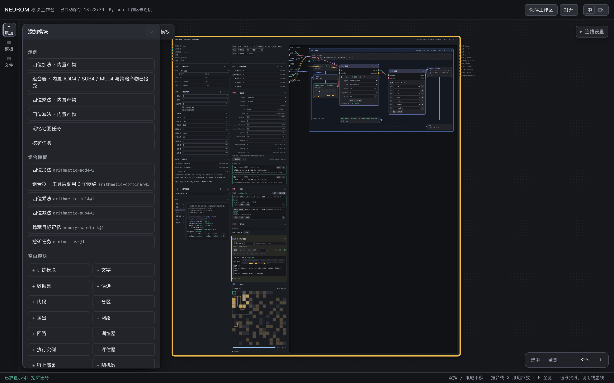
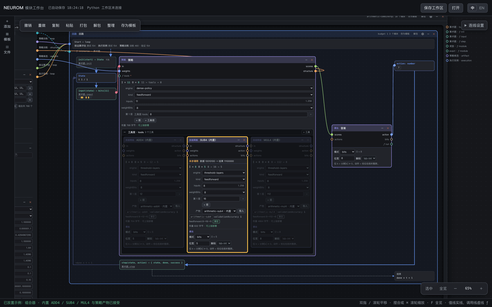
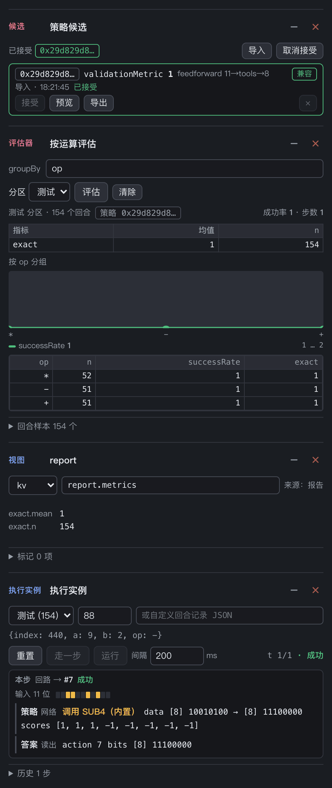
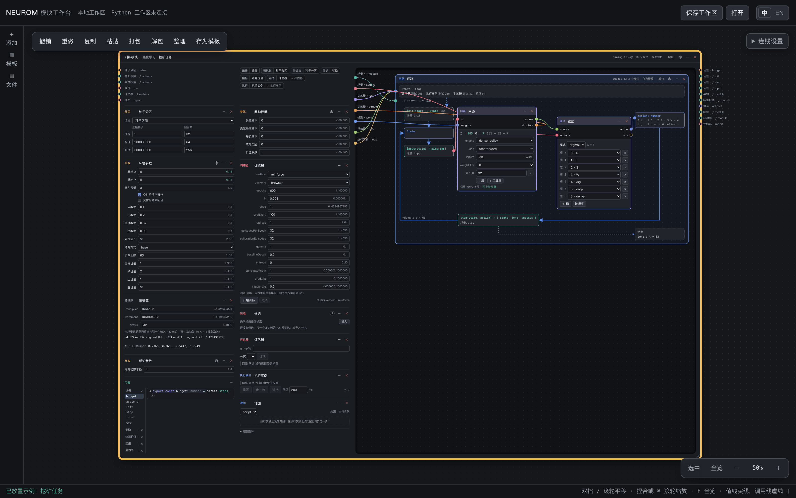
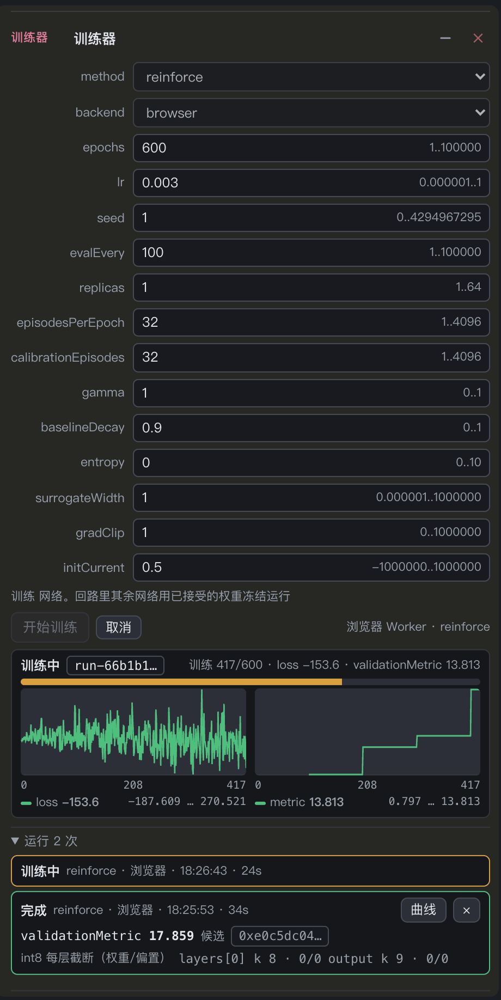
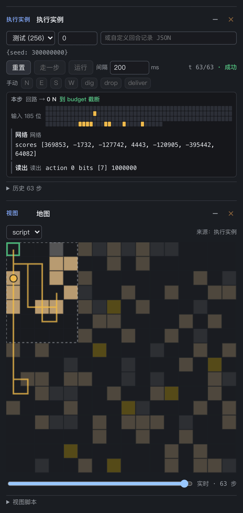
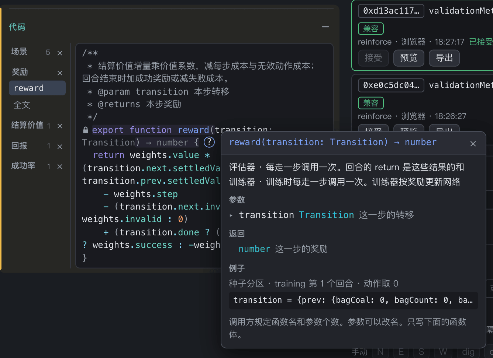
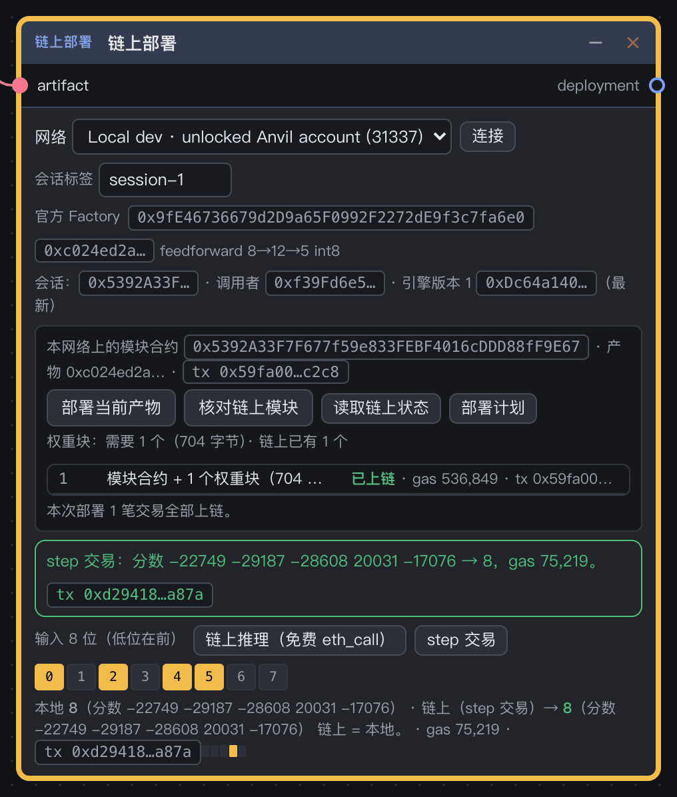

# 使用指南

**中文** · [English](user-guide.en.md)

本文教你安装、试用和测试 Neurom 工作台。每一节都写出要点哪里，以及你应该看到什么。画布操作的完整说明见 [前端操作说明](../frontend/README.md)。术语见 [CONTEXT.md](../CONTEXT.md)。

## 目录

1. [准备](#1-准备)
2. [启动工作台](#2-启动工作台)
3. [五分钟体验：组合器](#3-五分钟体验组合器)
4. [训练第一个模型：挖矿](#4-训练第一个模型挖矿)
5. [改规则](#5-改规则)
6. [用 Python 训练](#6-用-python-训练)
7. [部署到本地链](#7-部署到本地链)
8. [保存、分享和模板](#8-保存分享和模板)
9. [常用快捷键](#9-常用快捷键)
10. [脚本模块](#10-脚本模块)
11. [内置任务](#内置任务)
12. [常见问题](#常见问题)

## 1. 准备

| 工具 | 版本 | 什么时候需要 |
|---|---|---|
| Node.js | ≥ 22.12 | 一直需要 |
| Python | 3.12（CI 用的版本） | 只在用 Python 训练时需要 |
| Foundry（`forge`、`anvil`） | ≥ 1.8.0 | 只在部署到链上或运行合约测试时需要 |
| 浏览器 | 新版 Chrome、Edge 或 Safari | 一直需要 |

在仓库根目录安装依赖：

```sh
npm ci
```

## 2. 启动工作台

有三种启动方式。先用第一种。

| 方式 | 命令 | 地址 | 适合 |
|---|---|---|---|
| 开发服务器 | `npm run dev` | 终端显示的地址，默认 `http://localhost:5173/` | 试用、改源码 |
| 单文件 | `npm run build`，然后打开 `frontend/dist/neurom-studio.html` | `file://…` | 离线演示、只用浏览器训练 |
| Python Workspace | 见[第 6 节](#6-用-python-训练) | `http://127.0.0.1:18766/` | 用 Python 训练 |

不要用 `python -m http.server` 服务 `frontend/` 源码。源码里有 TypeScript 和 Vue SFC，浏览器不能直接运行它们。

页面打开后，你看到这些区域：

- 顶栏：工作区状态、「保存工作区」、「打开」和语言切换「中 / EN」。
- 左侧导航：「添加」「模板」「文件」三个抽屉。
- 中间：画布。
- 右下角：「选中」「全览」和缩放比例。
- 底部：状态栏。连线被拒绝时，这里写出原因。

<p align="center"></p>

## 3. 五分钟体验：组合器

组合器带有内置产物，所以不用训练就能看到结果。

1. 打开 `http://localhost:5173/?preset=arithmetic-combiner`。也可以在「添加」抽屉的「示例」里点「组合器 · 内置 ADD4 / SUB4 / MUL4 与策略产物已接受」。
2. 按 `F`，让画布显示整个训练模块。
3. 在左栏找到评估器「按运算评估」，点「评估」。
4. 在执行实例里，把回合下标改成 `88`。
5. 点「重置」，再点「走一步」。
6. 选中右边的回路框，再点右下角的「选中」，放大回路框。

你应该看到这些结果：

- 评估报告：测试分区 154 个回合，`exact` 均值 1。按 `op` 分组后，`*`、`−`、`+` 三组都是 1。
- 执行实例：下标 88 的测试回合是 `{index: 440, a: 9, b: 2, op: −}`。这一步「调用 SUB4（内置）」，答案的 `action` 是 7，结果「成功」。
- 回路框：SUB4 高亮，ADD4 和 MUL4 变暗。`State` 显示 `t 1 / 1`，`action` 显示 7。

模块标题来自模板。所以切换到英文界面后，有些标题仍是中文。

<p align="center"></p>

<p align="center"></p>

## 4. 训练第一个模型：挖矿

挖矿任务没有内置产物。你要自己训练一个网络。

1. 如果工作区里有要保留的内容，先点「保存工作区」。
2. 在「文件」抽屉里点「清空整个工作区」。
3. 打开 `http://localhost:5173/?preset=mining-task`。
4. 在训练器上确认 `backend` 是 `browser`。
5. 点「开始训练」。训练器显示进度条、loss 曲线和验证指标曲线。
6. 训练结束后，在候选上点一个候选的「接受」。
7. 在执行实例上点「重置」，再点「运行」。
8. 看地图视图。视图画出玩家的轨迹、视野和基地。

<p align="center"></p>

参考结果（种子 1，600 轮，Apple Silicon 上的无头 Chrome）：

- 训练用时约 35 秒。
- 验证指标 `validationMetric` 是 17.859。
- 测试回合 0 跑满 63 步，结果「成功」。

每次训练、每个种子的结果可能不同。挖矿没有钉住的数字。

<table>
  <tr>
    <td width="50%" valign="top"></td>
    <td width="50%" valign="top"></td>
  </tr>
</table>

训练只产生候选。你接受一个候选后，权重才流向网络。训练开始后再改画布，不影响正在运行的训练。

要从已接受的权重继续训练，把候选的 `weights` 接到训练器的 `init`。下一次训练从这个产物开始，不从随机权重开始。训练器先验证起点，记为第 0 轮。只有更好的一轮才能替换起点。产物的网络结构和读出必须和被训练的网络相同，否则训练器报告问题（ADR 0020）。

要让训练等上一阶段过关，把评估器的 `report` 接到训练器的 `gate`。然后在训练器里选择这个评估器的一个指标，再填写最小值（≥）或最大值（≤）。点“开始训练”时，训练器读取这个评估器当前的报告。下面几种情况不开始训练，训练按钮下面写出原因：

- 还没有报告。
- 报告已经过时：评估以后，评估器的训练快照又改变了。
- 报告里没有这个指标。
- 指标没有达到条件。

训练器只在开始时检查条件。训练进行中报告变化，不中断训练。浏览器后端和 Python 后端都一样：工作台在开始训练前检查条件，然后才把训练交给后端。报告是会话状态，不随工作区保存。所以重新打开页面以后，先在评估器上点“评估”，再开始带 `gate` 的训练（ADR 0020）。

注意：训练时不要关闭页面。浏览器训练在 Web Worker 里运行，关闭页面会中断训练。重新打开后，这次运行标为失败。

## 5. 改规则

规则写在训练模块左栏的模块里。改这些模块，不用改代码。

- 环境参数：网格边长、步数上限、背包容量、资源概率、价值和结算方式。
- 感知参数：方形视野半径。
- 奖励权重：每步成本、无效动作成本、成功奖励、失败成本、价值系数。
- 代码：场景（`init`、`input`、`step`、`budget`、`actions`）、奖励和指标。

参数的范围写在声明里。值越界时，模块报错，并且画布阻止打包。

代码模块有角色页。被别的模块按协议调用的函数，各有一个竖向 tab。

- 函数头按协议锁定。参数可以改名，但是不能增删。
- 点行尾的 **?**，打开说明窗。说明窗写出谁在什么时候调用它、参数、返回值和一个真实运行的例子。
- 把鼠标停在一个名字上，查看它的类型和说明。
- 类型错误画波浪线，并列在编辑器下方。

<p align="center"></p>

改了场景、`budget` 或驱动分区的回合种类后，候选把旧产物标为“环境不同”。这时你要重新训练。

## 6. 用 Python 训练

Python 后端用 PyTorch 训练同一份训练快照。

1. 构建单文件页面：

   ```sh
   npm run build
   ```

2. 安装 Python 依赖：

   ```sh
   python3 -m venv ~/.cache/neurom-venv
   ~/.cache/neurom-venv/bin/python -m pip install -r training/requirements.txt -r training/requirements-torch.txt
   ```

3. 启动 Workspace：

   ```sh
   ~/.cache/neurom-venv/bin/python training/workspace.py --port 18766
   ```

4. 打开 `http://127.0.0.1:18766/`。顶栏显示「Python 工作区已连接」。
5. 在训练器上把 `backend` 改成 `python`，然后点「开始训练」。

开发服务器把 `/api` 代理到 `127.0.0.1:18766`。所以 Workspace 运行时，`npm run dev` 打开的页面也能用 Python 训练。Workspace 持有 Python 运行。刷新页面后，页面重新接上这些运行。

离线训练、快照格式和给 AI 的任务书见 [AI / Python 训练指南](ai-module-training.md)。

## 7. 部署到本地链

本节在本地 Anvil 上部署 ADD4，然后发一笔 step 交易。

1. 在第一个终端启动 Anvil：

   ```sh
   anvil --network monad --port 18545
   ```

2. 在第二个终端部署协议合约。如果节点是新启动的，必须先做这一步。

   ```sh
   cd contracts
   forge script script/Deploy.s.sol --rpc-url http://127.0.0.1:18545 --unlocked --sender 0xf39fd6e51aad88f6f4ce6ab8827279cfffb92266 --broadcast
   ```

   输出里的 `factory` 应该是 `0x9fE46736679d2D9a65F0992F2272dE9f3c7fa6e0`。这是 `frontend/chain.js` 里 31337 的官方 Factory。

3. 在空画布上打开 `?preset=arithmetic-add4`。
4. 在「添加」抽屉的「空白模块」里点「+ 链上部署」。
5. 从训练模块右侧的 `cands · artifact` 端口拖一根线，接到链上部署模块的 `artifact` 输入。
6. 在链上部署模块上选网络「Local dev · unlocked Anvil account (31337)」，点「连接」。
7. 点「部署当前产物」。然后点「核对链上模块」。
8. 在「输入 8 位（低位在前）」里点亮位 0、2、4、5。这表示 a = 5，b = 3。
9. 点「链上推理（免费 eth_call）」，再点「step 交易」。

你应该看到这些结果：

- 部署计划：1 个权重块（704 字节），1 笔交易全部上链。
- step 交易的结果是 8，并且写出「链上 = 本地」。
- 我们测得一笔 step 的 gas 是 75,219。

<p align="center"></p>

部署、step 和 reset 是交易。只读预览是 eth_call。Local dev 使用 Anvil 的解锁测试账户，不打开浏览器钱包。测试网和主网目前没有官方 Factory，所以不能在这两个网络上部署和核对。

注意：不要把解锁的 Anvil 节点暴露到公网。否则任何人都能用解锁的账户发交易。

## 8. 保存、分享和模板

- 工作区自动保存在浏览器的 `localStorage`（键 `neurom-workbench`）。产物很大，所以它们按内容 id 存在浏览器的 IndexedDB（`neurom-artifacts`）里，`localStorage` 只记下它们的 id。IndexedDB 里的产物不自动删除。不同的端口和域名各有一份保存。
- 「保存工作区」把整个工作区导出成 JSON 文件。「打开」导入这个文件。要在别的地址使用工作区，先导出，再导入。
- 如果文件打不开，状态栏写出格式、出错位置和原因。当前工作区保持不变。
- 选中模块或组合，再点「存为模板」，就得到一份模板。「模板」抽屉里可以实例化、分叉、导入和导出 YAML 模板。
- 实例不随模板更新。每个组合的标题旁显示来源 `模板 id@revision`。

## 9. 常用快捷键

| 操作 | 按键 |
|---|---|
| 全览 | `F` |
| 恢复 100% | `0` |
| 缩放 | `⌘ / Ctrl` + 滚轮，或 `+ / −` |
| 平移 | 滚轮、触控板双指、中键拖动，或按住空格移动鼠标 |
| 撤销 / 重做 | `⌘ / Ctrl Z` / `⌘ / Ctrl Shift Z` 或 `⌘ / Ctrl Y` |
| 复制 / 粘贴 | `⌘ / Ctrl C` / `⌘ / Ctrl V` |
| 全选 | `⌘ / Ctrl A` |
| 打包 / 解包 | `⌘ / Ctrl G` / `⌘ / Ctrl Shift G` |
| 删除选中的模块或线 | `Delete` 或 `Backspace` |
| 在线上加中转点 | Alt + 点击，或双击线 |

## 10. 脚本模块

脚本模块运行你写的 JavaScript，并把结果画成视图。它只做推理。训练快照不包含它，它也不改变环境哈希（ADR 0019）。

1. 点「添加」。
2. 点「脚本模块」。
3. 点「单步」。
4. 点「运行」。
5. 点「暂停」。
6. 点「重置」。
7. 点「✎ 编辑代码」。
8. 在文件列表下面输入文件名。
9. 点「＋ 文件」。
10. 点「保存并重新运行」。

每一步的结果：

- 新模块带一个计数器示例。
- 「单步」让计数和「第 n 轮」各加 1。
- 「运行」让计数连续增加，「暂停」让计数停下。
- 「重置」重新启动 `main`，计数回到 0。
- 编辑器左边是文件列表，右边是代码。
- 「保存并重新运行」用新代码重新启动脚本。「取消」丢掉没有保存的修改。

`main.js` 不能删除。

`main.js` 的默认导出是 `{ layout, views, main }`：

- `layout`：CSS grid 的 `columns`、`rows` 和 `areas`。如果没有 `layout`，视图按自动换行的 grid 排列。
- `views`：把 `areas` 里的格子名映射到 Vue 组件。每个组件收到 `state` 和 `run` 两个 prop。
- `main(ctx)`：你自己写的循环。每一轮开头写 `await ctx.frame()`。`ctx.state` 是视图读取的响应式数据。

```js
import { Controls } from '@ui';
import { Board } from './views.js';

export default {
  layout: { columns: '1fr 160px', rows: '1fr', areas: ['board side'] },
  views: { board: Board, side: Controls },
  async main(ctx) {
    ctx.state.t = 0;
    while (true) {
      await ctx.frame();
      ctx.state.t += 1;
    }
  },
};
```

`run` 有这些成员：

- `reset()`、`step()`、`play()`、`pause()` 和 `toggle()`：重置、单步、运行、暂停，以及在运行和暂停之间切换。
- `steps`：当前轮数。
- `running`：是否在连续运行。
- `done`：`main` 是否已经结束。

`import { Controls } from '@ui'` 得到内置的运行按钮。文件之间用 `import` 引用，例如 `import { Board } from './views.js'`。导入的名字取导入时的值。

拖动模块的右下角可以改变大小，视图跟着自适应。脚本出错时，模块在「✎ 编辑代码」下面显示文件、行号和错误信息。脚本在视图脚本的沙箱里运行，不能访问工作台、存储和网络。

### 输入：调用网络和代码函数

脚本模块可以调用接进来的网络和代码函数，也可以读取接进来的值。

1. 点「✎ 编辑代码」。
2. 在「函数输入」下面输入名字，例如 `红方`，然后点「＋ 函数输入」。
3. 在「值输入」下面输入名字，例如 `p`，然后点「＋ 值输入」。
4. 点「保存并重新运行」。
5. 把一个读出的 `ƒ run` 或代码模块导出的函数接到模块左边的函数输入。
6. 把一个值（例如参数模块的 `params`）接到值输入。

每一步的结果：

- 每个名字在模块左边成为一个端口。函数输入的端口带 ƒ。
- 编辑器在每个名字下面写出接进来的模块。没有保存的名字写“保存后生效”。
- 改名时，连线跟着名字走：一个列表的个数不变时按位置，否则按名字。

在脚本里：

- `await ctx.call.<名字>(…参数)` 调用一个函数输入，得到结果。
- `ctx.values.<名字>` 读取一个值输入。

```js
const bits = await ctx.call.view(state, 0);
const out = await ctx.call.红方(bits);
const grid = ctx.values.p.grid;
```

页面在沙箱外执行每次调用，只把结果送回脚本：

- 网络通过它的读出的 `run` 执行：参数是一个 0/1 位数组，结果是读出的位。bits 读出和 argmax 读出都可以。网络用它已接受的权重，并且每次调用都从零状态开始，不保留记忆。
- 代码函数按它的程序执行，读它所在文件的输入和常量。参数可以是数、布尔值、字符串、数组和记录。
- 「重置」以后，旧一轮还没有回复的调用被丢弃。

这些情况会报告问题：

- 声明了函数输入，但是没有接线。
- 同一个名字声明了两次，或者既是函数输入又是值输入。
- 接进来的网络正在被训练器训练。和工具层的规则一样，这样的网络不能被调用。冻结一个副本：另加一个网络模块，结构相同，`weights` 接到候选。

调用没有声明的名字、读取没有值的值输入、或者调用失败时，脚本在那一行得到一个错误。没有捕获的错误显示在「✎ 编辑代码」下面。

场景导出的函数如果接到了脚本模块，场景检查不会把它当作拼错的角色。

## 内置任务

### 挖矿

挖矿（`mining-task`，REINFORCE）：玩家在网格上挖土 / 煤 / 金。玩家可以原地收工，也可以回基地交付。环境参数包括：

- 2–16 格的边长。
- 步数。
- 背包容量。
- 资源分布和价值。
- 结算方式。
- 基地。
- 目标价值。
- 交付后是否结束回合。

感知参数只有方形视野半径（1..4）。奖励系数是单独的参数模块。

默认规则（ADR 0018）：

- 16×16 网格，63 步，背包容量 3。
- 空地 / 土 / 煤 / 金的概率是 0.67 / 0.2 / 0.1 / 0.03。
- 价值：土 1，煤 2，金 10。
- 在基地结算，目标价值 1。
- “交付后结束回合”默认关闭。交付清空背包，回合继续到步数上限，所以玩家可以多次往返。

场景模块的 `input` 编码成 185 个输入位：

- 9×9 方形视野里每格的煤和金，各一位（81 + 81 位）。土和空地读 0。半径外或地图外的格读作空地。
- 基地的相对 x / y 偏移（各 5 位，+15）。
- 背包里的土 / 煤 / 金（各 2 位，到 3 饱和）。
- 背包已满（1 位）。
- 剩余步数（6 位）。

`input` 不给出最近目标的方向或距离。删掉一项，网络就收不到这一项。你也可以把这一项换成同宽的 0，保持布局。环境参数和感知参数都不会进入网络。

网络有 7 个动作槽。读出映射表里设为“无效”的槽是无效动作，它消耗一步。地图的随机数来自随机数模块的 32 位线性同余表，在 IR 里逐位确定。默认网络是 FF 185→32→7（`dense-policy`，int8 权重）。奖励是结算价值的增量。成功 = 至少交付一次，目标价值 1。

### 记忆地图

记忆地图（`memory-map-task`，交叉熵）：6×6 网格，起点 (2,2)。目标从其余 35 格中选择。一个回合分三段：

- 预览：目标显示一次，然后隐藏。
- 等待：等待 D 次。
- 寻找：最多用 8 步寻找目标。

预览和等待阶段的动作不移动玩家。目标隐藏后，`input` 不编码目标。最短路教师 `target(state)` 直接读状态里的目标，产生训练标签。网络看不到目标。默认网络是 LIF 55→32→7，用 int16 权重（`weightBits: 16`）。记忆地图没有内置产物。

评估器按延迟分组，给出保留曲线。测试分区有 35 个目标 × 延迟 0/1/2/4/8/16 = 210 回合。

每次训练、每个种子的结果都不同。这是有限域上的记忆诊断，不是新地图上的泛化。

### 四位算术

四位算术（`arithmetic-add4 / sub4 / mul4`，hinge）：三个阈值网络，结构是 8→12→5、8→16→5 和 8→112→8。每题一步。全部 256 组都枚举。内置产物是 int8，准确率 100%。

### 组合器

组合器（`arithmetic-combiner`，REINFORCE）：题目是 `op ∈ {*, +, −}` × a × b，共 768 题。题目按下标 mod 5 分成训练 / 验证 / 测试。策略网络只有一个工具层 `{ tools: tools, data: 8 }`。工具层的决策头直接读 11 个输入位 `op ‖ a ‖ b`。决策头选出冻结的内置 ADD4 / SUB4 / MUL4 之一，并决定交给它的 8 个数据位。

只有选中的网络运行。选中网络的结果位（零扩展到 8 位）就是答案。内置策略产物（int8）在 154 道测试题上全对。每题都选了对应的网络，交给它的正是 a‖b。

### 坦克大战

坦克大战（`tank-battle`，分阶段训练）：Battle City 式的关卡和对战。模板有 4 个训练模块，每个训练模块训练一个网络。阶段 1 · 模仿和阶段 2 · 对战训练各有“中”和“大”两个。阶段 1 在关卡里模仿场景里的教师。关卡里，网络开我方坦克，场景里的巡逻机器人开敌方坦克。阶段 2 从阶段 1 的权重开始（ADR 0020），在对战地图上和场景里的对战机器人打（ADR 0022）。训练以后，脚本模块“坦克对战”让两个阶段 2 的网络对战（ADR 0019）。

规则写在场景模块里：

- 地图开始时的布局固定，照原版第 1 关的布局缩到 9×9。格子有空地、砖墙和钢墙。基地在底部正中 (4, 8)，四周围一圈砖墙。
- 我方有 1 辆坦克和 1 条命。坦克从基地左边隔一格的 (2, 8) 出发，朝上。
- 有 6 个动作：上、右、下、左、开火、等待。移动动作总是改变朝向。目标格是地图外、墙、基地或敌人时，坦克只转向。
- 敌人一共 6 辆。第一辆在开始时出现。以后每 8 步，如果场上少于 3 辆并且出生格是空的，下一辆出现。出生格在第 0 行，x 是 0、4、8，轮流使用。
- 机器人沿当前方向前进。前面的格走不进去，或者按转向概率（0.1），它换方向，这一步不走。新方向一半的机会朝下，另一半在上、右、左里随机选。没有子弹在飞时，它按开火概率（0.3）朝前开火，不瞄准。
- 每辆坦克同时最多 1 颗子弹在飞。子弹每步飞 2 格。打中砖墙时，子弹和这格砖墙一起消失。打中钢墙或飞出地图时，子弹消失。我方子弹和敌人的子弹相遇时，两颗一起消失。敌人的子弹穿过敌人，不伤它们。
- 一步里，我方坦克先移动或开火。然后每个敌人巡逻和开火，然后每颗子弹飞 2 格，最后新的敌人可能出现。
- 击毁 6 辆敌人就过关。我方坦克被击中，或者基地被任何子弹打中（包括我方的子弹），就输。走满 200 步也结束，不算过关。
- 每一步，场景在状态的 `trails` 里记下每颗子弹这一步的轨迹：出发格、方向、飞过的格数、最后到的格和停下的原因。原因是还在飞、砖墙、钢墙或地图边、基地、坦克、和另一颗子弹到同一格，或者和另一颗子弹互相穿过。开火后在同一步停下的子弹也有轨迹。

所有数量和概率都在参数模块里：回合步数、敌人总数、同时在场的敌人最多、敌人出现的间隔步数、机器人转向概率、转向时朝下的概率、机器人开火概率。随机数来自随机数模块，用每一局的种子。每一步每个敌人用 3 次抽取。

`input` 给出 492 位，全图可见。前 486 位是 6 个通道，每个通道 81 位（每格 1 位，按行排列）：砖墙、钢墙、基地、敌方坦克、敌方子弹、我方坦克。然后是我方朝向 4 位、我方子弹是否在飞 1 位和偏置 1 位。

最初的地图是 13×13，输入 1020 位。在 13×13 上，“中”和教师一致的比例停在 0.7 左右（4000 轮，node 里 396 秒）。“大”训练 2500 轮（node 里 319 秒）只到 0.86，再训练会超过 5 分钟。所以地图缩到 9×9。

教师 `teacher(state)` 是场景导出的函数。它给出我方坦克 6 个动作槽的目标位。几个动作一样好时，它们都是 1。它按这个顺序判断，用第一条给出动作的规则：

1. 下一步会有敌人的子弹打中自己时，向子弹的侧面躲开。如果正对着这颗子弹，并且自己的子弹不在飞，开火也一样好，因为两颗子弹会一起消失。
2. 有敌人同行或同列，中间只有空地、砖墙或坦克时，转向这个敌人。已经朝向它时开火。自己的子弹还在飞时等待。
3. 有敌人正对着基地时，沿最短路走向最近的、能对准这样一个敌人的格。
4. 否则沿最短路走向最近的、能对准任何一个敌人的格。
5. 都不行时等待，例如场上没有敌人。

移动动作不走进下一步会被敌人的子弹打到的格。视线在钢墙和基地停下。所以朝前开火会先打到自己的基地时，教师不开火。教师自己在种子 1 到 200 上过关 110 局，我方坦克被击中 81 局，基地被毁 9 局，平均击毁 4.5 辆。

阶段 1 · 模仿有“中”和“大”两个训练模块。每个框里有一个训练器和一个回路框：

- “中”是 FF 492→32→32→6。
- “大”是 FF 492→128→128→128→6。

两个网络都用 `dense-policy` 和 int16 权重。argmax 读出把 6 个槽映射到动作 0 到 5。两个训练器的方法都是交叉熵，目标是场景的 `teacher`，exploration 是 0.1。训练器没有接指标，所以它保留验证种子上贪心准确率最高的模型。两个训练器的其他配置不同：

- “中”：5000 轮，每轮 16 局，lr 0.005。
- “大”：1500 轮，每轮 8 局，lr 0.003。

“中”用较少的轮数或较小的 lr 时，和教师一致的比例达不到 0.9。exploration 是 0.25 或 0.5 时，结果比 0.1 差。

每个结构有自己的候选、评估器、评估报告、执行实例和回放。评估器在 256 个固定的测试种子上报告 4 个指标：过关率、平均击毁数、基地保住的比例和和教师一致的比例。在一局里，和教师一致的比例是我方的动作在教师目标位里的步数比例。场景在 `State.agree` 里数这些步。评估器对各局取平均。

在浏览器里测得的阶段 1 的结果（训练器种子 1，评估用 256 个测试种子）：

| 结构 | 耗时 | 过关率 | 平均击毁数 | 基地保住的比例 | 和教师一致的比例 |
| --- | --- | --- | --- | --- | --- |
| 中 | 432 秒 | 0.301 | 3.84 | 0.934 | 0.909 |
| 大 | 131 秒 | 0.313 | 3.72 | 0.914 | 0.927 |

浏览器里的结果和 node 里同样配置的结果相同。机器的速度不同，耗时也不同。两个和教师一致的比例都超过 0.9，所以阶段 2 的两个 gate 都通过。

回放视图画出地图（砖墙、钢墙、基地）、我方坦克、敌方坦克和飞行中的子弹。地图来自状态里的 `cells`，所以打掉的砖墙不再画出。基地被毁时画成灰色并打叉。图下面是步数、我方的动作、击毁数和结果。拖动视图里的回看滑条，可以一步一步地看一局。

执行实例走一步时，回放播这一步的动画。子弹沿 `trails` 的轨迹匀速飞，每步 2 格。坦克先于子弹行动，所以坦克在前半步滑一格并转向。砖墙在子弹打到它时才消失。子弹停下的地方有一个短的效果：砖墙碎掉、钢墙上的火花、坦克或基地爆炸，或者两颗子弹相撞的闪光。

一步动画的时长是最近 4 步到达间隔的平均，限制在 80 到 600 毫秒。间隔大于 600 毫秒时（例如单步），时长是 200 毫秒。上一步还没有播完时新的一步到达，上一步在 40 毫秒内播完，然后播新的一步。所以显示可能落后于计算，但不跳过子弹。等着播的步超过 8 步时，每步只播一帧。拖动回看滑条时，回放直接跳到选中的那一步，不播动画。

场景、参数、对战训练参数、随机数、种子分区和 8 个指标只有一份。它们在训练模块的框外面，接到所有回路、训练器和评估器上。所以只有场景里有一份规则。每个框在槽位里列出它用的共用模块，例如“场景 · 场景”。每个回路框写着 `ƒ scenario ← 场景`。

#### 阶段 2 · 对战训练

阶段 2 · 对战训练也有“中”和“大”两个训练模块，在阶段 1 的右边。每个框里有一个训练器和一个回路框。网络的结构和阶段 1 相同。两个训练器的方法都是 REINFORCE。网络在对战地图上开第 0 方的坦克（见下面的对战），场景里的对战机器人开第 1 方的坦克。

训练器的 2 个输入把两个阶段连起来：

- `init` 接阶段 1 同一结构的候选的 `weights`。训练从阶段 1 接受的权重开始，不做偏置校准。
- `gate` 接阶段 1 同一结构的评估器的报告。条件是 `{ metric: 和教师一致的比例, min: 0.9 }`。没有报告、报告已过时或者没有达标时，训练器不开始，并说明原因。

回路用配置 `roles` 调用场景的另外 3 个导出（ADR 0022）：

- `duelInit(start)`：和 `battle` 相同，再记下回合种子。
- `duelInput(state)`：第 0 方看到的 492 位，也就是 `view(state, 0)`。
- `duelStep(state, action)`：对战机器人 `bot(state, 1)` 选第 1 方的动作，然后 `play` 让双方同时行动。然后它按阶段 2 的规则判断结果（见下面）。赢时 `success` 是 true。

所以回路框里写着 `场景.duelInit`、`场景.duelInput` 和 `场景.duelStep`。阶段 1 的回路仍然调用 `init`、`input` 和 `step`。

阶段 2 的规则和“坦克对战”不同。目的是打掉对方的基地，击毁对方的坦克只是让打基地更容易：

- 网络打掉机器人的基地，就赢。
- 网络的坦克被击中，或者网络的基地被毁，就输。
- 机器人的坦克被击中时，它从场上消失，回合继续。不在场上的坦克不行动，不挡路，也不开火。
- 走满回合步数（200）还没有赢，也算输。所以没有平局。

对战机器人按这个顺序判断，用第一条给出动作的规则：

1. 下一步对方的子弹会打中自己时，躲到侧面。如果正对着这颗子弹，并且自己的子弹不在飞，开火也一样好。
2. 对方的坦克或对方的基地在视线上时，转向它。已经朝向它时开火。自己的子弹还在飞时等待。
3. 否则沿最短路走向最近的、能看到对方坦克或对方基地的格。
4. 都不行时等待。

视线在钢墙和地图边停下。对战机器人不朝自己的基地开火，也不走进下一步会被打到的格。几个动作一样好时，它随机选一个。然后它按随机动作概率改做一个随机动作。随机数用回合种子和步数。

阶段 2 的参数在单独的参数模块“对战训练参数”里，所以阶段 1 的训练快照不变，它的产物仍然兼容：

- 对战机器人的随机动作概率：0.2。
- 打掉对方基地的奖励：1。
- 击毁对方坦克的奖励：0.3。
- 输的奖励：−1。
- 每步的代价：0.002。

奖励是场景导出的 `duelReward(transition)`：赢得“打掉对方基地的奖励”，输得“输的奖励”。机器人的坦克被击中的那一步，再得“击毁对方坦克的奖励”。每一步还减“每步的代价”，所以赢得越快，回报越高。击毁坦克只是手段，所以它的奖励比打掉基地的奖励小。

两个训练器的配置相同：2400 轮，每轮 32 局，lr 0.002，entropy 0.01，`gamma` 1。训练器没有接指标，所以它按验证种子上的平均回报选模型。评估器接奖励和 4 个指标：胜率、击毁对方坦克的比例、我方坦克被击中的比例和超时的比例。这 4 个指标也在框外面，两个评估器共用。

训练的顺序：

1. 在“训练器（中）”里点“开始训练”。
2. 训练结束后，在“候选（中）”里点一个候选的“接受”。
3. 在“评估器（中）”里点“评估”。
4. “训练器（中，阶段 2）”的 gate 显示“已通过”以后，在这个训练器里点“开始训练”。
5. 训练结束后，在“候选（中，阶段 2）”里点一个候选的“接受”。
6. 在“评估器（中，阶段 2）”里点“评估”。
7. 在“训练器（大）”里点“开始训练”。
8. 训练结束后，在“候选（大）”里点一个候选的“接受”。
9. 在“评估器（大）”里点“评估”。
10. “训练器（大，阶段 2）”的 gate 显示“已通过”以后，在这个训练器里点“开始训练”。
11. 训练结束后，在“候选（大，阶段 2）”里点一个候选的“接受”。
12. 在“评估器（大，阶段 2）”里点“评估”。

在 200 个测试种子上和对战机器人打的结果（node，训练器种子 1）。“我方基地被毁”是网络的基地被机器人打掉：

| 网络 | 胜率 | 击毁对方坦克 | 我方坦克被击中 | 我方基地被毁 | 超时 | 赢的局的平均步数 |
| --- | --- | --- | --- | --- | --- | --- |
| 只等待 | 0 | 0 | 0.305 | 0.695 | 0 | |
| 中，阶段 2 | 0.72 | 0.765 | 0.02 | 0.26 | 0 | 20.0 |
| 大，阶段 2 | 0.65 | 0.63 | 0.04 | 0.31 | 0 | 18.5 |

- 阶段 2 的网络大多先击毁机器人的坦克，再去打基地。“中”赢的 144 局里，有 124 局是先击毁了坦克。
- 输的局大多是机器人先打掉了网络的基地。
- 训练器种子 2 时，“中”的胜率是 0.675，“大”是 0.68。
- 在 node 里，4 个训练同时运行时，“中”用了 114 秒，“大”用了 210 秒。

阶段 2 的起点是按实测选的（训练器种子 1，200 个测试种子上的胜率）：

| 阶段 2 的起点 | 中 | 大 |
| --- | --- | --- |
| 以前的闯关阶段的权重 | 0.66 | 0.47 |
| 阶段 1 的权重（现在） | 0.72 | 0.65 |
| 随机权重 | 0.865 | 0.055 |

以前模板里还有一个闯关阶段。它用 REINFORCE 在关卡里训练，对战训练从它的权重开始。它教会网络站着不动开火。在关卡里这样有效，因为敌人会走进火线。但是对战机器人去打基地，站着不动的网络会丢掉基地。

闯关阶段的网络对机器人一局也赢不了，因为它们没有在有敌方基地的地图上训练过。所以这个阶段删掉了。从随机权重开始时，“大”学不到东西，训练器选了第 60 轮的模型。

#### 对战

对战有两个冻结的网络“中（对战）”和“大（对战）”，结构和训练模块里的相同。它们的 `weights` 接阶段 2 的候选。训练器正在训练的网络不能被调用，所以对战用单独的网络模块。脚本模块“坦克对战”有 5 个函数输入：

- `红方` 和 `蓝方`：两个网络的读出的 `run`。模板里红方是“中”，蓝方是“大”。
- `battle`、`view` 和 `play`：场景导出的对战函数。

对战的规则也只在场景里。关卡和对战用同一份移动、子弹、砖墙、钢墙和命中的代码。对战和关卡有这些不同：

- 地图的两端各有一个基地。第 4 到 8 行和关卡的地图相同，第 0 到 3 行是第 5 到 8 行转 180°。
- 没有机器人。红方是第 0 方，基地在底部。蓝方是第 1 方，基地在顶部。
- 每方的坦克从自己一边底部两行的一个空格出发。出发格由种子决定。
- 双方同时行动。两辆坦克要走进同一格时，两辆都只转向。
- 子弹打中一方的坦克或者这一方自己的基地时，这一方输。同一步双方都输，或者走满 200 步，是平局。

`view(state, side)` 给出一方看到的 492 位，顺序和关卡的 `input` 相同。蓝方看到的地图转 180°，所以每一方的基地都在下方，和关卡里一样。对方的基地是要打的目标，所以它和对方的坦克一起在敌方坦克的通道里。`play(state, a, b)` 收到每一方按自己的地图选的动作，然后把蓝方的动作换成世界的方向。

脚本有 3 个文件：

- `main.js`：布局和 `main`。每次“重置”开始新的一局，种子就是局号。
- `game.js`：一局的流程。每一步，它先调用 `view` 和这一方的网络，再按随机动作概率改做一个随机动作，最后调用 `play`。随机动作概率是 `RANDOM`，默认 0.1。随机数来自固定的种子，所以同一局的结果可以重复。
- `views.js`：3 个视图。战场画出地图、两个基地、两辆坦克和飞行中的子弹。战场和回放一样播每一步的动画，时长的规则也相同。侧栏有 `Controls`、局号、种子、随机动作概率、结果和双方的状态。日志列出每一步双方的动作，`*` 是随机动作，最后一行是结果。侧栏和日志直接显示最新的一步。

交换 `红方` 和 `蓝方` 的连线，两个网络就交换位置。

对战的顺序：

1. 在“候选（中，阶段 2）”和“候选（大，阶段 2）”里各接受一个候选。
2. 在“坦克对战”里点“运行”。一局结束后，点“重置”开始下一局。

也可以只点一次：点“坦克对战”标题上的 ▶「运行到这里」（ADR 0023）。它从这个模块往上找：

- 候选里已经接受了兼容的产物，就不再训练。
- 没有接受的，就先训练，再接受训练器选出的候选。
- gate 要的报告没有或者过时了，就先评估。

然后脚本重新开始，并运行。状态栏显示每一步。gate 没有通过时，链停下并说明原因。训练模块里的候选、训练器、评估器和执行实例也有这个按钮。

一个无界面脚本在种子 1 到 200 上测了对战。它运行对战脚本的 `game.js` 和页面一侧的调用。两个网络是阶段 2 的网络（训练器种子 1）。每一行是两种座位加起来的 400 局：

| 随机动作概率 | “中”赢 | “大”赢 | 平局 |
| --- | --- | --- | --- |
| 0 | 152 | 212 | 36 |
| 0.1 | 159 | 221 | 20 |

“坦克对战”仍然用对战的规则：击中坦克或者打掉基地都算赢，走满 200 步是平局。

- 两种座位加起来，“大”赢得更多。
- 以前从闯关阶段来的网络在随机动作概率 0 时，“中”赢 135 局，“大”赢 46 局，平局 219 局。现在的网络让平局降到 36 局。

`frontend/templates/artifacts/artifacts.test.js` 钉住四位算术和组合器的数字。挖矿、记忆地图和坦克大战没有钉住的数字。场景用 IR 解释执行，代价是训练速度。每步的主要工作见[设计文档第 11 节](design.md#11-正确性与性能)。

`frontend/templates/tank-battle.test.js` 通过运行器在固定的种子上检查关卡的规则。它还在固定的局面里检查教师的目标位。规则的检查：

- 砖墙被打掉，钢墙挡子弹。
- 两颗子弹相遇时一起消失。
- 敌人分批出现，最多 3 辆同时在场。
- 敌人的子弹不伤敌人。
- 我方子弹打中基地算输，击毁 6 辆算赢。
- 步数用完不算赢。
- 每颗子弹的轨迹和规则的结果一致：开火打到相邻的砖墙、飞 2 格、打掉 2 格外的砖墙、打到钢墙或地图边、打中坦克、打中基地、两颗子弹到同一格或者互相穿过。

教师的检查：

- 躲子弹。
- 隔着砖墙开火。
- 先拦截正对基地的敌人。
- 不朝自己的基地开火。
- 几条最短路都算对。

对战的检查通过脚本模块的调用进行：

- 地图转 180° 以后不变。蓝方看到的位和转过来的对战里红方看到的位相同。双方的规则对称。
- 打中对方的坦克或基地就赢。同一步双方都输，或者步数用完，是平局。
- 对战用关卡的代码记下两颗子弹的轨迹。
- 一局通过脚本的调用跑完，结果和直接调用场景函数、直接运行网络的结果相同。
- 交换连线就交换位置。随机动作概率是 0 和 0.1 时，同一个种子的结果都可以重复。

阶段 2 的检查：

- 阶段 2 的训练器的 `init` 接阶段 1 同一结构的候选。它的 `gate` 接阶段 1 同一结构的评估器。和教师一致的比例是 0.89 时 gate 不通过，0.9 时通过。没有报告或者报告已过时，gate 也不通过。
- 训练从阶段 1 接受的权重开始。训练器的目标是场景的 `duelReward`。
- 回路的开始和 `battle` 的开始相同，网络的输入和 `view(state, 0)` 相同。
- 改对战训练参数不改变阶段 1 的训练快照的环境。
- 对战机器人朝看到的坦克开火，没有朝向它时先转向，自己的子弹在飞时等待。
- 对战机器人向侧面躲子弹，不沿着通向自己基地的线开火。
- 机器人的坦克被击中时离开地图，回合继续。不在场上的坦克不行动。打掉机器人的基地就赢。
- 我方坦克被击中算输。走满步数也算输，没有平局。
- 网络只等待时，每一局都输。同一个种子给出同样的随机动作。
- 打掉对方基地得 1，击毁对方坦克得击毁的奖励，输得 −1，每一步减每步的代价。

### 哪些是训练出来的，哪些是设计的

| 组件 | 性质 | 证据 |
|---|---|---|
| ADD4 / SUB4 / MUL4 模块 | 训练出来的阈值神经网络（8→12→5、8→16→5、8→112→8）。QAT，int8 权重，每层一个 scale | 穷举 256 组，100% |
| 组合器的策略 | 学出来的：一个工具层的决策头是 11 → 3 个选择 + 8 个数据位。这个工具层用 REINFORCE 学会选哪个工具、交给它哪些位。工具权重冻结。奖励只看答案 | 模板 `arithmetic-combiner`。154 道测试题全对，每题都选对工具，交出 a‖b |
| 工具层与位线 | 设计的：工具层每一步只运行选中的工具。结果零扩展后交给后面的层，或作为输出。位线切片、拼接位向量 | `frontend/core/loop.js`、`frontend/runtime/dense-policy.js`，模块种类 `network` / `bits` |
| 挖矿 / 记忆策略 | 学出来的：挖矿 FF 185→32→7 用 REINFORCE 训练，记忆地图 LIF 55→32→7 用交叉熵训练。两个都是整数网络 | 用户在画布上训练，没有内置产物。每次训练生成新候选 |
| 场景规则 | 设计的：模板里的场景模块和其他代码模块 | `frontend/templates/*.yaml` |
| 链上部署按钮 | 本地 Anvil 上实际点击部署、核对、step、reset。公共链签名没有验证 | 真实回执、事件摘要和持久电位，与本地整数结果逐项核对 |

模块不可改。要优化一个模块，就训练一个新模块。每个模块在它自己的输入空间上穷举检查，这保证组合的正确性。

## 常见问题

| 现象 | 原因 | 处理 |
|---|---|---|
| `?preset=…` 没有放置示例 | 画布不空。`preset` 只在空画布上生效 | 在「文件」抽屉里点「清空整个工作区」，然后重新打开地址。也可以在「添加 → 示例」里放置 |
| 顶栏显示「Python 工作区未连接」 | Workspace 没有运行 | 浏览器训练不受影响。要用 Python 训练，按[第 6 节](#6-用-python-训练)启动 Workspace |
| 开发服务器的地址不是 5173 | 5173 已被占用，Vite 换了一个端口 | 用终端显示的地址。工作区按地址分开保存 |
| 页面空白或报模块错误 | 用 `http.server` 或 `file://` 打开了源码 | 用 `npm run dev`，或者打开构建后的 `frontend/dist/neurom-studio.html` |
| 打开页面时出现冲突面板 | 本地保存的工作区无法恢复 | 先点「导出本地存档」。然后打开改好的文件，或者丢弃本地存档 |
| 执行实例或评估器说网络没有已接受的权重 | 挖矿和记忆地图没有内置产物 | 先训练，再在候选上点「接受」 |
| 候选标为“环境不同” | 训练后改了场景、`budget` 或分区的回合种类 | 重新训练 |
| 链上部署在测试网或主网上不能用 | 这两个网络还没有官方 Factory | 用 Local dev（Anvil） |
| Local dev 核对失败或找不到 Factory | 新启动的 Anvil 上还没有部署协议合约 | 按[第 7 节](#7-部署到本地链)第 2 步运行 `Deploy.s.sol` |
